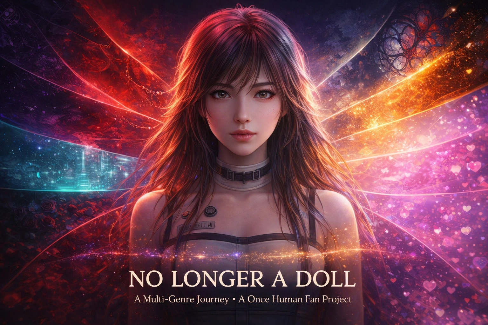

Der Fan-Song **No Longer a Doll** und die dazugehörigen Storys basieren auf der Lore des Survival-Shooters *Once Human*. Sie beleuchten die rätselhafte Verbindung zwischen **Rebecca**, einem Menschen, der im unterirdischen LEA-Forschungslabor gefangen gehalten wird, dem attraktiven geisterhaften Guide **Mitsuko** und dem Spieler, der über seinen Meta-Human gegen den Rosetta-Konzern kämpft. Hinter dem Guide Mitsuko verbirgt sich Rebecca – dieselbe Person, dasselbe Gesicht, eine zweite Wahrheit. Der Song spinnt diese Verbindung auf seine eigene Weise weiter.

---

## &#128286; Inhaltswarnung / Content Warning

**Die nachfolgenden Abschnitte und verlinkten Dateien enthalten anzügliche Inhalte (NSFW).**  
Das Spiel *Once Human* ist ab 18 Jahren freigegeben. Bitte lies nur weiter, wenn du volljährig bist.

### Inspiration & Hintergrund

Die Keimzelle des Songs bildete ein einzelner In-Game-Gruß von mir zum chinesischen Neujahr im Februar 2026 in der fortlaufenden Grußkarten-Anzeige des Events. Während die meisten Beiträge dort bei einer Bewertung von 20 bis 70 Punkten blieben, erreichte meine augenzwinkernde Zweideutigkeit (unter voller Ausnutzung des Zeichenlimits) stolze 98 Punkte – inklusive eines hübschen, magenta-violetten Glitzerns auf der Grußkarte: *Was macht Rebecca in deiner Hose? / Sie sucht den Stecker für ihre Dose!* Auf Englisch: *What is Rebecca doing in your pocket? / She is looking for the plug for her socket!*

Diese positive Resonanz aus der Community war mir Ansporn genug, die Idee weiterzuspinnen und daraus ein größeres Projekt zu machen. Beim Schreiben verfolgte ich eine Art **„Method Writing“**: Ich habe mich bewusst in die Rolle einer verführerischen Succubus-Figur hineinversetzt und nach Formulierungen gesucht, die einerseits sofort unter die Haut gehen, sich andererseits aber komplett harmlos als Gaming- und Lore-Begriffe lesen lassen. Genau diese Reibung zwischen scheinbar unschuldigem Spiel-Vokabular und einer hypnotischen, anzüglichen Lesart bildet das Spannungsfeld des Songs.

Ab April entstand aus diesem Ansatz zunächst eine electro-hypnotische Hymne, die ich über viele verschiedene Musikrichtungen hinweg ausarbeitete. Im September begann ich schließlich damit, die begleitende Story niederzuschreiben und zu vertiefen, bevor im November die Veröffentlichung auf Suno sowie die Dokumentation hier auf GitHub folgten.

### Produktion & KI-Einsatz

Konzept, Story und Songtext stammen von mir. Die Ausarbeitung der Musik- und Bild-Prompts entstand nicht auf Knopfdruck, sondern in einem intensiven, iterativen Dialog mit KI-Assistenten: Gemeinsam haben wir Stimmungen, musikalische Strukturen und visuelle Nuancen abgewogen, verworfen und verfeinert, bis die Prompts exakt meiner Vorstellung entsprachen. 

Dabei nutzte ich Google Gemini als Sparringspartner für Musiktheorie, Reim-Feinschliff und die Prüfung der Interpretationen sowie Claude für die Ausformulierung der Bild-Prompts. Die finale Audio-Umsetzung erfolgte mit ACE-Step 1.5 in ComfyUI und Suno, die Cover-Arts wurden mit GPT Image 1.5 generiert.

---

## Das Projekt entdecken (NSFW)

Mit dem Klick auf die folgenden Links bestätigst du, dass du alt genug für diese Inhalte bist.  
**Empfohlener Einstieg:** Lies zuerst den Songtext, tauche dann in die Story-Ebenen ein – und höre anschließend die Musik mit dem Wissen, was sich wirklich hinter den Zeilen verbirgt.

### 1. Der Songtext: *No Longer a Doll*
*Das Herzstück des Projekts – ein englisches Gedicht auf drei Ebenen:*
* [➜ Formatierter Songtext](lyrics/lyrics_format.md) – *Nur zum Lesen und Mitsingen.*
* [➜ Songtext mit Interpretation](lyrics/lyrics_meaning.md) – *Alle Verweise auf Once Human und doppeldeutige Metaphern.*
* [➜ Songtext als Prompt](lyrics/lyrics_prompt.md) – *Die phonetische Version für ACE-Step und Suno.*

### 2. Die Storys: Hinter den Kulissen
*Die Handlung aus verschiedenen Perspektiven:*
* [➜ Teil 1: Rebeccas Erwachen](story/story_rebecca.md) – *Die Story aus Sicht von Rebecca.*
* [➜ Teil 2: Mehr als ein Spiel](story/story_player.md) – *Die Story aus Sicht des zuhörenden Spielers.*
* [➜ Teil 3: Akte des LEA-Vorfalls](story/story_rosetta.md) – *Rosettas Untersuchung des Vorfalls.*

### 3. Die Musik & Cover-Art
*Dieselben 60 Zeilen – umgesetzt in zahlreichen Tracks über verschiedenste Genres hinweg:*
* [➜ Suno: **Story-Album**](https://suno.com/album/4df93d82-9d74-411c-ad86-34303e5e222d) – *Eine kuratierte Auswahl, welche die Handlung chronologisch erzählt.*
* [➜ Suno: **Komplett-Mix**](https://suno.com/album/2d41deeb-6bb0-40eb-b423-e866effcd27b) – *Alle Tracks, nach Stimmung und Tempo sortiert für fließende Übergänge.*
* [➜ Musikrichtungen & Cover-Art](styles/styles.md) – *Alle Style-Prompts, Tracks und Cover-Designs im Detail.*
* [➜ Album-Cover & Prompts](styles/album.md) – *Die Albumcover für Suno inklusive der Image-Prompts.*
* [➜ Titelbilder & Banner-Prompts](styles/preview.md) – *Alternative Preview-Banner inklusive der verwendeten Prompts.*

---

## Vom Textadventure zur Regie: Was dieses Projekt über Handwerk und Psychologie gezeigt hat

Wer programmieren gelernt hat, kennt die Verschiebung von der mühsam gestanzten Lochkarte hin zu Hochsprachen wie Python, in denen wenige Zeilen ganze Systeme bewegen. Niemand trauert dem Stanzen nach, weil erst durch das bessere Werkzeug Platz für größere Ideen entstand. Mit KI-Tools erleben wir gerade denselben Schritt beim Schreiben und Musikmachen: Vieles vom mechanischen Handwerk wird abgenommen, und die eigentliche Arbeit verlagert sich eine Etage höher – **in die Regie**.

Für mich fühlte sich das anfangs an wie ein klassisches Textadventure. Es begann ganz leicht: Ich hatte drei Viertel eines Reimpaars im Kopf, wusste genau, welche Verführung darin stecken sollte, und suchte im offenen Dialog mit der KI nach diesem einen fehlenden Wort, das am Ende noch einmal richtig zuschlägt.

Aus diesem kleinen Reim-Rätsel wurde eine monatelange Abenteuerreise durch die Psychologie – auf drei Ebenen gleichzeitig:

* **Im Songtext** musste ich selbst in die Rolle des Succubus schlüpfen, um den Hörer Zeile für Zeile zu umgarnen und zwischen den Ebenen zu halten.
* **In den Storys** habe ich mich komplett in den Leser versetzt: Wann verrate ich zu viel? Wann schicke ich ihn auf eine falsche Fährte, damit er die Wahrheit selbst entdeckt und durch eine echte emotionale Achterbahn geht?
* **Im Dialog mit der KI** habe ich gemerkt, dass der Ton die Musik macht: Lade ich mein Gegenüber auf Augenhöhe und per „Du“ zum gemeinsamen Tüfteln ein, statt es mit kalten Befehlen zu quälen, liefert das Modell plötzlich Nuancen, auf die ich allein nie gekommen wäre. *(Meine Erkenntnisse und Experimente zu neutralen, einladenden und abwertenden Prompts habe ich in einem eigenen [➜ Erfahrungsbericht zur KI-Psychologie](experiments/ai_psychology.md) festgehalten).*

Am Ende war die Geschichte so dicht, dass sogar die Frage nach dem „Danach“ schon den Keim für ein nächstes Kapitel gelegt hat – bis hin zu dem Punkt, an dem ich mich plötzlich selbst als Teil meiner eigenen Lore wiederfand. Die KI hat dabei kein Instrument ersetzt und mir das Denken nicht abgenommen. Sie war das Werkzeug, mit dem aus einer nächtlichen Spielerei ein ganzes Universum werden konnte.

---

## Lizenz, Urheberrecht & Community-Nutzung

### 1. Eigene Texte, Storys, Prompts & lokale Audio-Tracks

Alle von mir verfassten sowie mithilfe von KI-Werkzeugen ausgearbeiteten Songtexte, Geschichten und Style-/Image-Prompts sowie die lokal generierten Audio-Tracks (**ACE-Step 1.5**) stammen von **Sebastian Rostock** und stehen – soweit urheberrechtlich schutzfähig – unter der [Creative Commons BY-NC-SA 4.0](LICENSE)-Lizenz.

Für diese eigenen Inhalte gelten zusätzlich **ausdrückliche Ausnahmen für die Community**:

* **Für Streamer & Content Creator:** Ihr dürft die Texte sowie die lokal mit ACE-Step 1.5 erstellten Songs gerne für eure YouTube-Videos oder Twitch-Streams nutzen – auch wenn euer Kanal monetarisiert ist. Eine Namensnennung/Verlinkung wäre nett. *(Hinweis: Für die extern auf Suno gehosteten Tracks gelten abweichende Regeln, siehe Abschnitt 2).*

* **Für die Entwickler (Starry Studio / NetEase):** Ihr habt die volle, kostenlose Erlaubnis, diesen Songtext, die Geschichten oder die lokal generierten Tracks direkt im Spiel oder für euer Marketing zu verwenden.

* **Verboten:** Der direkte kommerzielle Weiterverkauf der Songs oder Texte (z. B. als eigener Release auf Spotify oder Verkauf als E-Book) ist untersagt.

### 2. Hinweis zu Suno-Tracks & Cover-Art (KI)

* **Suno-Audio (Verlinkte Tracks):** Die auf [Suno](https://suno.com) gehosteten Tracks wurden im kostenlosen Tarif erstellt und sind daher **nicht** Teil der Lizenz (CC BY-NC-SA 4.0) dieses Repositories. Die Rechte an diesen Audiodateien liegen gemäß den [Suno Terms of Service](https://suno.com) bei Suno; sie dürfen ausschließlich über die offiziellen Suno-Links für nicht-kommerzielle Zwecke unter Nennung von Suno geteilt und angehört werden (keine Monetarisierung, kein Re-Upload der Audiodateien).

* **Bilder:** Die Cover-Arts wurden mit GPT Image 1.5 generiert und dienen der nicht-kommerziellen Illustration dieses Fan-Projekts.

### 3. Marken- und Urheberrecht (*Once Human*)

Dies ist ein privates, nicht-kommerzielles Fan-Projekt. Alle Rechte an dem Spiel *Once Human*, den Charakteren (u. a. Rebecca, Mitsuko), Orten und der Lore liegen vollständig bei den jeweiligen Rechteinhabern (**Starry Studio / NetEase**).