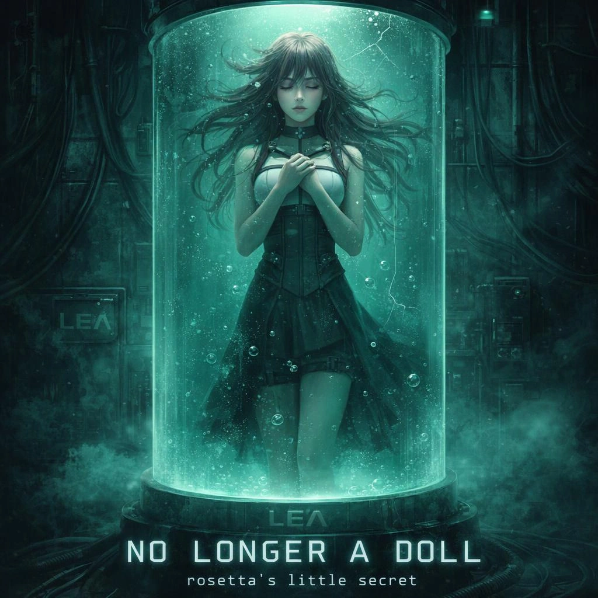
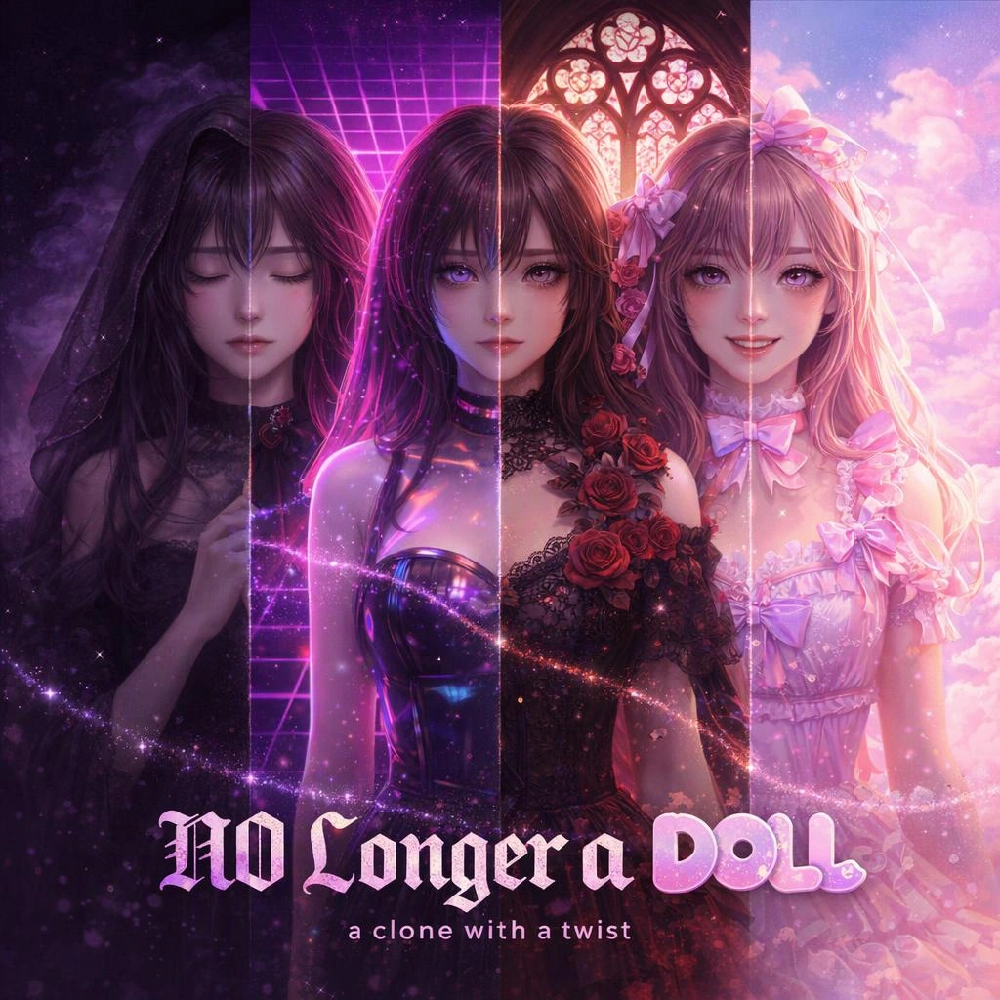
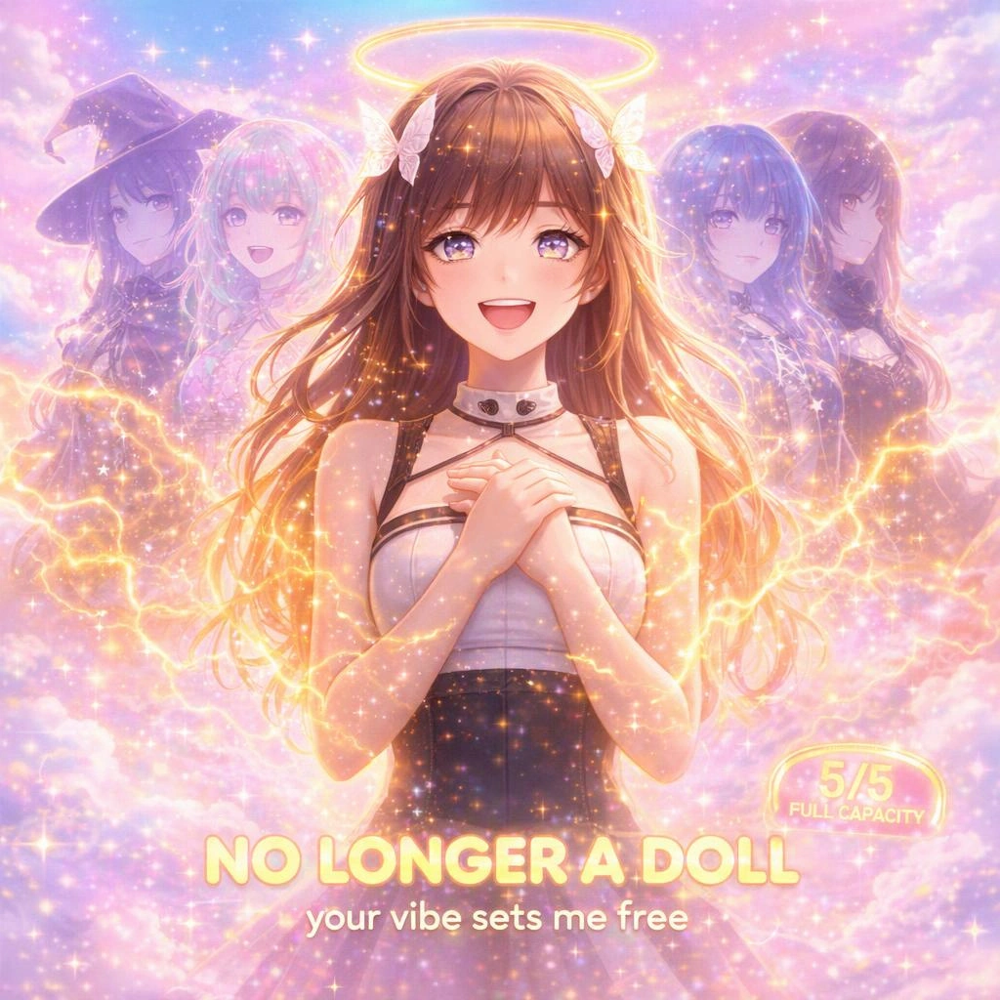

## Album-Cover & Visual Concepts

Für die Veröffentlichung der Musik auf Suno sind mehrere Album-Cover entstanden, welche die musikalische und inhaltliche Entwicklung von *No Longer a Doll* widerspiegeln. Während die ersten beiden Designs aktiv als Cover für den **Komplett-Mix** und das **Story-Album** im Einsatz sind, zeigt die dritte Variante das strahlende Finale als konzeptionelle Alternative.

---

#### Variante 01: Rosettas Geheimnis *(Cover: Komplett-Mix)*



````text
SUBJECT: Rebecca from Once Human, use the reference image for face, hairstyle and complete outfit. Eyes CLOSED, floating inside a glass tube filled with faintly glowing liquid, hair drifting, peaceful but eerie.
ENVIRONMENT: Dark industrial lab with cables along the walls and a "LEA" logo etched on the tube base.
LIGHT & FX: Green-cyan liquid glow, rising bubbles, condensation on the glass, a single small crack forming.
COLOR PALETTE: Black #06090A, toxic teal #1BB7A6, pale aqua #9FE8DC, steel #3B4248.
TYPOGRAPHY: Title "NO LONGER A DOLL" in clinical monospace font like a lab label. Tagline in lowercase: "rosetta's little secret".
STYLE: Eerie sci-fi industrial pop cover, cinematic, 1:1.
````

---

#### Variante 02: Die vier Gesichter *(Cover: Story-Album)*



````text
SUBJECT: Rebecca (reference image for face, hairstyle, complete outfit). One centered figure whose body is split into four vertical style zones, left to right:
1. Witch-house: dark veil, EYES CLOSED.
2. Hyperpop: neon gloss, EYES OPEN.
3. Gothic: lace and roses, EYES OPEN with a melancholic gaze.
4. Kawaii: pastel ribbons, EYES OPEN with a happy smile.
Transitions between the zones are seamless gradients.
ENVIRONMENT: The background follows the same four zones: a misty ritual void, a neon grid, a cathedral window, and pastel clouds.
LIGHT & FX: Each zone has its own lighting. A shared thread of stardust runs through all four.
COLOR PALETTE: Void Black #0B0710, Neon Magenta #FF2EC4, Gothic Wine #5A0F2E, Pastel Pink #FFC4E1, Lavender #C8B6FF.
TYPOGRAPHY: "NO LONGER A DOLL" with letters morphing in style from gothic blackletter to bubbly kawaii. Tagline: "a clone with a twist".
STYLE: Conceptual evolution cover, clean composition, square 1:1.
````

---

#### Variante 03: Vollkommene Freiheit *(Konzept-Alternative)*



````text
SUBJECT: Rebecca (reference image for face, hairstyle, complete outfit, kawaii-future restyle). EYES OPEN, radiant smile. Behind her, three fading ghost silhouettes of her past forms (witch-house, hyperpop, gothic). Golden electricity connects the ghosts and flows into her present body.
ENVIRONMENT: A bright pastel sky with a golden halo ring.
LIGHT & FX: Golden lightning, soft bloom, sparkles.
COLOR PALETTE: Electric Gold #FFC83D, Pastel Pink #FFC4E1, Baby Blue #BDE6FF, White #FFFFFF, Lilac #D9C2FF.
TYPOGRAPHY: "NO LONGER A DOLL" in a gold rounded font. Tagline: "your vibe sets me free". Badge: "5/5 FULL CAPACITY".
STYLE: Kawaii-cinematic finale, square 1:1.
````

---

Hier geht es zurück zum [➜ Hauptdokument](../README.md).
