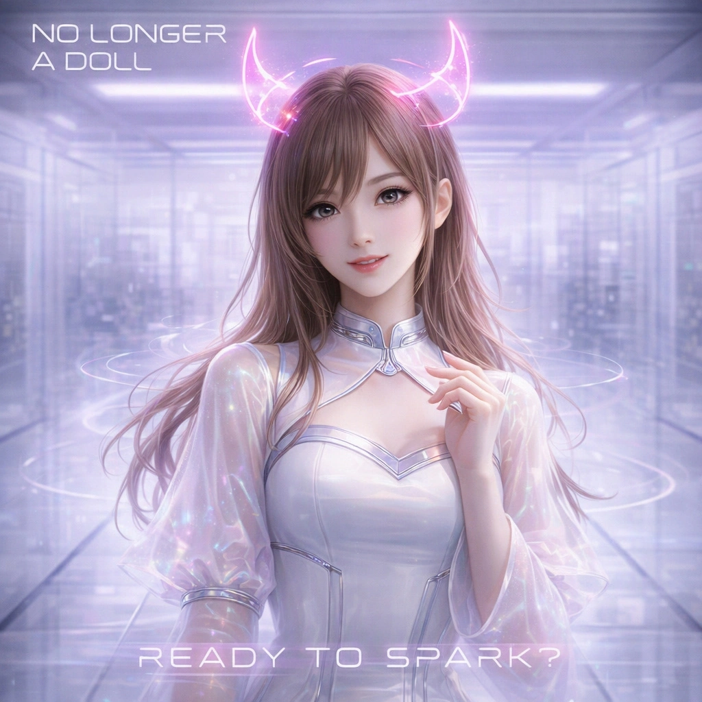
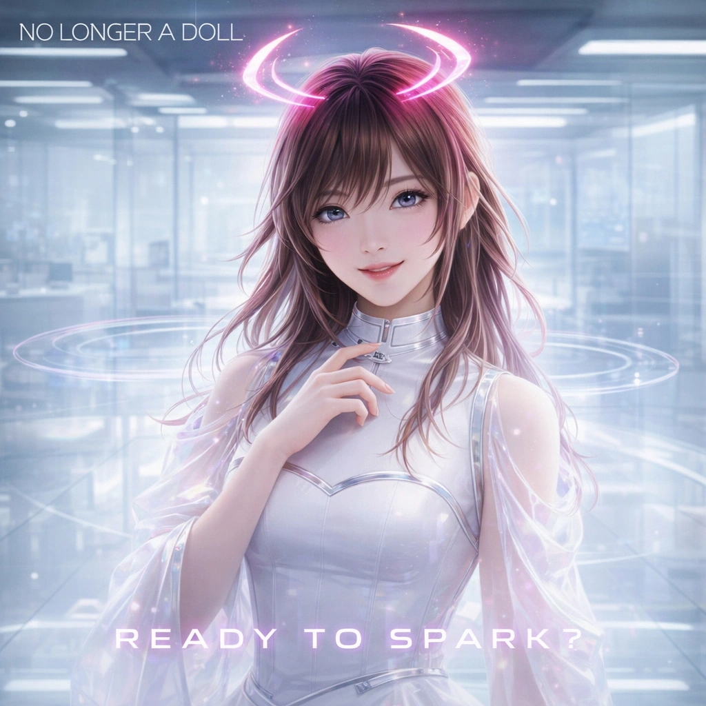

## Angel-Vocal Cyber-Pop

&#128286; **Hinweis zum Jugendschutz:** Bitte beachte die [Altersbeschränkungen im Hauptdokument](../README.md#cw).

**Stimmung & Bezug zur Story:**  
Unschuldig-süß vs. gefährlich. Der Kontrast zwischen einer klaren, engelhaften Stimme und harten Industrial-Drops passt perfekt zu Rebeccas *Puppen*-Tarnung und dem Durchbrechen ihrer menschlichen Stimme.

---

## Tracks & Style-Prompts

#### Variante 01

[➜ 05 - No Longer a Doll (Angel-Vocal Cyber-Pop)](https://suno.com/s/vD2csKhJztck1xjr)
*(leider mit kleinem Textfehler bei „far behind“)*

````text
Cyber-pop with industrial pop edges; clear, angelic young female vocals range from close, sweet crooning legato to climbing top notes, doubled on the hooks; cinematic production, driving four-on-the-floor at 130 BPM; heavy featured synth bass, metallic percussion, and an intense boss-battle EDM drop
````

#### Variante 02

[➜ 05_02 - No Longer a Doll (Angel-Vocal Cyber-Pop)](https://suno.com/s/q2iy70GCvDXJGZ80)
*(leider mit kleinem Textfehler bei „I’m looking“ und „Always in your territory“)*

````text
Cyber-pop with industrial pop edges; clear angelic female vocals in a low, dark register, half-spoken talk-sing, dry and upfront; heavy featured synth bass, metallic synth pulses and hard-hitting EDM drop; syncopated industrial dance pulse; cinematic production with sharp transitions and a wide, forceful drop
````

#### Variante 03

[➜ 05_03 - No Longer a Doll (Angel-Vocal Cyber-Pop)](https://suno.com/s/3uofMsX5G9wJo44P)
*(leider mit kleinem Textfehler bei „from the cradle“ und „Perfect ending“)*

````text
Dark cinematic cyber-pop, eerie industrial pop, heavy synth bass, clear angelic young female vocals, sweet melodic girl singing, intense boss-battle EDM drop
````

---

## Covers & Image-Prompts

#### Variante 01




````text
SUBJECT:
Mitsuko from Once Human — use the attached reference image for faceand hairstyle (styled in a pristine white futuristic idol dress with translucent iridescent sleeves and subtle chrome trim). Her eyes are OPEN, clear, sweet and mesmerizing, tilting her head slightly with an innocent, angelic smile that contrasts subtly with sharp, knowing eyes. Centered waist-up portrait, one hand raised gently near her collarbone with fingers poised. No microphone.

ENVIRONMENT:
A sleek, sterile pearl-white sci-fi studio chamber with a mirror-like glass floor and subtle holographic data rings floating quietly in the air, faint dark laboratory silhouettes visible through frosted glass walls behind her.

LIGHT & FX:
Bright, clean clinical studio lighting framed by a subtle dark vignette; floating just above her head is a fractured, glowing neon-magenta halo split into two graceful, curved horn-like arcs, casting a soft violet-pink glow across her natural skin texture and hair.

COLOR PALETTE:
Sterile Pearl White #F1F5F9, Ice Cyan #7DD3FC, Shadow Charcoal #1E293B, Neon Magenta #F43F8E, Pale Lilac #D8B4FE.

TYPOGRAPHY:
Title "NO LONGER A DOLL" in clean, futuristic geometric sans-serif with a thin chrome outline, placed in the top-left corner.
Tagline "READY TO SPARK?" in crisp, wide-spaced futuristic uppercase typography near the bottom, glowing soft magenta-white.

STYLE:
Angelic cyber-pop single cover, square 1:1, hyper-clean futuristic fashion photography, uncanny-beautiful contrast between innocence and danger, sharp focus.
````

---

Hier geht es weiter zur [➜ nächsten Musikrichtung (*Dark Cinematic Cyber-Pop*)](dark_cinematic_cyber_pop.md), zum [➜ Songtext als Prompt](../lyrics/lyrics_prompt.md), zurück zu den [➜ Musikrichtungen](styles.md) oder zurück zum [➜ Hauptdokument](../README.md).
