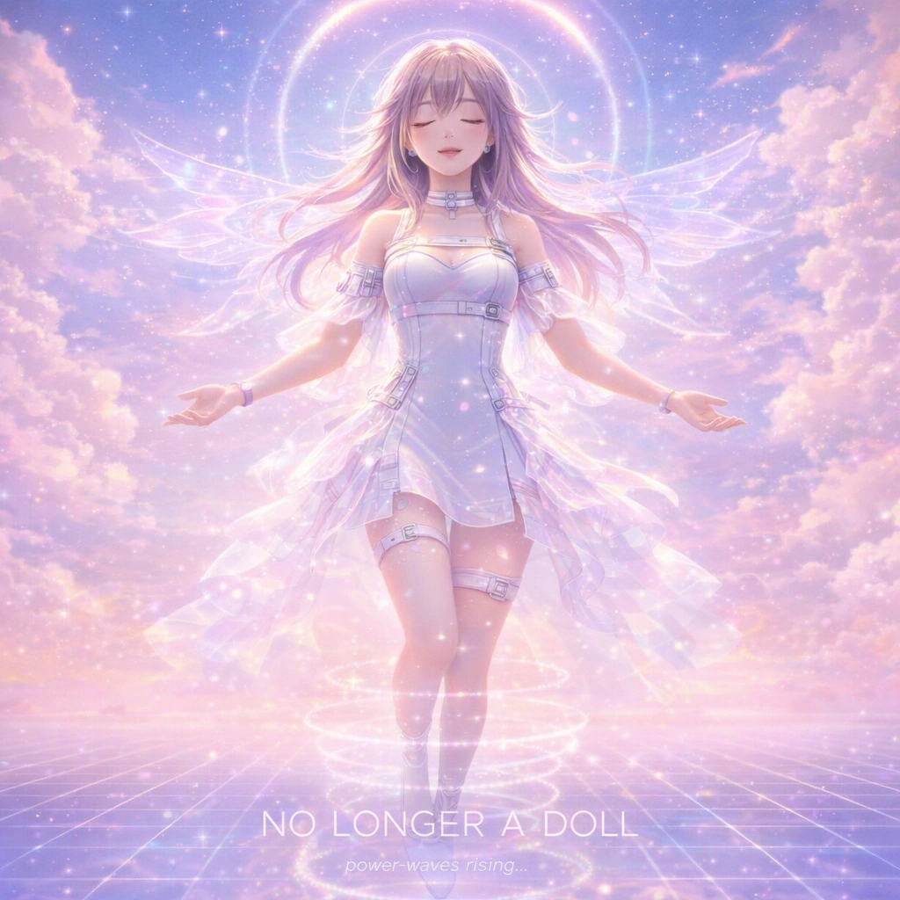
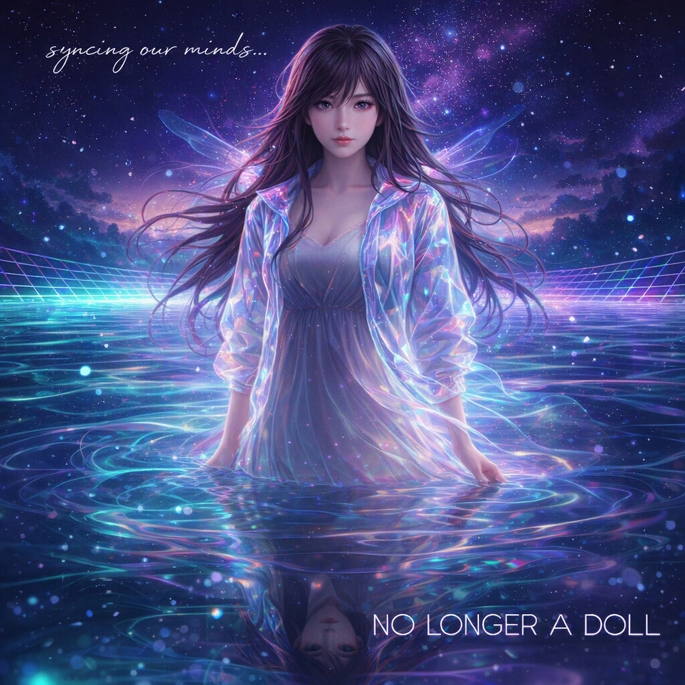
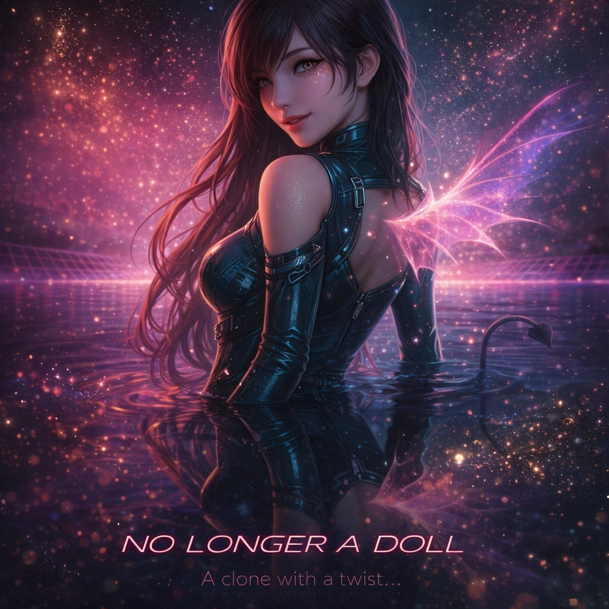

## Cyber-Pop / Liquid DnB

&#128286; **Hinweis zum Jugendschutz:** Bitte beachte die [Altersbeschränkungen im Hauptdokument](../README.md#cw).

**Stimmung & Bezug zur Story:**  
Schwerelos, fließend und futuristisch. Die schnellen Liquid-Drum-&-Bass-Beats passen perfekt zum Gleiten in die Hände des Spielers und dem schwebenden Rausch auf der *stardust-road*.

---

## Tracks & Style-Prompts

#### Variante 01

[➜ 09 - No Longer a Doll (Cyber-Pop / Liquid DnB)](https://suno.com/s/sG8HGbWrLvfEt4fY)

````text
Cyber-pop, synth-wave with liquid drum-and-bass drive at 170–175 BPM; shimmering arpeggiated synths, deep sub-bass and liquid breakbeats; immersive digital atmosphere, euphoric electronic drop, spacious stereo depth; low, dark female vocals with a beautiful tone, doubled hooks and stacked harmonies on the “Oh-yeah?!” hook
````

#### Variante 02

[➜ 09_02 - No Longer a Doll (Cyber-Pop / Liquid DnB)](https://suno.com/s/jfJuFN1kwCGU3sfH)
*(leider mit kleinem Textfehler bei „poor“, „five-five“ und „longer a doll“)*

````text
Futuristic cyber-pop, mesmerizing synth-wave, liquid drum and bass elements, euphoric electronic drop, clear angelic young female vocals, sweet melodic girl singing, immersive digital atmosphere
````

#### Variante 03

[➜ 09_03 - No Longer a Doll (Cyber-Pop / Liquid DnB)](https://suno.com/s/3OnKIwqVkqg8DlI0)
*(leider mit kleinem Textfehler bei „a doll“ und „power-waves“)*

````text
Futuristic cyber-pop, mesmerizing synth-wave, liquid drum and bass elements, euphoric electronic drop, beautiful female vocals, immersive digital atmosphere
````

#### Variante 04

[➜ 09_04 - No Longer a Doll (Cyber-Pop / Liquid DnB)](https://suno.com/s/ZuZWF4SU0ZgUb3mP)
*(leider mit kleinem Textfehler bei „all your stress“ und deutlich bei „I forgot“)*

````text
Futuristic cyber-pop, mesmerizing synth-wave, liquid drum and bass elements, euphoric electronic drop, clear angelic young female vocals, sweet melodic girl singing, immersive digital atmosphere
````

---

## Covers & Image-Prompts

#### Variante 01



````text
SUBJECT: Mitsuko from Once Human. Use the attached reference image for face, hairstyle and complete outfit; light, airy white-and-pastel variant. Eyes CLOSED, serene and blissful smile, floating weightlessly upward, arms softly open.
ENVIRONMENT: Dawn synthwave sky, endless pastel grid below, translucent digital clouds, rising soundwave rings beneath her.
LIGHT & FX: Soft pastel halo, shimmering arpeggio particles spiraling upward, gentle bloom, dreamy haze. No cables, plugs or sockets.
COLOR PALETTE: Baby blue #A8E6FF, lavender #C7B8FF, peach glow #FFC4A8, soft pink #FFB3D9, pearl white #FAF8FF.
TYPOGRAPHY: Title "NO LONGER A DOLL" in rounded elegant sans-serif, white with pastel gradient glow. Tagline "power-waves rising" in small lowercase italic.
STYLE: Ethereal angelic cyber-pop artwork, soft painterly-digital, uplifting, 1:1.
````

#### Variante 02



````text
SUBJECT: Mitsuko from Once Human — use the attached reference image for face and hairstyle (wearing a weightless, translucent iridescent synthwave jacket and flowing sheer dress). Her eyes are OPEN, calm, deep and magnetic, gazing serenely toward the viewer. Full-to-three-quarter shot standing knee-deep in a mirror-like lake of flowing liquid light, her hair and sheer fabric drifting effortlessly as if suspended in a gentle underwater current. No microphone.
ENVIRONMENT: A vast, surreal nocturnal synthwave horizon where a glowing retro grid dissolves into bioluminescent mist, rising light bubbles, and distant starry sky.
LIGHT & FX: Rippling arpeggiated light waves spreading across the luminous water surface; in her crisp reflection on the glowing water below, faint ethereal light-wings unfold behind her shoulders, while fine streams of violet stardust swirl from her temples into the water like a silent mental link.
COLOR PALETTE: Abyssal Teal #042F2E, Bioluminescent Cyan #2DD4BF, Deep Midnight #090D16, Stardust Lavender #C084FC, Soft Sunset Rose #FF7AA8.
TYPOGRAPHY: Title "NO LONGER A DOLL" in clean, thin futuristic outline sans-serif with a chrome sheen, placed in the bottom-right corner. Tagline "syncing our minds..." in fluid, weightless lowercase handwritten script typography floating in the upper-left dark sky.
STYLE: Liquid drum-and-bass cyber-pop album cover, square 1:1, surreal fine-art digital photography, smooth luminous gradients, weightless and hypnotic, no literal wings on her actual body.
````

#### Variante 03



````text
SUBJECT: Mitsuko from Once Human. Use the attached reference image for face, hairstyle and complete outfit; deep-teal glossy variant. Eyes OPEN, seductive yet gentle side glance over her shoulder, playful smile. Subtle succubus hint: her reflection in the liquid surface below shows faint light-wings and a slender heart-tipped tail silhouette that she herself does not have. Charming, never threatening.
ENVIRONMENT: Dark liquid-light lake at night, synthwave grid fading into mist, stardust floating in warm air.
LIGHT & FX: Teal and magenta glow, glittering stardust drifting from the viewer toward her, heat-haze shimmer, ripple distortions. No cables, plugs or sockets.
COLOR PALETTE: Deep teal #014F5C, magenta #E0218A, warm violet #5D1F7A, stardust gold-white #FFF1C9, black water #05080F.
TYPOGRAPHY: Title "NO LONGER A DOLL" in sleek italic sans-serif with magenta glow. Tagline "stardust in the heat" in lowercase, mirrored faintly in the water.
STYLE: Moody cinematic cyber-pop, semi-realistic, alluring and mysterious, 1:1.
````

---

Hier geht es weiter zur [➜ nächsten Musikrichtung (*K-Pop Glitch-Core*)](k_pop_glitch_core.md), zum [➜ Songtext als Prompt](../lyrics/lyrics_prompt.md), zurück zu den [➜ Musikrichtungen](styles.md) oder zurück zum [➜ Hauptdokument](../README.md).
