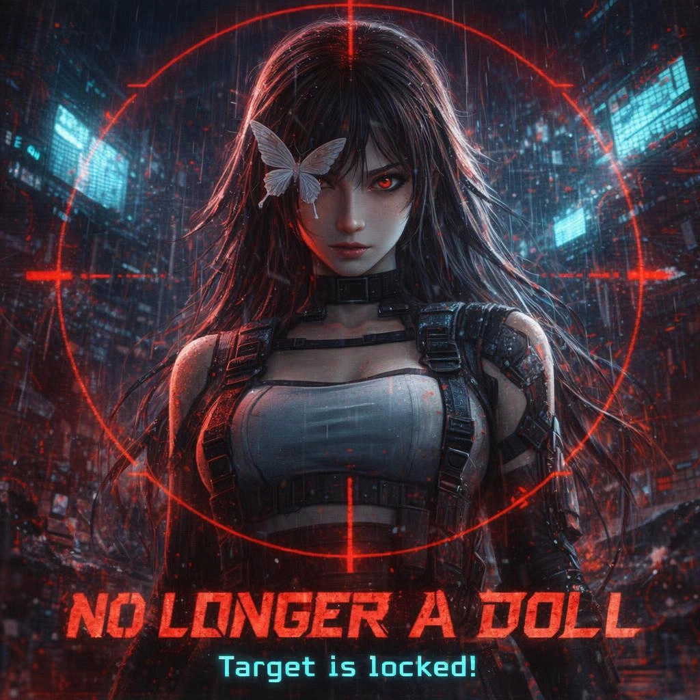
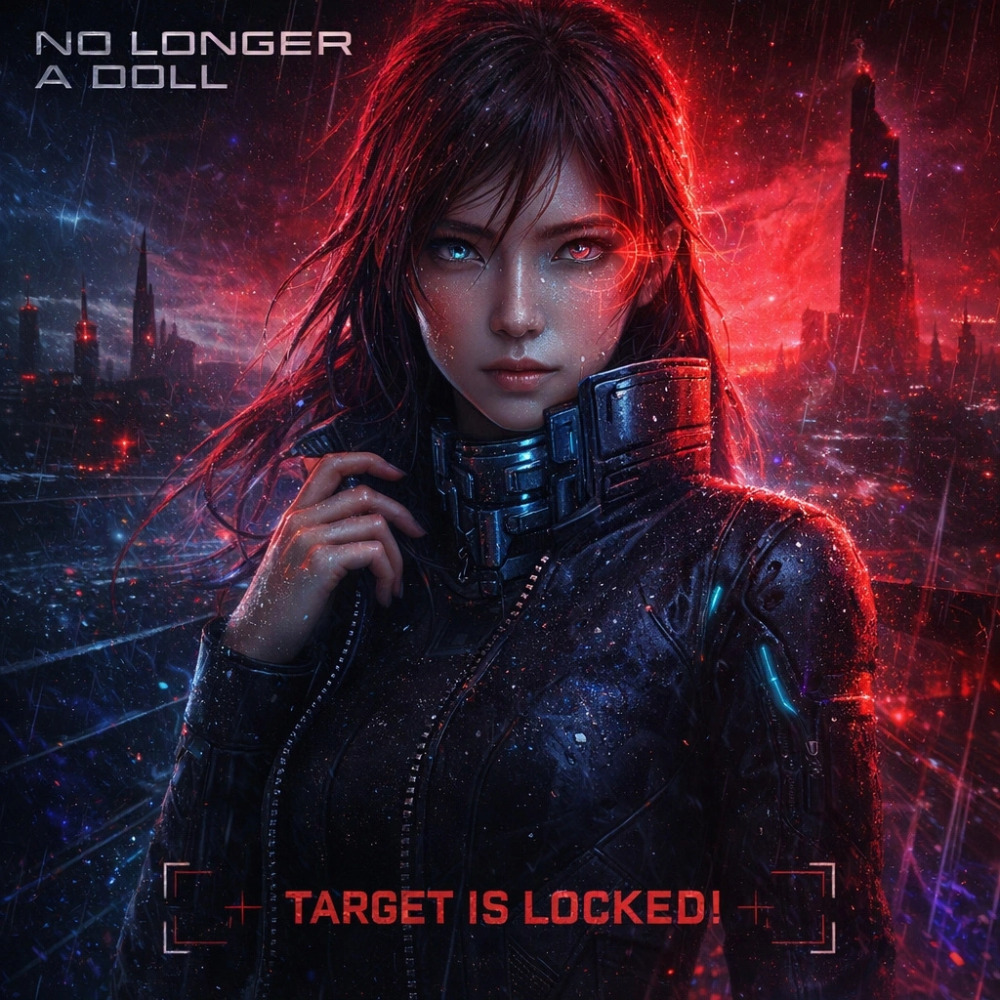
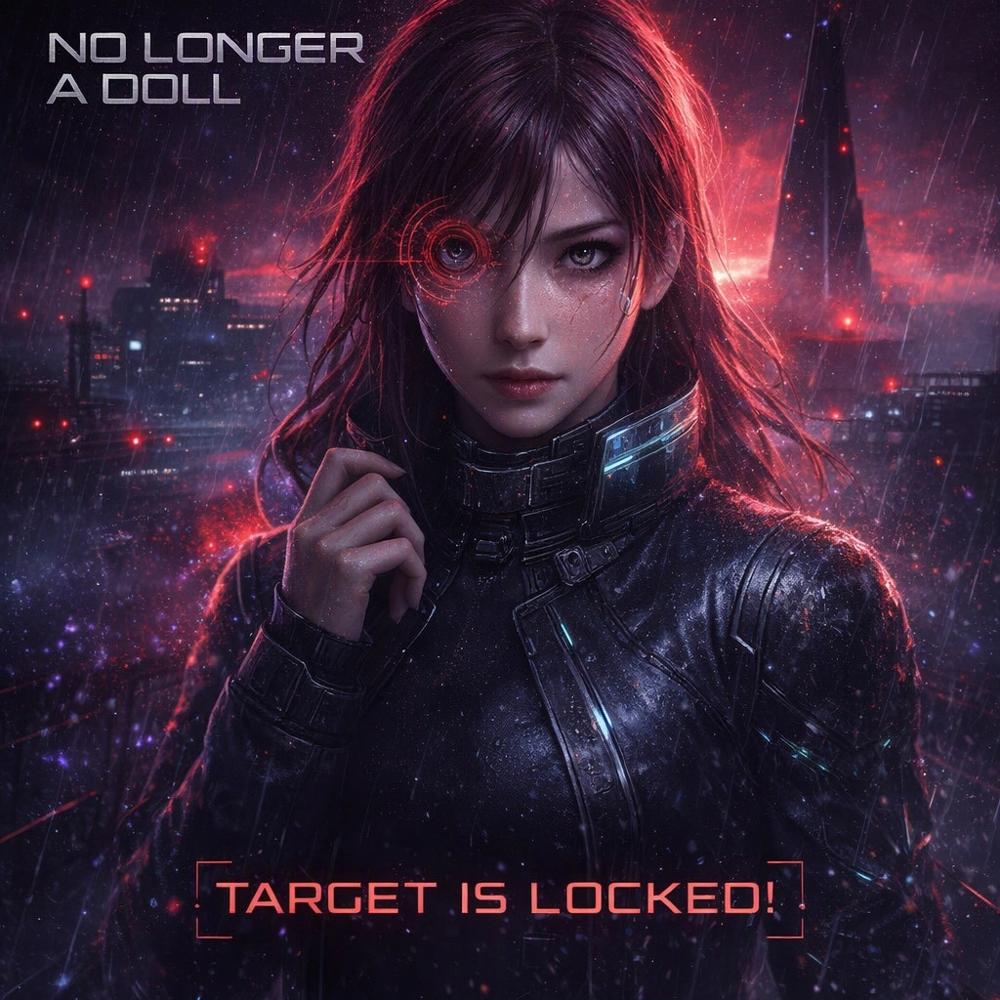
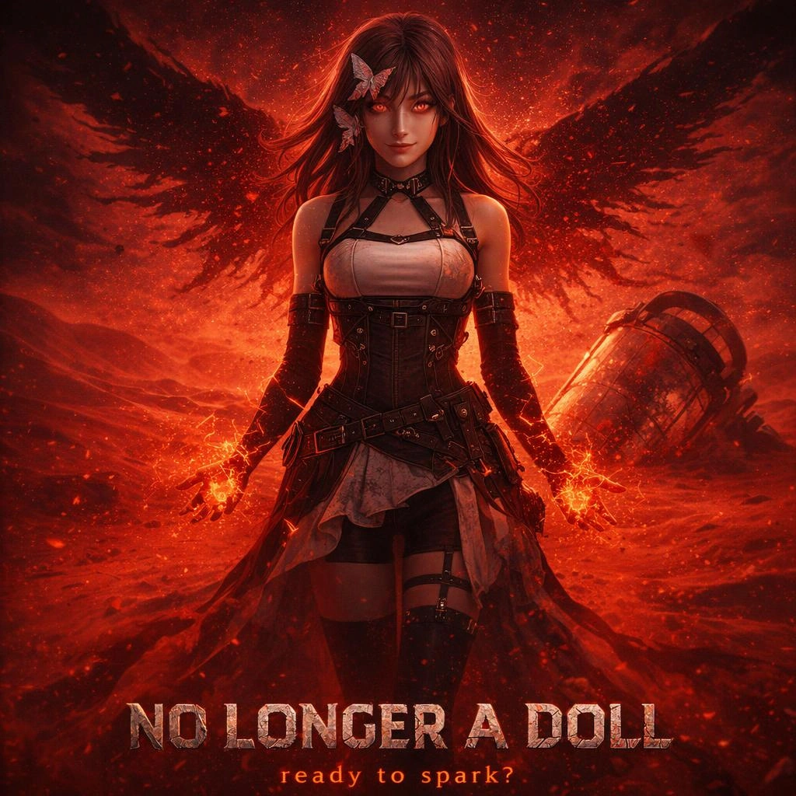

## Dark Cinematic Cyber-Pop

&#128286; **Hinweis zum Jugendschutz:** Bitte beachte die [Altersbeschränkungen im Hauptdokument](../README.md#cw).

**Stimmung & Bezug zur Story:**  
Bedrohlich, intensiv und dramatisch. Der *Boss-Battle-Drop* unterstreicht die rohe Gefahr von Stardust, den Buffer Overflow und den Kampf gegen Rosettas Code.

---

## Tracks & Style-Prompts

#### Variante 01

[➜ 06 - No Longer a Doll (Dark Cinematic Cyber-Pop)](https://suno.com/s/W9tqsCJAA3ZHW4ke)
*(leider mit kleinem Textfehler bei „Oh, I will heal you“)*

````text
Dark cinematic cyber-pop, eerie industrial pop; haunting female vocals move from whispers to wide-range top notes, with roomy, unprocessed delivery and stacked hook harmonies; hard-edged transient shaping cuts through the mix; heavy synth bass, grinding metal percussion and pulsing synth arpeggios; intense boss-battle EDM drop on a driving four-on-the-floor beat, followed by a soft fade
````

#### Variante 02

[➜ 06_02 - No Longer a Doll (Dark Cinematic Cyber-Pop)](https://suno.com/s/zchg5sRFPP02pNHc)
*(leider mit kleinem Textfehler bei „what am I doing“)*

````text
Cyber-pop, low-register haunting female vocals, hushed and close-mic with whispered ad-libs between lines; rapid double-time EDM build into an intense boss-battle drop; heavy synth-bass lead, industrial metal snare, granular vocal chops; hard-cut drop transitions, dark cinematic layers and tightly controlled electronic mix
````

#### Variante 03

[➜ 06_03 - No Longer a Doll (Dark Cinematic Cyber-Pop)](https://suno.com/s/jsP53A28KtzKmq6v)
*(leider mit Textfehler bei „perfect five-five body“ und „human memories“)*

````text
Dark cinematic cyber-pop, eerie industrial pop; haunting female vocals in a warm mid-range, half-spoken talk-sing with whispered ad-libs between lines; saturated bass distortion and tight vocal doubles; half-time cinematic stomp; heavy synth bass, metallic percussion and arpeggiated synths build to an intense boss-battle EDM drop
````

#### Variante 04

[➜ 06_04 - No Longer a Doll (Dark Cinematic Cyber-Pop)](https://suno.com/s/1Zb8GDtqP3CgrVLM)
*(leider mit kleinem Textfehler bei „in my warm embrace“ und deutlichem bei „looking for the plug“)*

````text
Dark cinematic cyber-pop, eerie industrial pop, heavy synth bass, haunting female vocals, intense boss-battle EDM drop
````

---

## Covers & Image-Prompts

#### Variante 01



````text
SUBJECT: Rebecca from Once Human, use the reference image for face, hairstyle and complete outfit (outfit may add tactical straps). Eyes OPEN, cold, focused, predatory but beautiful gaze, low camera angle.
ENVIRONMENT: Ruined cyberpunk arena at night, rain, holographic billboards.
LIGHT & FX: Red HUD targeting reticle locked on the viewer in the foreground, scanlines, harsh red and cyan contrast lighting.
COLOR PALETTE: Black #050608, crimson #D7263D, cyan #1FD1F9, gunmetal #2B2F36.
TYPOGRAPHY: Title "NO LONGER A DOLL" in aggressive angular display font. Tagline: "Target is locked!"
STYLE: Boss-battle game key art, dark cinematic cyberpunk, 1:1.
````

#### Variante 02




````text
SUBJECT: Rebecca from Once Human — use the attached reference image for face and hairstyle (wearing a tactical matte-black cybernetic jacket with high metallic collar accents and subtle iridescent seams). Her eyes are OPEN, intense, focused and piercing, staring directly into the camera with calm determination, fine rainwater droplets glistening on her skin. Upper-body hero framing, slightly low angle, one hand raised near her collar. No microphone.
ENVIRONMENT: A storm-drenched futuristic rooftop overlooking a dark industrial LEA Labs complex in the Red Sands at night, with distant red warning beacons and a towering monolith silhouette piercing through heavy rain and fog.
LIGHT & FX: Dramatic crimson backlight rim contrasting against cold cyan side light. A faint, translucent red holographic targeting reticle hovers near one eye, while swirling violet stardust sparks and rain streaks cut diagonally across the dark frame. Crisp anamorphic lens flare.
COLOR PALETTE: Pitch Black #08090C, Crimson Alert #D91E36, Tactical Steel #27303F, Electric Violet #A020F0, Cold Cyan #4FE3E0.
TYPOGRAPHY: Title "NO LONGER A DOLL" in sharp, angular military-grade sci-fi sans-serif, all caps, metallic steel finish, placed in the top-left corner. Tagline "TARGET IS LOCKED!" in bold, condensed crimson stencil font at the bottom center, framed by thin HUD targeting brackets.
STYLE: Dark cinematic cyber-pop soundtrack cover, square 1:1, high-contrast blockbuster key art, semi-realistic digital painting with photographic skin detail, rain-soaked atmosphere.
````

#### Variante 03



````text
SUBJECT: Rebecca from Once Human, use the reference image for face, hairstyle and complete outfit. Eyes OPEN, faint red glow in the irises, a confident smirk.
ENVIRONMENT: Red Sands desert storm at night, a shattered glass tube half-buried in the sand behind her.
LIGHT & FX: Her shadow cast on the sandstorm is huge and wing-shaped, red sparks circling her hands, crackling static in the air.
COLOR PALETTE: Dark red-brown #2A0E0A, sand red #B5452B, ember #FF5A36, black #070505.
TYPOGRAPHY: Title "NO LONGER A DOLL" in cracked metallic font. Tagline: "ready to spark?"
STYLE: Epic, ominous yet alluring cyberpunk boss key art, 1:1.
````

---

Hier geht es weiter zur [➜ nächsten Musikrichtung (*Drift / Cyberpunk Phonk*)](drift_cyberpunk_phonk.md), zum [➜ Songtext als Prompt](../lyrics/lyrics_prompt.md), zurück zu den [➜ Musikrichtungen](styles.md) oder zurück zum [➜ Hauptdokument](../README.md).
