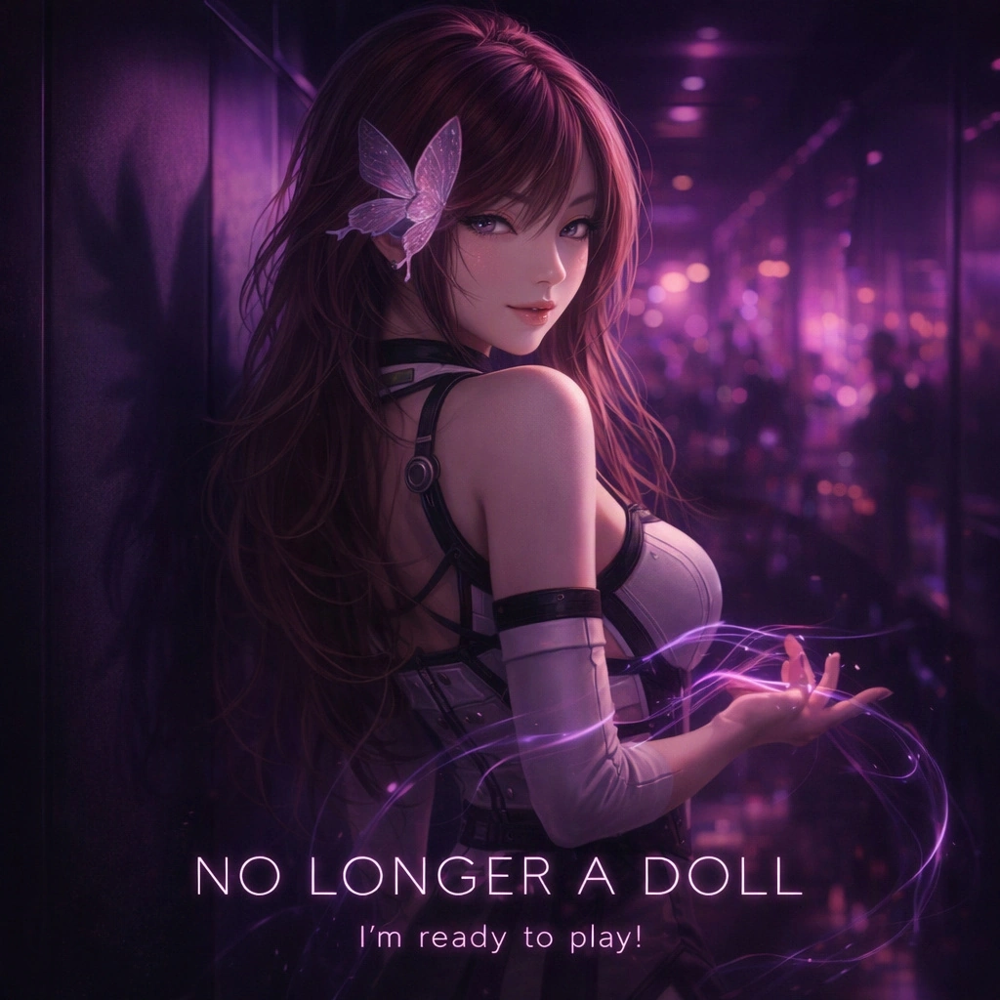
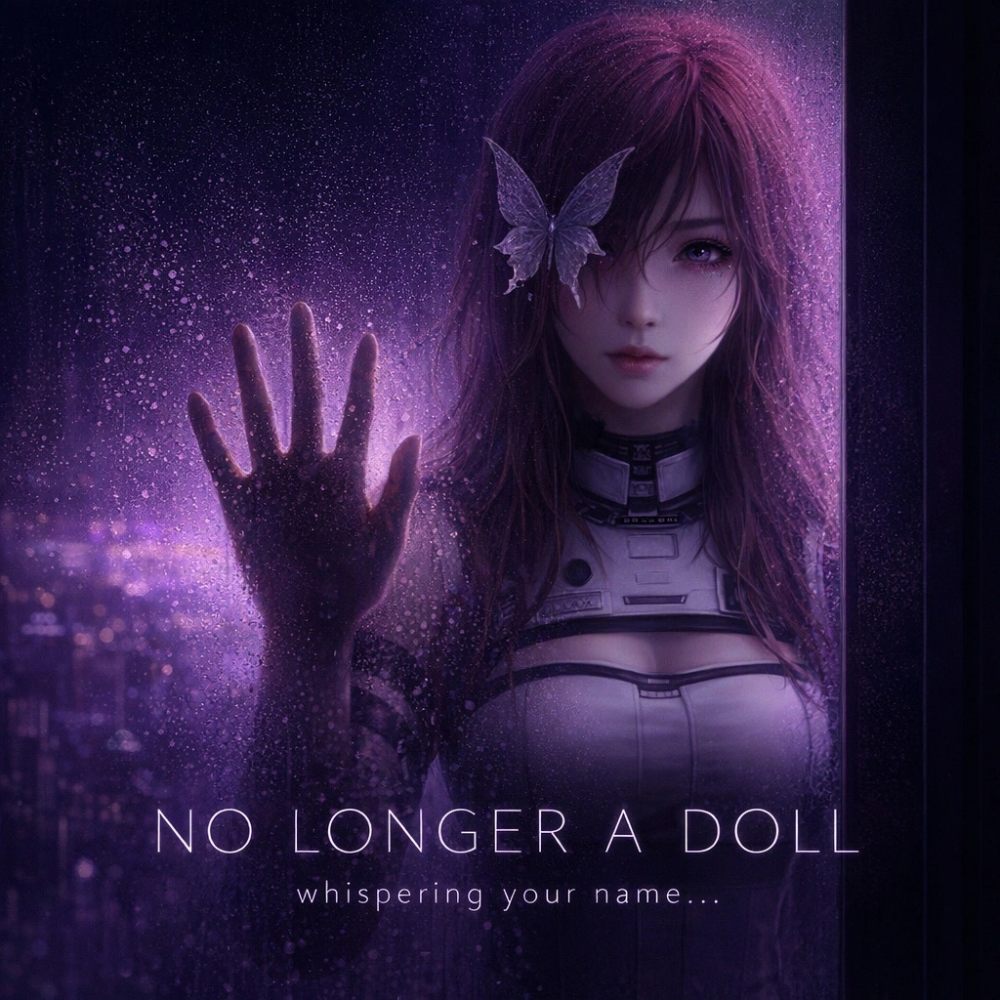
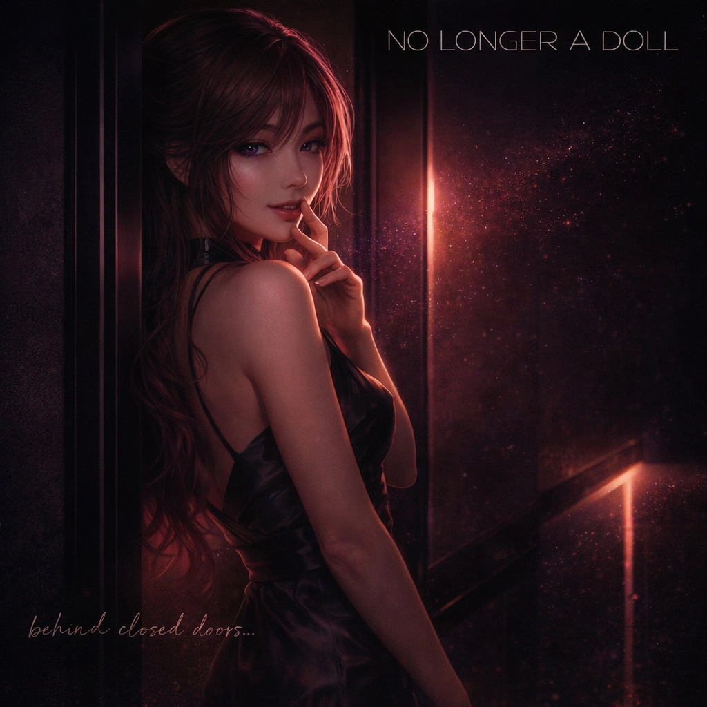
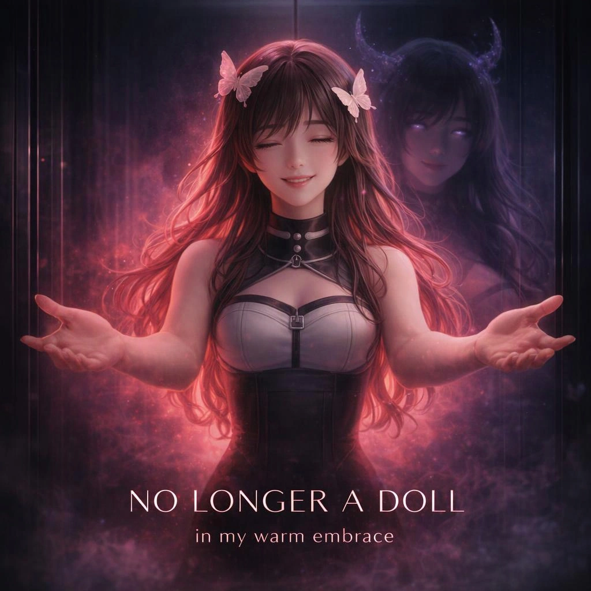

## Dark-Pop

&#128286; **Hinweis zum Jugendschutz:** Bitte beachte die [Altersbeschränkungen im Hauptdokument](../README.md#cw).

**Stimmung & Bezug zur Story:**  
Verführerisch, kontrolliert und geheimnisvoll. Dieser Stil passt perfekt zur *Porzellan-Puppe*, die den Spieler um den Finger wickelt und unbemerkt den Takt vorgibt (*I'm leading the beat*).

---

## Tracks & Style-Prompts

#### Variante 01
[➜ 03 - No Longer a Doll (Dark-Pop)](https://suno.com/s/OMwgtyyzVn9LyyHm)

````text
A sleek, mid-tempo futuristic dark-pop track with a heavy, pulsating synth-bassline and an alluring, mysterious atmosphere. The production seamlessly blends a confident, rhythmic verse with breathy, seductive vocals into an explosive, club-ready chorus featuring a hypnotic synth hook. Smooth, polished female vocals with a dark, enchanting and powerful delivery
````

#### Variante 02

[➜ 03_02 - No Longer a Doll (Dark-Pop)](https://suno.com/s/Lb3RGPYaK5DZjDnB)
*(leider mit Textfehler bei „flowing into me“)*

````text
Dark-pop, mid-tempo pulse; heavy pulsating synth bass, hypnotic synth-hook and tight electronic percussion, sleek futuristic polished production; smooth female vocals, breathy and close-mic with whispered ad-libs, rhythmic confident verses climbing into powerful top notes and an explosive club-ready chorus
````

#### Variante 03

[➜ 03_03 - No Longer a Doll (Dark-Pop)](https://suno.com/s/GTiD6jbCWl78feU8)
*(leider mit Textfehler bei „flowing into me“)*

````text
A sleek, mid-tempo futuristic dark-pop track with a heavy, pulsating synth-bassline and an alluring, mysterious atmosphere. The production seamlessly blends a confident, rhythmic verse with breathy, seductive vocals into an explosive, club-ready chorus featuring a hypnotic synth hook. Smooth, polished female vocals with a dark, enchanting and powerful delivery
````

---

## Covers & Image-Prompts

#### Variante 01



````text
SUBJECT: Mitsuko from Once Human, use the reference image for face, hairstyle and complete outfit. Eyes OPEN but half-lidded, alluring, playful gaze over her shoulder. Graceful and attractive, never menacing.
ENVIRONMENT: Dark club corridor with glossy black panels, blurred dance-floor lights in the background.
LIGHT & FX: Thin violet light threads drift from the foreground toward her fingertips, a subtle hint of absorbed energy. Her backlight casts a soft shadow on the wall that faintly resembles wings, ambiguous and elegant.
COLOR PALETTE: Black #08070C, plum #4B1248, violet #7B3FE4, soft pink highlight #FF7AC6.
TYPOGRAPHY: Title "NO LONGER A DOLL" in sleek sans-serif with a slight glow. Tagline: "I'm ready to play!"
STYLE: Seductive but tasteful dark-pop cover, cinematic photography, shallow depth of field, 1:1.
````

#### Variante 02



````text
SUBJECT: Mitsuko from Once Human, use the reference image for face, hairstyle and complete outfit. Eyes OPEN, mysterious, calm gaze. She stands half-hidden behind a frosted glass door, one hand pressed against the glass.
ENVIRONMENT: Dim futuristic penthouse hallway, frosted glass, soft city lights blurred far behind.
LIGHT & FX: Diffused purple backlight through the frosted glass, her silhouette partially sharp where her hand touches the glass, light condensation droplets.
COLOR PALETTE: Midnight blue #0D1027, smoky purple #3C2A5E, lilac #B79CFF, pale skin highlight #F4E6EE.
TYPOGRAPHY: Title "NO LONGER A DOLL" in elegant thin sans-serif. Tagline in lowercase: "whispering your name…".
STYLE: Moody, enchanting dark-pop cover, soft cinematic grain, 1:1.
````

#### Variante 03



````text
SUBJECT: Mitsuko from Once Human — use the attached reference image for face and hairstyle (outfit styled in sleek black silk editorial eveningwear with subtle matte-black satin accents). Her eyes are OPEN, half-lidded and alluring, looking back over her shoulder with a sultry, knowing smile. Waist-up three-quarter pose, leaning gracefully against a doorframe in dim half-shadow, one hand raised lightly near her lips as if about to whisper a secret. No microphone.
ENVIRONMENT: A minimalist luxury apartment hallway at night with a glossy black reflective floor and a single heavy door slightly ajar, casting a sharp vertical beam of warm-violet light across the dark wall.
LIGHT & FX: Chiaroscuro low-key studio lighting with a soft magenta rim light and warm bronze fill. Fine magenta stardust particles float lazily in the doorway beam. Only in her reflection on the glossy black floor do two curved wisps of her hair form faint horn-like silhouettes and a subtle violet glint in her irises. Subtle 35mm film grain and soft halation.
COLOR PALETTE: Deep Obsidian #0B090E, Warm Shadow Bronze #2B1E1A, Satin Black #16141C, Neon Magenta #FF2A85, Soft Rose Highlight #FF7AC6.
TYPOGRAPHY: Title "NO LONGER A DOLL" in sleek, wide-spaced chrome-tinted sans-serif, placed in the top-right corner.
Tagline "behind closed doors..." in delicate, intimate lowercase handwritten script typography near the bottom-left, softly illuminated.
STYLE: High-end dark-pop single cover, square 1:1, moody editorial fashion photography meets photographic skin realism, shallow depth of field, seductive and tasteful, no literal horns or tails on her actual body.
````

#### Variante 04



````text
SUBJECT: Rebecca from Once Human, use the reference image for face, hairstyle and complete outfit. Eyes CLOSED, serene, inviting smile, arms gently open as if offering an embrace.
ENVIRONMENT: Black glass room. Her reflection in the glass wall shows subtle differences: hair strands forming soft horn-like shapes and faint glowing violet eyes. Only the reflection shows this.
LIGHT & FX: Warm rose glow around her body, cold violet glow in the reflection, faint mist.
COLOR PALETTE: Black #07060A, rose #D9467A, violet #5B2A86, cool silver #AEB4C2.
TYPOGRAPHY: Title "NO LONGER A DOLL" in refined sans-serif. Tagline in lowercase: "in my warm embrace".
STYLE: Elegant, alluring, slightly uncanny dark-pop cover, beautiful and lovable, never frightening, 1:1.
````

---

Hier geht es weiter zur [➜ nächsten Musikrichtung (*Dreamy Electropop*)](dreamy_electropop.md), zum [➜ Songtext als Prompt](../lyrics/lyrics_prompt.md), zurück zu den [➜ Musikrichtungen](styles.md) oder zurück zum [➜ Hauptdokument](../README.md).
