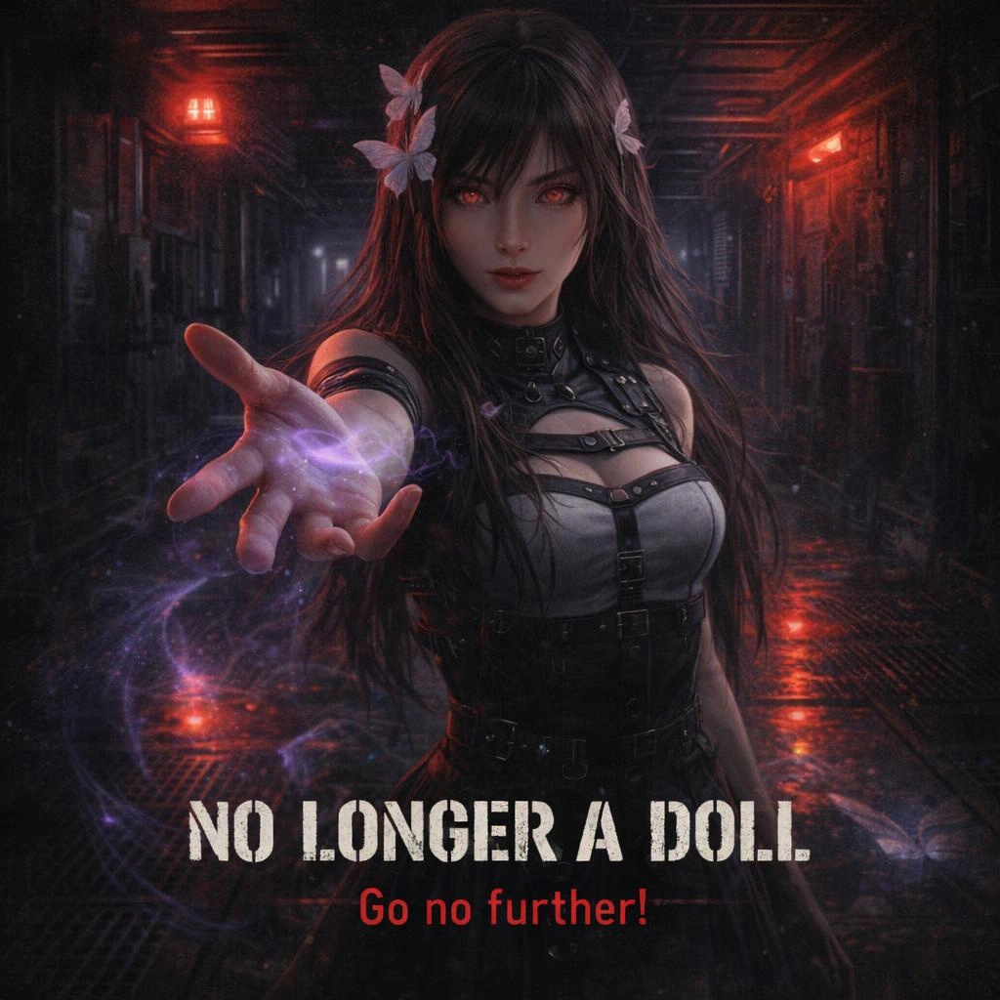
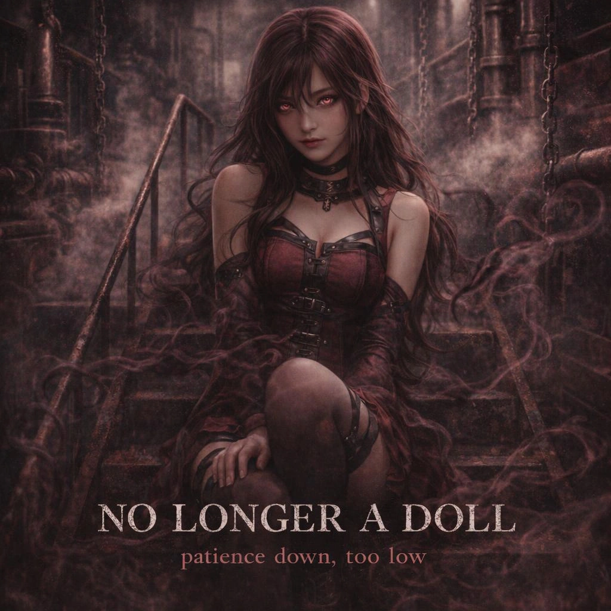
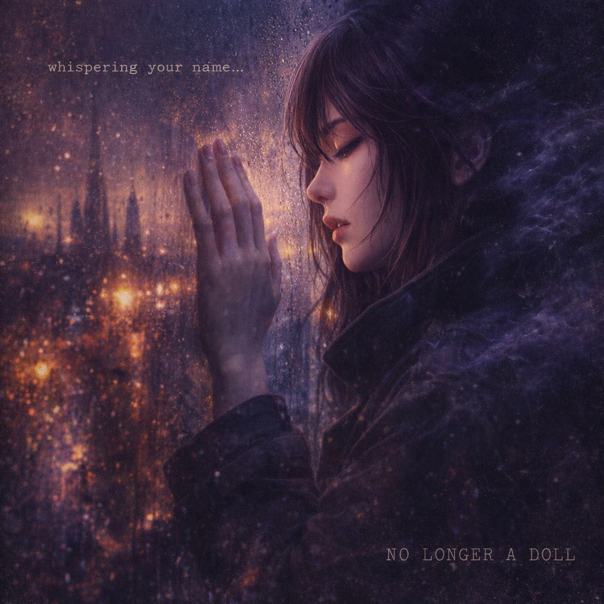

## Darkwave Trip-Hop

&#128286; **Hinweis zum Jugendschutz:** Bitte beachte die [Altersbeschränkungen im Hauptdokument](../README.md#cw).

**Stimmung & Bezug zur Story:**  
Hypnotisch, schattig, geflüstert und lauernd. Dieser Stil spiegelt das langsame Verschmelzen der Welten und das Schwinden der Vernunft im **Pre-Chorus** wider.

---

## Tracks & Style-Prompts

#### Variante 01

[➜ 02 - No Longer a Doll (Darkwave Trip-Hop)](https://suno.com/s/5QusrBd5N4HfADfD)

````text
Darkwave trip-hop, slow stalking beat with industrial metal percussion and distorted synth pulses, lush shadowy harmonies, mechanical distortion and a wide, climbing female whisper kept close-mic and hushed
````

#### Variante 02

[➜ 02_02 - No Longer a Doll (Darkwave Trip-Hop)](https://suno.com/s/eFNxdJ6BcvAdJ9Fa)

````text
Darkwave with trip-hop undercurrent: syncopated trip-hop beat, industrial metal percussion, mechanical distortion, and lush shadowed synths; high, light female vocals in a hushed, close-mic whisper, layered octave doubles and haunting harmonies; hypnotic midtempo syncopation; tape-echo repeats trail through a dark, spacious mix
````

---
#### Variante 03

[➜ 02_03 - No Longer a Doll (Darkwave Trip-Hop)](https://suno.com/s/ffa8XguvYTzZNpF0)
*(leider mit kleinem Textfehler bei „into me“)*

````text
Darkwave with a trip-hop pulse: lurching industrial backbeat, trip-hop drums and clanging metal percussion under mechanical distortion and cybernetic dream-pop synths; saturated drum bus; female vocals shift from seductive whispers to wide-ranging, legato crooning, climbing into high notes, with haunting lush harmonies and doubled hooks
````

---

## Covers & Image-Prompts

#### Variante 01



````text
SUBJECT: Mitsuko from Once Human, use the reference image for face, hairstyle and complete outfit. Eyes OPEN, intense and tender at once, reaching one hand toward the viewer as if pulling them closer.
ENVIRONMENT: Dark lab corridor, metal grates, a red warning light rotating slowly.
LIGHT & FX: Faint violet aura flowing from the viewer's direction into her open palm, subtle wing-shaped light reflections on the wet floor.
COLOR PALETTE: Black #0C0C10, warning red #B3202C, violet #6B3FA0, steel #5C626B.
TYPOGRAPHY: Title "NO LONGER A DOLL" in sharp industrial stencil font. Tagline: "Go no further!"
STYLE: Tense, alluring darkwave cover, cinematic grain, protective and possessive mood, 1:1.
````

#### Variante 02



````text
SUBJECT: Mitsuko from Once Human, use the reference image for face, hairstyle and complete outfit. Eyes OPEN, slow seductive glance from under her lashes, sitting on a rusted metal staircase.
ENVIRONMENT: Industrial machine room with pipes and metal chains, steam in the air.
LIGHT & FX: Dark smoke tendrils curl around her and reach gently toward the viewer, faint dusky red glow in her irises, echo trails in the smoke.
COLOR PALETTE: Black #0B0B0D, oxblood #5A1A22, gunmetal #3A3F45, muted rose #B56576.
TYPOGRAPHY: Title "NO LONGER A DOLL" in distressed serif. Tagline in lowercase: "patience down, too low".
STYLE: Sensual, smoky darkwave cover, grainy film, attractive and enigmatic, 1:1.
````

#### Variante 03



````text
SUBJECT: Mitsuko from Once Human — use the attached reference image for face and hairstyle (wearing an oversized dark vintage trench coat with an upturned collar over dark layered fabric). Her eyes are CLOSED, serene, melancholic and dreaming, lips slightly parted as if whispering. Close-up profile-to-three-quarter framing, resting her forehead and one pale hand gently against the inside of a rain-streaked glass window. No microphone.
ENVIRONMENT: A moody nocturnal cityscape seen through wet, condensation-covered window glass; blurred amber and indigo street reflections blend subtly with the distant, misty silhouette of towering monolithic spires on the horizon.
LIGHT & FX: Soft 90s analog film lighting with cool slate-indigo ambient light and muted street-amber reflections across her cheek. Drifting pale smoke and violet stardust haze curl behind her shoulders in the faint, ambiguous contour of shadowy wings. Subtle tape-echo double-exposure trails and analog halation.
COLOR PALETTE: Midnight Indigo #0D1021, Rain Slate #2E3B4E, Muted Street Amber #C88A36, Stardust Lavender #B388FF, Porcelain #EDE4E1.
TYPOGRAPHY: Title "NO LONGER A DOLL" in worn, thin typewriter-style serif with a subtle analog ink-bleed, placed in the bottom-right corner.
Tagline "whispering your name..." in soft, airy lowercase handwritten script typography in the upper-left negative space.
STYLE: 90s darkwave trip-hop album cover, square 1:1, atmospheric neo-noir cinematography, grainy analog 35mm film texture, lots of breathing room, haunting and intimate, no literal wings.
````

---

Hier geht es weiter zur [➜ nächsten Musikrichtung (*Dark-Pop*)](dark_pop.md), zum [➜ Songtext als Prompt](../lyrics/lyrics_prompt.md), zurück zu den [➜ Musikrichtungen](styles.md) oder zurück zum [➜ Hauptdokument](../README.md).
