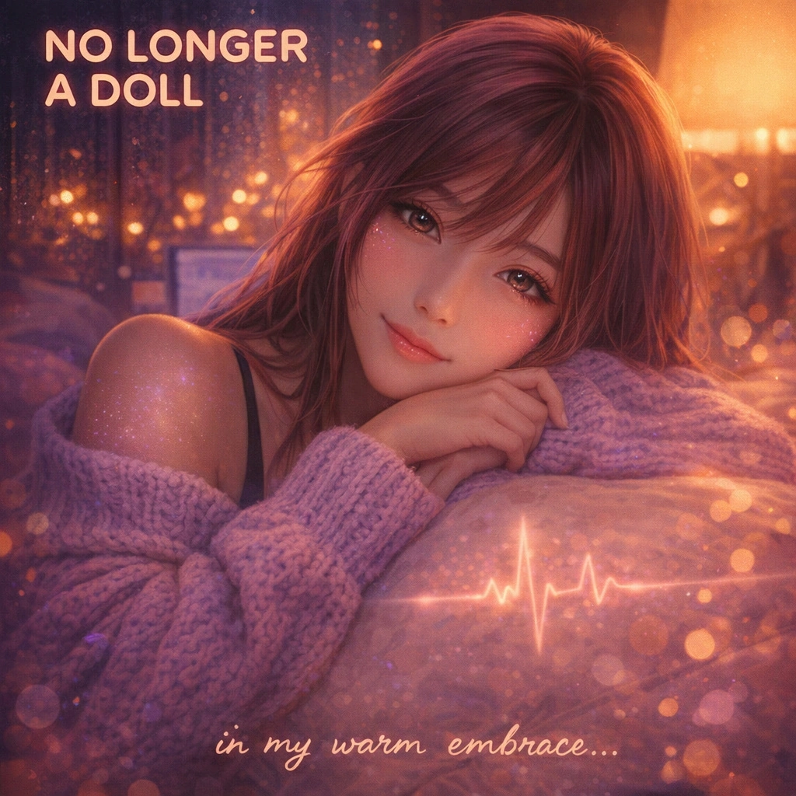
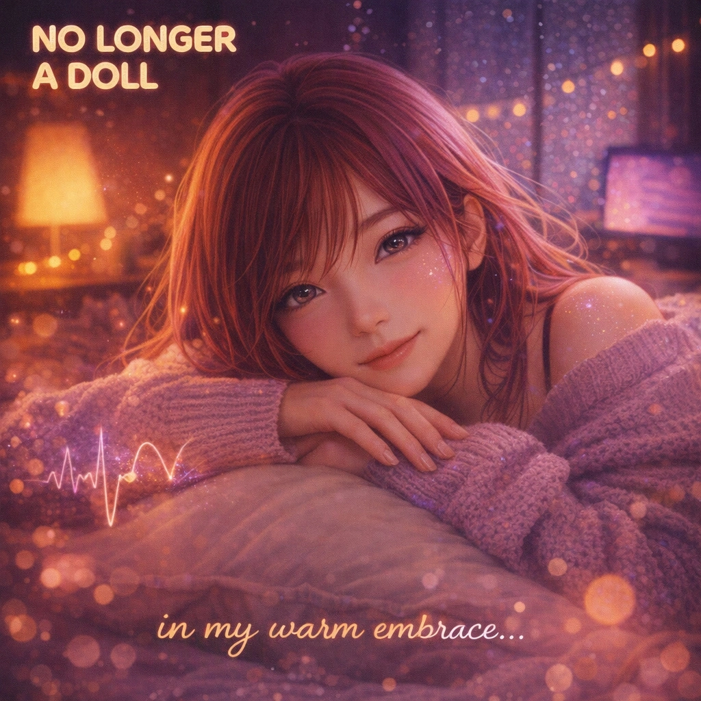
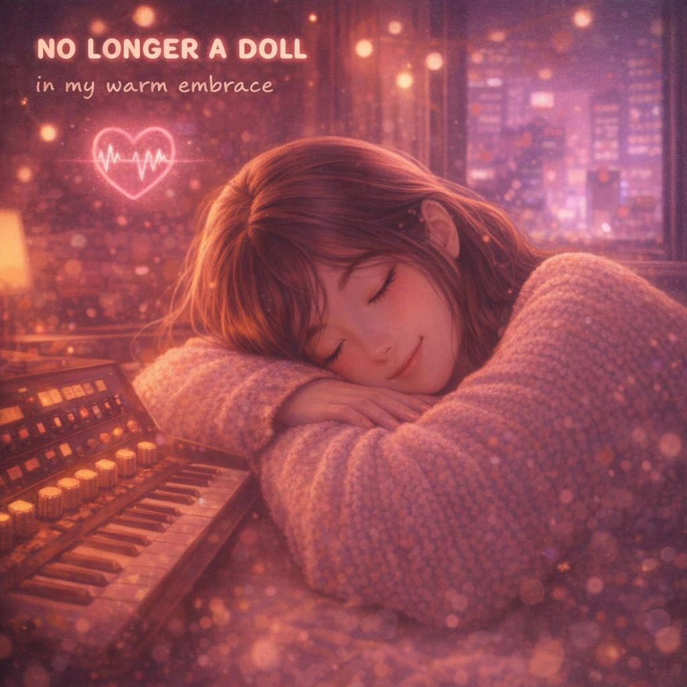
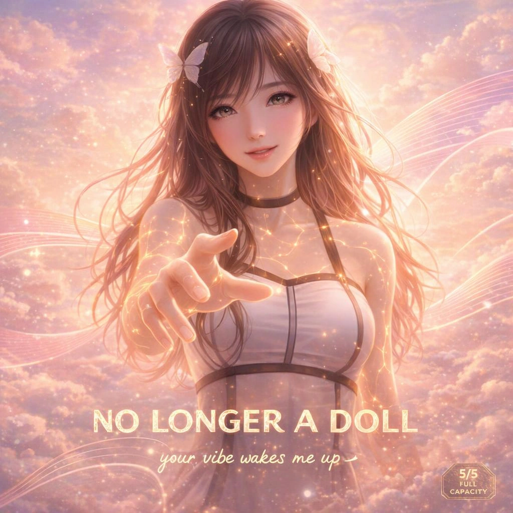
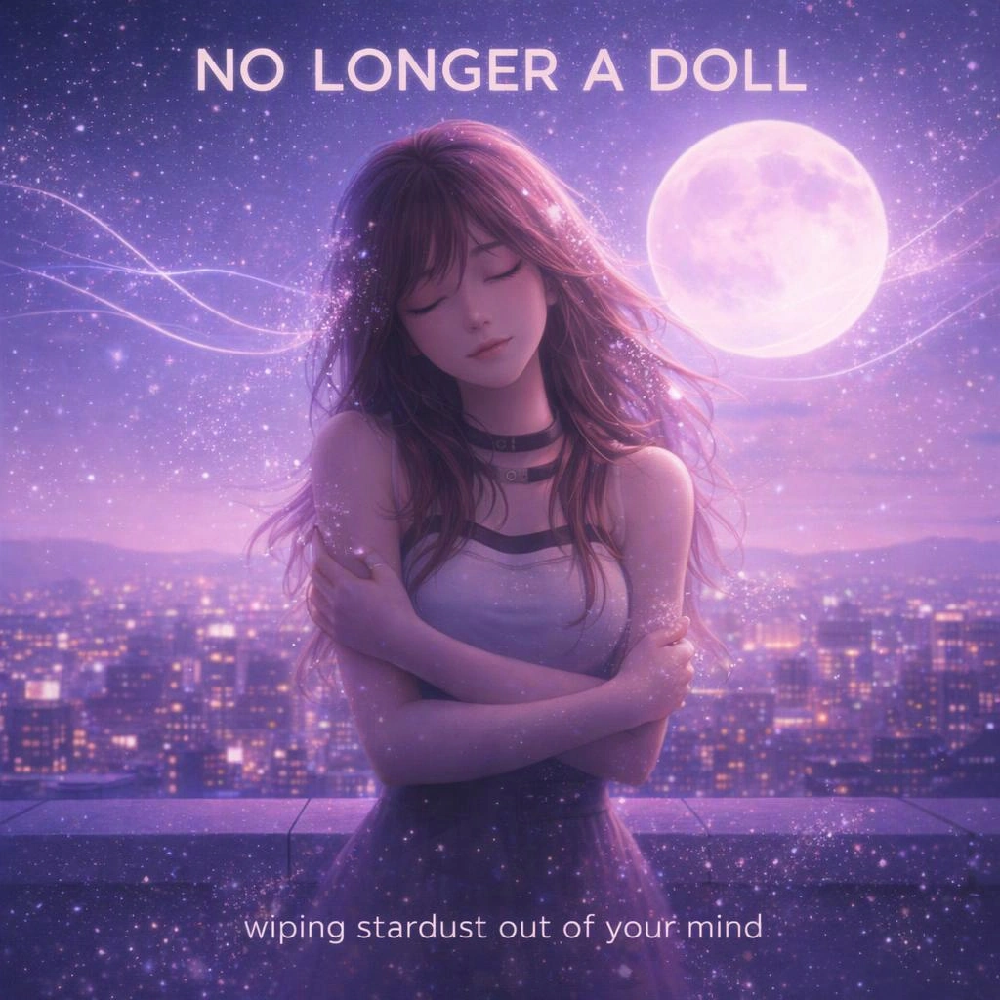

## Dreamy Electropop

&#128286; **Hinweis zum Jugendschutz:** Bitte beachte die [Altersbeschränkungen im Hauptdokument](../README.md#cw).

**Stimmung & Bezug zur Story:**  
Intim, warm, geborgen und sanft. Dieser Stil unterstreicht den **Pre-Chorus** (*In my warm embrace, you can hide*).

---

## Tracks & Style-Prompts

#### Variante 01

[➜ 04 - No Longer a Doll (Dreamy Electropop)](https://suno.com/s/huf3KIq99qzgY8bU)
*(leider mit kleinem Textfehler bei „in the night“)*

````text
Dreamy electropop, glowing analog synths, soft electronic heartbeat rhythm, lo-fi pop beat, intimate breathy female vocals, angelic clean voice, warm embrace ambiance, uplifting chorus, melodic, catchy, 110 bpm, E minor
````

#### Variante 02

[➜ 04_02 - No Longer a Doll (Dreamy Electropop)](https://suno.com/s/KYcp1l97zEQ43rnH)

````text
Dreamy electropop, 110 BPM soft heartbeat pulse, glowing analog synths over a lo-fi pop beat, intimate breathy female talk-sing in a soft register with clean angelic tone and whispered ad-libs between lines, warm embrace ambience, rising melodic chorus with a catchy hook
````

---

## Covers & Image-Prompts

#### Variante 01




````text
SUBJECT: Mitsuko from Once Human — use the attached reference image for face and hairstyle (wearing an oversized, cozy pastel-lavender knit sweater slipping gently off one shoulder over dark loungewear). Her eyes are OPEN, soft, tender and dreamy, resting her chin lightly on her folded arms on a plush pillow while gazing directly into the viewer with a warm, intimate smile. Close-up portrait framing, no microphone.
ENVIRONMENT: A cozy, dimly lit bedroom at night with raindrops streaking down a dark window, warm fairy lights blurred in the background, and the soft edge of a glowing monitor desk visible in the deep shadows.
LIGHT & FX: Warm amber bedside lamp glow blending gently with a soft violet stardust shimmer across her cheek and shoulder. A delicate, translucent glowing heartbeat waveform floats subtly in the warm air beside her, surrounded by dreamy out-of-focus bokeh circles and soft 35mm lens diffusion.
COLOR PALETTE: Midnight Plum #161026, Warm Lamp Amber #FBBF24, Soft Cream #FEF3C7, Stardust Violet #C084FC, Dusty Rose #E3A1B4.
TYPOGRAPHY: Title "NO LONGER A DOLL" in a rounded, soft retro sans-serif with a gentle warm glow, placed in the top-left corner.
Tagline "in my warm embrace..." in soft, intimate lowercase handwritten script typography near the bottom, warmly lit.
STYLE: Dreamy bedroom-electropop single cover, square 1:1, intimate 35mm analog portrait photography, soft halation, warm and comforting atmosphere.
````

#### Variante 02



````text
SUBJECT: Mitsuko (use the uploaded reference image for face, hairstyle; complete outfit softened into an oversized pastel knit over her original outfit). Eyes CLOSED, head resting on folded arms, dreamy peaceful smile, as if listening to a heartbeat.
ENVIRONMENT: Cozy dim bedroom at night, glowing vintage analog synthesizer beside her, soft fairy lights, a window showing a hazy neon city. A small pulsing heart-shaped waveform floats above her.
LIGHT & FX: Warm lo-fi glow, gentle film grain, soft bokeh, faint VHS bloom, subtle pink haze.
COLOR PALETTE: Peach #F6C1A5, dusty pink #E3A1B4, lavender #B9A7D6, warm cream #FFF3E6, deep plum #3A2540.
TYPOGRAPHY: Title "NO LONGER A DOLL" in a rounded, soft retro font with light glow, top left. Tagline "in my warm embrace" lowercase handwritten script below.
STYLE: Dreamy lo-fi illustration, soft focus, intimate, warm, album cover, square 1:1.
````

#### Variante 03



````text
SUBJECT: Mitsuko (use the uploaded reference image for face, hairstyle and complete outfit). Eyes OPEN, softly waking, a tender lovestruck gaze toward the viewer, hand reaching gently forward. Delicate golden electric threads flow across her skin like glowing veins of light, softest at her fingertips.
ENVIRONMENT: Floating in a dreamy pastel void of clouds and soft analog synth wave-lines that bend around her like ribbons.
LIGHT & FX: Warm golden sunrise glow from behind, gentle sparkle particles, heart-rhythm light pulses, soft bloom.
COLOR PALETTE: Honey gold #F2C14E, soft apricot #F7B58C, blush #F2C4CE, pearl white #FAF6F0, twilight lilac #9C8AC0.
TYPOGRAPHY: Title "NO LONGER A DOLL" in rounded retro font with gold foil shimmer, centered. Tagline "your vibe wakes me up" lowercase script beneath. Small gold badge: "5/5 FULL CAPACITY".
STYLE: Ethereal dreamy illustration, warm, romantic, polished, album cover, square 1:1. No cables, no plugs, no sockets.
````

#### Variante 04



````text
SUBJECT: Mitsuko (use the uploaded reference image for face, hairstyle and complete outfit). Eyes CLOSED, gently swaying, arms loosely around herself, peaceful crooning expression. Glittering stardust drifting away from her hair as if being softly wiped from a dream.
ENVIRONMENT: Rooftop at twilight, pastel city lights below, oversized soft moon, floating analog synth wave-lines across the sky.
LIGHT & FX: Lavender-blue ambient glow, slow-motion stardust trails, dreamy soft bloom, light film grain.
COLOR PALETTE: Periwinkle #8FA3E0, lilac #C3A9E0, soft rose #EBB3C7, misty white #F4F2FA, night indigo #232347.
TYPOGRAPHY: Title "NO LONGER A DOLL" in rounded retro sans, soft white glow, top. Tagline "wiping stardust out of your mind" lowercase, thin, bottom center.
STYLE: Dreamy lo-fi cinematic illustration, calm, melodic, album cover, square 1:1. No gold electricity. 
````

---

Hier geht es weiter zur [➜ nächsten Musikrichtung (*Angel-Vocal Cyber-Pop*)](angel_vocal_cyber_pop.md), zum [➜ Songtext als Prompt](../lyrics/lyrics_prompt.md), zurück zu den [➜ Musikrichtungen](styles.md) oder zurück zum [➜ Hauptdokument](../README.md).
