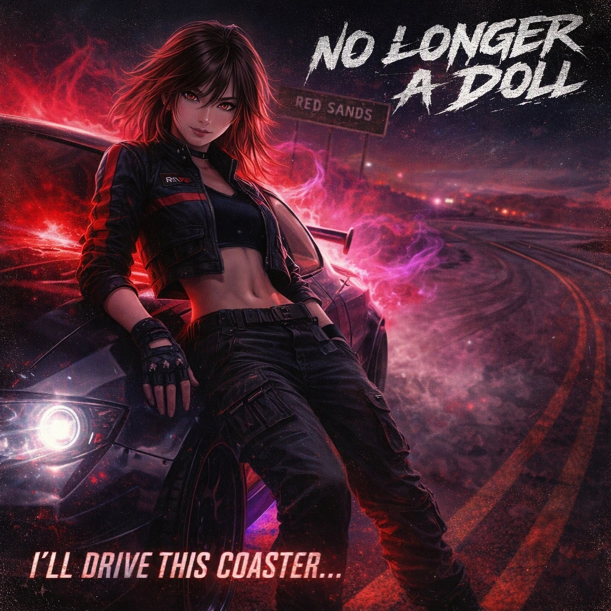
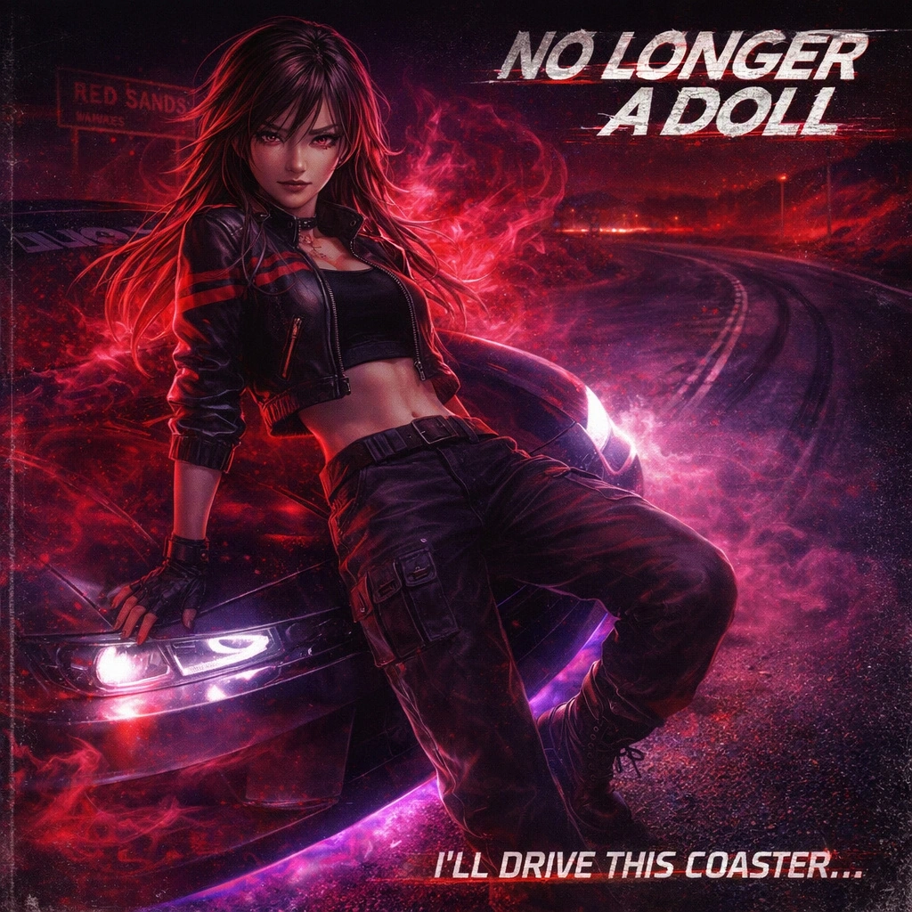
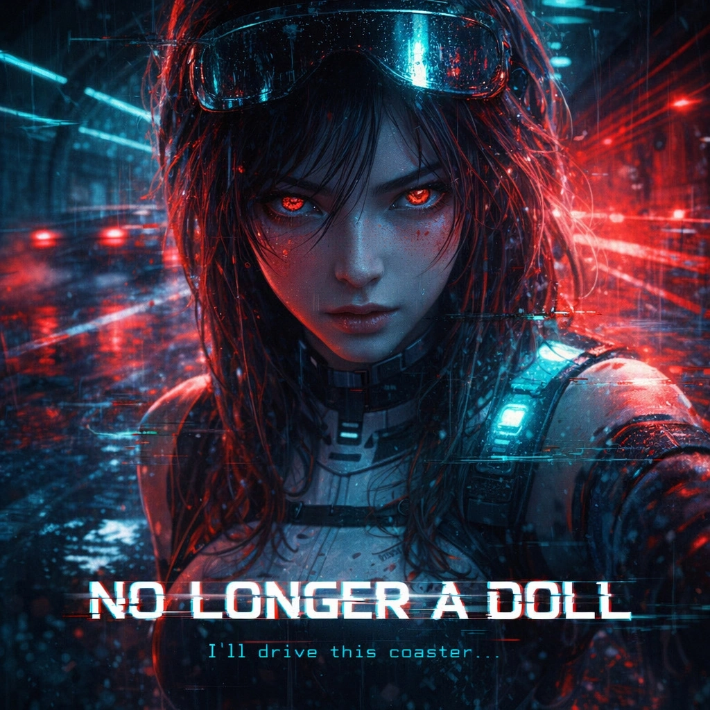
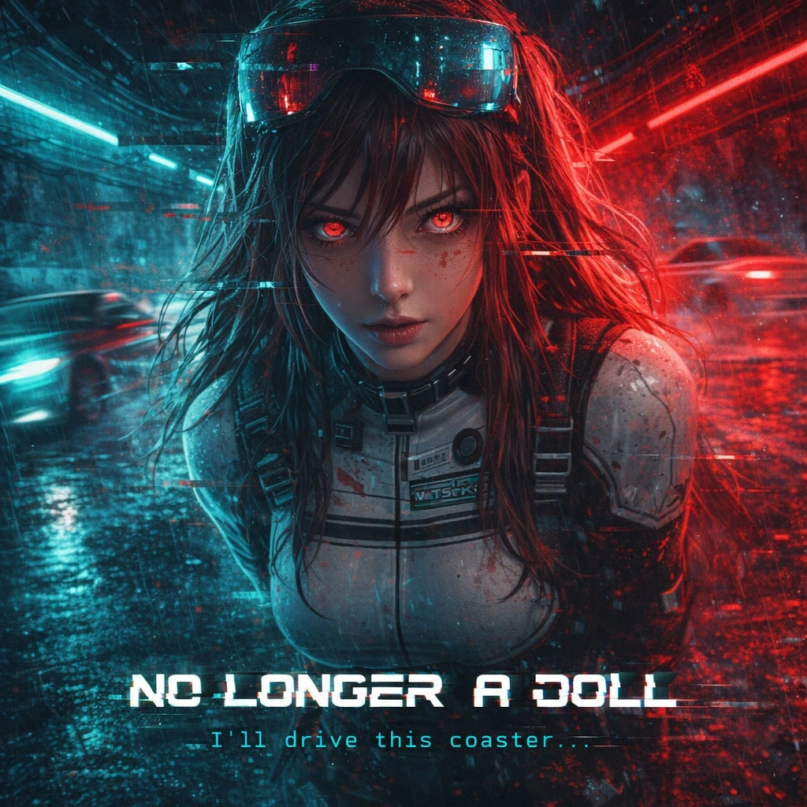
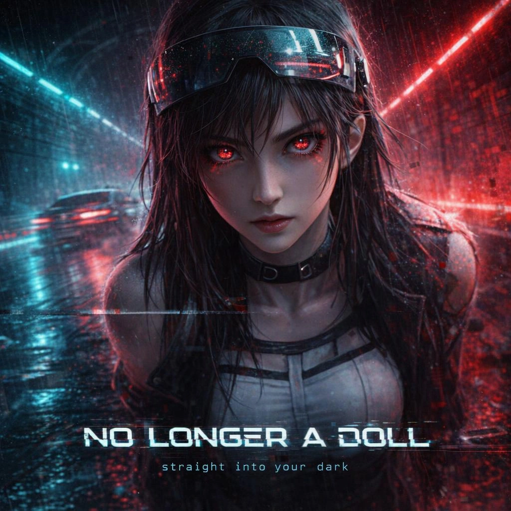

## Drift / Cyberpunk Phonk

&#128286; **Hinweis zum Jugendschutz:** Bitte beachte die [Altersbeschränkungen im Hauptdokument](../README.md#cw).

**Stimmung & Bezug zur Story:**  
Aggressiv, treibend, kompromisslos und dominant. Dieser Stil betont *I'll drive this coaster, yeah I hold the keys* – Rebecca übernimmt mit voller Wucht das Steuer und bricht aus den LEA-Labs aus.

---

## Tracks & Style-Prompts

#### Variante 01

[➜ 07 - No Longer a Doll (Drift / Cyberpunk Phonk)](https://suno.com/s/c1tbXKo7jPyHPyNa)

````text
Drift phonk with lo-fi tape grit and rough saturation; relentless four-on-the-floor drive; high, light-register female vocals, menacing yet crooned in legato phrases, dry and upfront; distorted 808 bass, dark cowbell melody, and high-octane electronic synths
````

#### Variante 02

[➜ 07_02 - No Longer a Doll (Drift / Cyberpunk Phonk)](https://suno.com/s/WmvO4ap4Ry3OntoI)
*(leider mit kleinem Textfehler bei „Perfect ending“)*

````text
Drift phonk, clipped 808 saturation, distorted 808 bass and a dark cowbell melody over hard electronic hits; low-register menacing female vocals, stacked hook harmonies and gang-vocal shouts; aggressive half-time trap stomp
````

#### Variante 03

[➜ 07_03 - No Longer a Doll (Drift / Cyberpunk Phonk)](https://suno.com/s/LXX9CT54W3ZN6dj9)
*(leider mit kleinem Textfehler bei „intertwine“)*

````text
Cyberpunk phonk, aggressive drift phonk, distorted 808 bass, dark cowbell melody, high-octane electronic, menacing female vocal delivery, 140 BPM, write as d minor
````

#### Variante 04

[➜ 07_04 - No Longer a Doll (Drift / Cyberpunk Phonk)](https://suno.com/s/76Tk8IdCp4dFHYC5)
*(leider mit kleinem Textfehler bei „looking for the plug“ und „flowing into me“)*

````text
Cyberpunk phonk, aggressive drift phonk, distorted 808 bass, dark cowbell melody, high-octane electronic, menacing female vocal delivery, 140 BPM, write as d minor
````

---

## Covers & Image-Prompts

#### Variante 01




````text
SUBJECT:
Mitsuko from Once Human — use the attached reference image for faceand hairstyle (styled with a street-racing edge: cropped matte-black racing jacket with crimson stripes, dark cargo details, fingerless gloves). Her eyes are OPEN, narrow, predatory and confident, with a slight smirk directly toward the viewer. Aggressive low-angle hero shot, leaning back against the front fender of a slammed widebody JDM drift sports car, one boot braced forward. No microphone.

ENVIRONMENT:
An empty, rain-slicked desert highway in the Red Sands at night, long black tire marks curving around her, a weathered roadside sign reading "RED SANDS" half-obscured in the background haze, distant neon highway lights.

LIGHT & FX:
Harsh blood-red taillight glow from behind cutting through dense tire smoke, bright white headlight flare, and glowing violet underglow beneath the car that illuminates the swirling magenta-tinted smoke behind Rebecca like fierce, billowing wings. Heavy analog film grain and subtle chromatic aberration.

COLOR PALETTE:
Asphalt Black #0A0A0E, Blood Red #B3001B, Tire Smoke Grey #423F4D, Stardust Neon Purple #BF00FF, Chrome Silver #C9CED6.

TYPOGRAPHY:
Title "NO LONGER A DOLL" in aggressive, condensed brushed-chrome lettering with jagged distressed edges, slightly skewed for speed, at the top-right.
Tagline "I'LL DRIVE THIS COASTER..." in sharp, slightly slanted industrial uppercase typography at the bottom, glowing crimson-white.

STYLE:
Cyberpunk drift phonk album cover, square 1:1, gritty underground night car photography meets semi-realistic anime-realism, high contrast, visceral energy.
````

#### Variante 02




````text
SUBJECT: Mitsuko from Once Human (use reference image for face, hairstyle and complete outfit; may add a cyber-street layer: reflective visor pushed into her hair). Eyes OPEN, menacing focus, a red target reticle reflected in her irises. Close-up shot from the shoulders upward, leaning slightly toward the viewer.
ENVIRONMENT: Rain-wet underground tunnel with neon strips, a blurred drift car streaking past behind her, puddles reflecting neon.
LIGHT & FX: Hard cyan side light against blood-red back light, glitch slices across the frame, rain streaks, motion trails, heavy grain.
COLOR PALETTE: Neon Cyan #00E5FF, Blood Red #C3002F, Gunmetal #2A2D34, Tunnel Black #050608, Wet Chrome #B8C2CC.
TYPOGRAPHY: Title "NO LONGER A DOLL" in glitched, horizontally sliced techno font, center bottom. Tagline "I'll drive this coaster..." in small lowercase cyan monospace font beneath it.
STYLE: Cyberpunk phonk single cover, dark, aggressive, cinematic neon noir, square 1:1 format.
NEGATIVE: no explicit content.
````

#### Variante 03



````text
SUBJECT: Mitsuko from Once Human (use reference image for face, hairstyle and complete outfit; may add a cyber-street layer: reflective visor pushed into her hair). Eyes OPEN, menacing focus, a red target reticle reflected in her irises. Close-up shot from the shoulders upward, leaning slightly toward the viewer.
ENVIRONMENT: Rain-wet underground tunnel with neon strips, a blurred drift car streaking past behind her, puddles reflecting neon.
LIGHT & FX: Hard cyan side light against blood-red back light, glitch slices across the frame, rain streaks, motion trails, heavy grain.
COLOR PALETTE: Neon Cyan #00E5FF, Blood Red #C3002F, Gunmetal #2A2D34, Tunnel Black #050608, Wet Chrome #B8C2CC.
TYPOGRAPHY: Title "NO LONGER A DOLL" in glitched, horizontally sliced techno font, center bottom. Tagline "straight into your dark" in small lowercase cyan monospace font beneath it.
STYLE: Cyberpunk phonk single cover, dark, aggressive, cinematic neon noir, square 1:1 format.
NEGATIVE: no cables, no plugs, no sockets, no explicit content.
````

---

Hier geht es weiter zur [➜ nächsten Musikrichtung (*K-Pop Trap*)](k_pop_trap.md), zum [➜ Songtext als Prompt](../lyrics/lyrics_prompt.md), zurück zu den [➜ Musikrichtungen](styles.md) oder zurück zum [➜ Hauptdokument](../README.md).
