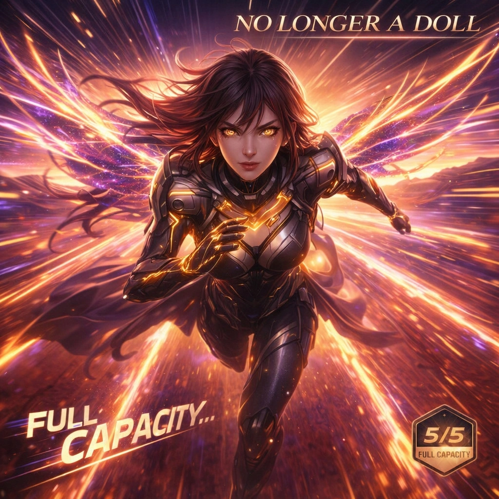

## Epic Orchestral DnB

&#128286; **Hinweis zum Jugendschutz:** Bitte beachte die [Altersbeschränkungen im Hauptdokument](../README.md#cw).

**Stimmung & Bezug zur Story:**  
Rasend, siegreich, adrenalingeladen und triumphal. Dieser Stil markiert den ultimativen Endspurt und Gipfel von **Chorus 2**: volle Energie, Befreiung und Triumph.

---

## Tracks & Style-Prompts

#### Variante 01

[➜ 15 - No Longer a Doll (Epic Orchestral DnB)](https://suno.com/s/7squg4kbGndOjOD2)

````text
epic hybrid orchestral, cinematic drum and bass, uplifting fast symphonic strings, powerful brass, fast driving energetic beat, emotional soaring female vocals, triumphant
170 bpm: E major
````

#### Variante 02

[➜ 15_02 - No Longer a Doll (Epic Orchestral DnB)](https://suno.com/s/uJ3g2NHkhvoCGE2k)

````text
Epic hybrid orchestral cinematic drum and bass, fast driving breakbeat with uplifting symphonic strings and powerful brass, sidechained orchestral impacts, warm mid-range female vocals in whispered, hypnotic half-spoken talk-sing, soft and emotional with a soaring euphoric lift
````
---

## Covers & Image-Prompts

#### Variante 01



```text
SUBJECT: Rebecca from Once Human — use the attached reference image for face and hairstyle (wearing sleek, aerodynamic dark-and-silver battle couture with long flowing coat-tails streaming behind her). Her eyes are OPEN, fierce, radiant and triumphant, captured mid-stride sprinting forward at blinding speed toward the viewer with her hair and fabric whipping back in the wind. Her face remains unmarred, while subtle golden energy shimmer traces along her hands and collarbone. No microphone.
ENVIRONMENT: A monumental futuristic light tunnel and glowing "stardust road" cutting through the nocturnal Red Sands desert in intense high-speed motion blur, opening toward a brilliant golden-violet dawn horizon.
LIGHT & FX: Dramatic 170-BPM radial speed lines, intense anamorphic lens flares, and glowing violet-and-gold energy trails fanning out symmetrically behind her shoulders like blazing phoenix-succubus wings.
COLOR PALETTE: Hyper-Speed Black #080910, Radiant Gold #FBBF24, Pure White #FFFFFF, Stardust Violet #9333EA, Crimson Sand #A8322A.
TYPOGRAPHY: Title "NO LONGER A DOLL" in sleek, wide-spaced metallic serif capitals with a subtle motion-blur trail, top-right corner. Tagline "FULL CAPACITY..." in bold, dynamic speed-angled uppercase typography at the bottom-left. Small hexagonal gold game-UI badge in the lower-right corner reading "5/5 FULL CAPACITY".
STYLE: Epic orchestral drum-and-bass album cover, square 1:1, high-velocity sci-fi action key art, cinematic semi-realistic digital painting with photographic skin detail, dramatic motion blur, keep her face without cracks.
```

---

Hier geht es weiter zur [➜ nächsten Musikrichtung (*K-Pop Neon-Pop*)](k_pop_neon_pop.md), zum [➜ Songtext als Prompt](../lyrics/lyrics_prompt.md), zurück zu den [➜ Musikrichtungen](styles.md) oder zurück zum [➜ Hauptdokument](../README.md).
