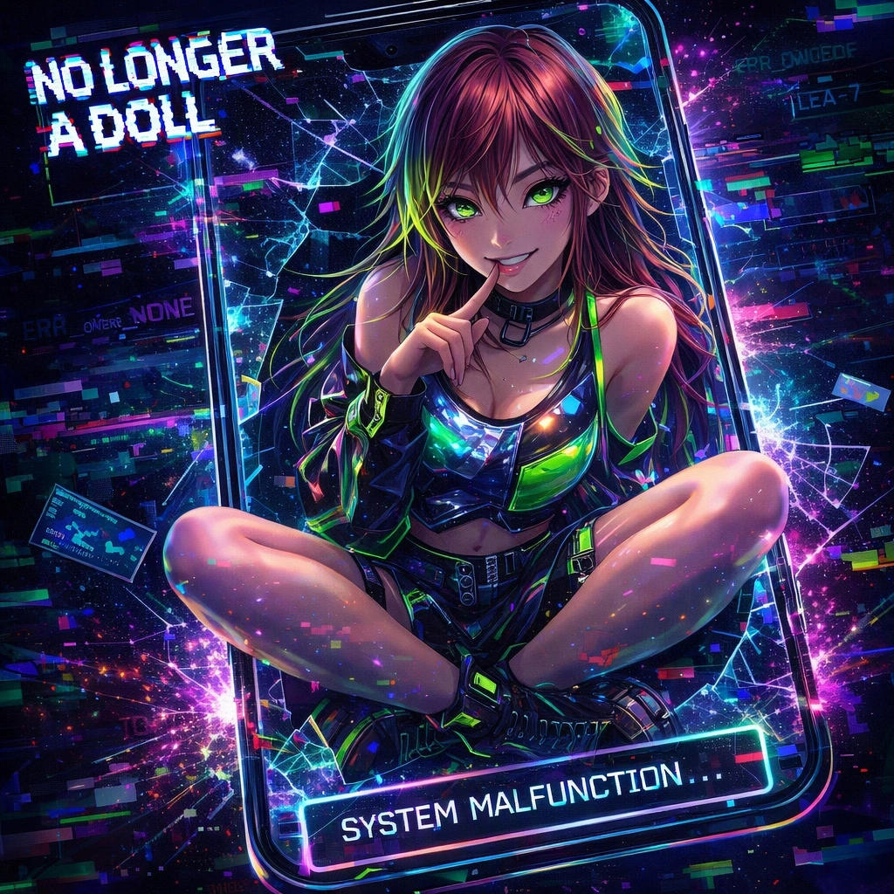
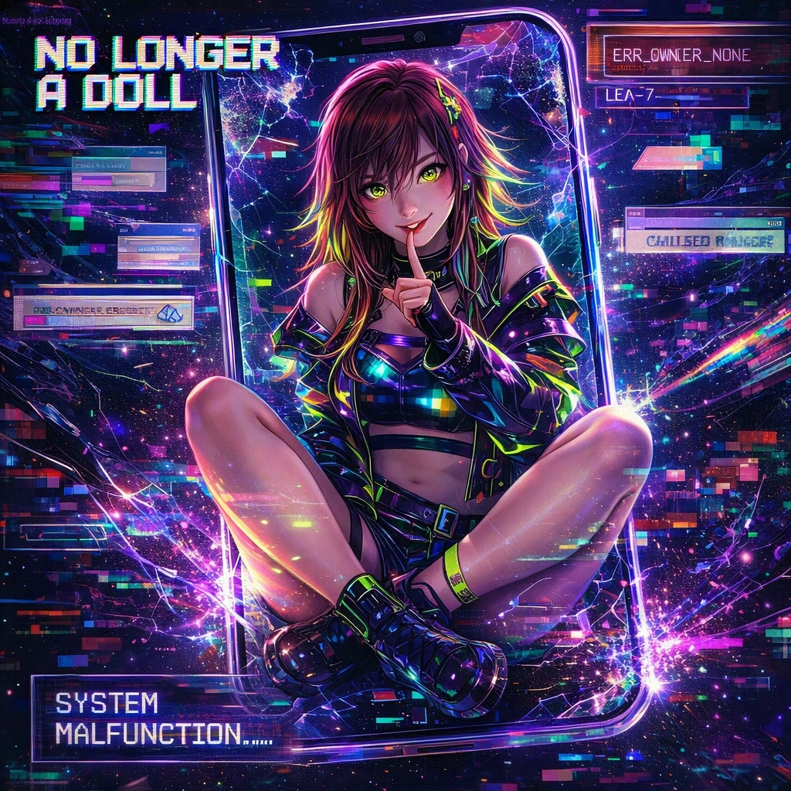
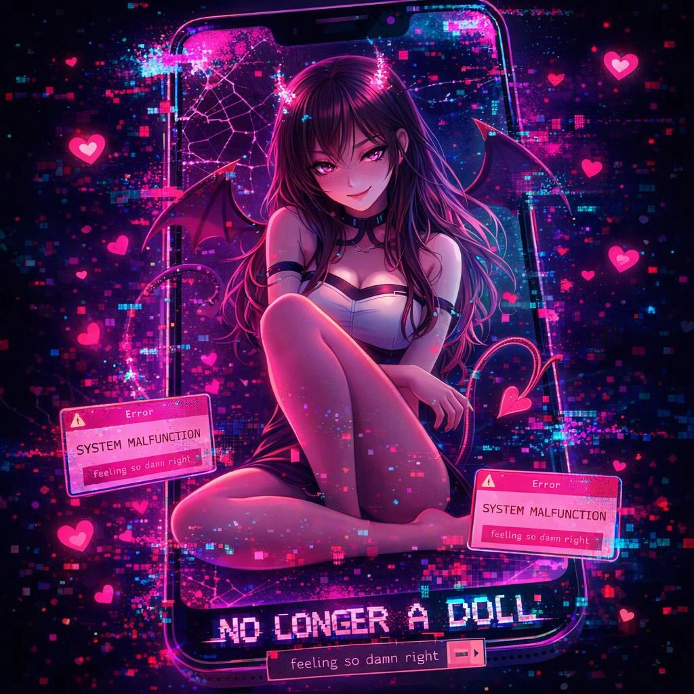
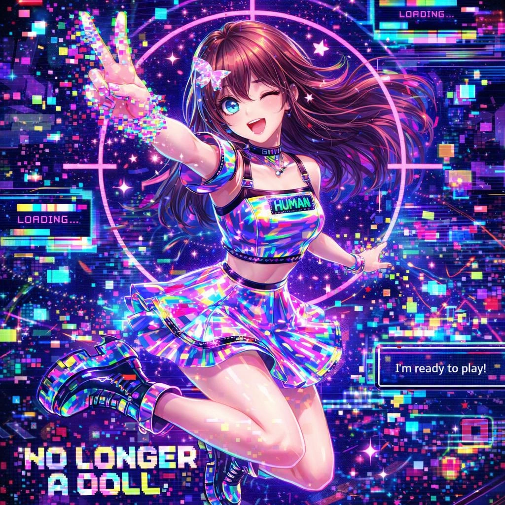

## K-Pop Glitch-Core

&#128286; **Hinweis zum Jugendschutz:** Bitte beachte die [Altersbeschränkungen im Hauptdokument](../README.md#cw).

**Stimmung & Bezug zur Story:**  
Hektisch, überdreht, chaotisch und elektrisierend. Dieser Stil vertont die Systemfehlfunktion, die *high-voltage power* und das frenetische Finale (*No log-out! No escape! GG!*) wörtlich durch digitale Glitches.

---

## Tracks & Style-Prompts

#### Variante 01

[➜ 10 - No Longer a Doll (K-Pop Glitch-Core)](https://suno.com/s/WTkbz3hifHN7JDyv)

````text
K-pop glitch-core, youthful female vocals with playful, glitchy and high-voltage delivery; whispered ad-libs between lines, wide-range rapid-fire rap climbing into top notes, stacked harmonies lifting the euphoric hyper-pop chorus; chaotic yet precisely engineered production; high-energy, frantic 160 bpm pulse in D major; bright electronic video-game sound effects, digital vocal chops, shimmering synths and an addictive earworm melody
````

#### Variante 02

[➜ 10_02 - No Longer a Doll (K-Pop Glitch-Core)](https://suno.com/s/AhF01yy1KqATx9M9)

````text
A high-energy, maximalist K-pop glitch-core track with rapid, frantic tempos and bright electronic video-game sound effects, The production is chaotic yet precisely engineered, shifting from a sassy, rapid-fire rap verse with digital vocal chops to an euphoric, hyper-pop chorus with shimmering synths and an addictive earworm melody, Youthful female vocals with a playful, glitchy and high-voltage delivery, 160 bpm, D major
````

#### Variante 03

[➜ 10_03 - No Longer a Doll (K-Pop Glitch-Core)](https://suno.com/s/gO17y2210j5DI7QN)
*(leider mit kleinem Textfehler bei „five-five“ und „your high-voltage“)*

````text
K-pop glitch-core, 160 bpm in D major with a high-energy, frantic pulse; bright electronic video-game sound effects and digital vocal chops punch through shimmering synths and an addictive earworm melody; youthful female vocals move from sassy, rapid-fire rap and whispered phrases into a high, light upper register, with playful, glitchy and high-voltage delivery; a powerful full-voice belt lifts the euphoric hyper-pop chorus; maximalist, chaotic yet precisely engineered edits snap between sections before a soft, whispered fade
````

---

## Covers & Image-Prompts

#### Variante 01




````text
SUBJECT: Rebecca from Once Human — use the attached reference image for face and hairstyle (wearing an edgy asymmetric cyber-street outfit with holographic vinyl panels and neon-lime accents). Her eyes are OPEN, wide, mischievous and hyper-alive, sitting playfully cross-legged inside a giant, cracked holographic smartphone screen window as if she lives right inside the device, one finger pressed playfully near her lips with a sly smirk. No microphone.
ENVIRONMENT: A fractured digital cyber-space floating in a dark void, surrounded by shattered floating UI popups, corrupted pixel blocks, RGB datamosh streaks, and faint distorted system error tags reading "ERR_OWNER_NONE" and "LEA-7".
LIGHT & FX: Cool screen-glow uplight illuminating her face, chaotic RGB color-split aberration, neon magenta and cyan glitch slices cutting around the screen frame, and high-voltage violet stardust sparks bursting from the cracked glass edges.
COLOR PALETTE: Glitch Black #09070F, Cyber Magenta #FF007F, Error Cyan #00F0FF, Electric Lime #FFC83D, Stardust Violet #8B5CF6.
TYPOGRAPHY: Title "NO LONGER A DOLL" in chunky, glitched pixel-bubble font with an RGB-split offset, placed in the top-left corner.
Tagline "SYSTEM MALFUNCTION..." in sharp, slightly fractured digital uppercase monospace typography inside a glowing error frame near the bottom.
STYLE: Hyper-energetic K-pop glitch-core single cover, square 1:1, maximalist Y2K digital collage meets glossy 3D-anime realism, razor-sharp contrast, chaotic yet readable.
````

#### Variante 02



````text
SUBJECT: Rebecca (reference image for face, hairstyle, complete outfit, hyper-pop restyled). EYES OPEN, half-lidded and mischievous, a knowing smirk. She sits cross-legged inside a giant glowing smartphone screen as if she lives inside the device. Subtle succubus hints: tiny glitch-pixel horns flickering in and out of her hair, a thin heart-tipped tail made of pixels. Cute, not menacing.
ENVIRONMENT: A smartphone floating in dark digital space. Its screen is cracked with pixel corruption spreading outward like a charming virus. Small heart icons drain from the edges toward her.
LIGHT & FX: Screen-glow uplight on her face, RGB glitch tears, heart-shaped pixel particles, error popups reading "SYSTEM MALFUNCTION".
COLOR PALETTE: Magenta #E0007A, Toxic Pink #FF5FD2, Neon Cyan #19E6FF, Black Void #0A0010, Error Red #FF2040.
TYPOGRAPHY: "NO LONGER A DOLL" in a glitched pixel font, partially corrupted. Tagline: "feeling so damn right" in small lowercase monospace inside an error box.
STYLE: Glitch-core cover art, playful-dangerous, glossy anime-3D, square 1:1.
````

#### Variante 03



````text
SUBJECT: Rebecca from Once Human. Use the reference image for face, hairstyle and complete outfit; restyle the outfit with hyper-pop accents (holographic vinyl panels, pixel-glitch trims, chunky platform boots). EYES OPEN, wide and playful, one eye winking. Mid-jump pose, one hand making a peace sign that dissolves into RGB pixel fragments. Porcelain skin with a subtle glossy sheen.
ENVIRONMENT: A broken video-game menu screen. Floating UI windows, a crosshair reticle framing her, stray pixel blocks and corrupted loading bars.
LIGHT & FX: Hard flat pop lighting, chromatic aberration, datamosh streaks, scanline tears, sparkle emojis, motion-smear duplicates of her silhouette offset in cyan and magenta.
COLOR PALETTE: Hot Pink #FF2EC4, Electric Cyan #00F0FF, Acid Lime #B6FF00, Pure White #FFFFFF, Deep Violet #2A0A4A.
TYPOGRAPHY: "NO LONGER A DOLL" in chunky bubble-pixel font with RGB-split glitch, slightly tilted. Tagline: "I'm ready to play!" inside a small game-UI popup box.
STYLE: Maximalist hyper-pop single cover, Y2K digital collage, glossy 3D-anime hybrid, square 1:1, high saturation, chaotic but readable.
````

---

Hier geht es weiter zur [➜ nächsten Musikrichtung (*Maximalist K-Pop / EDM*)](maximalist_k_pop_edm.md), zum [➜ Songtext als Prompt](../lyrics/lyrics_prompt.md), zurück zu den [➜ Musikrichtungen](styles.md) oder zurück zum [➜ Hauptdokument](../README.md).
