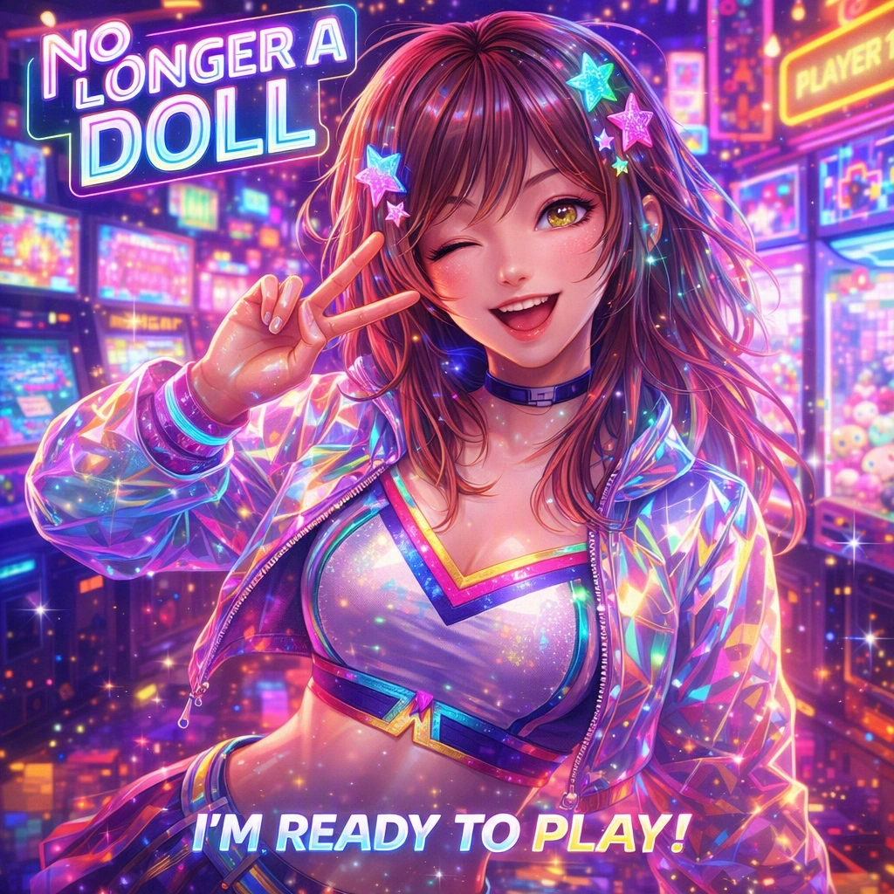
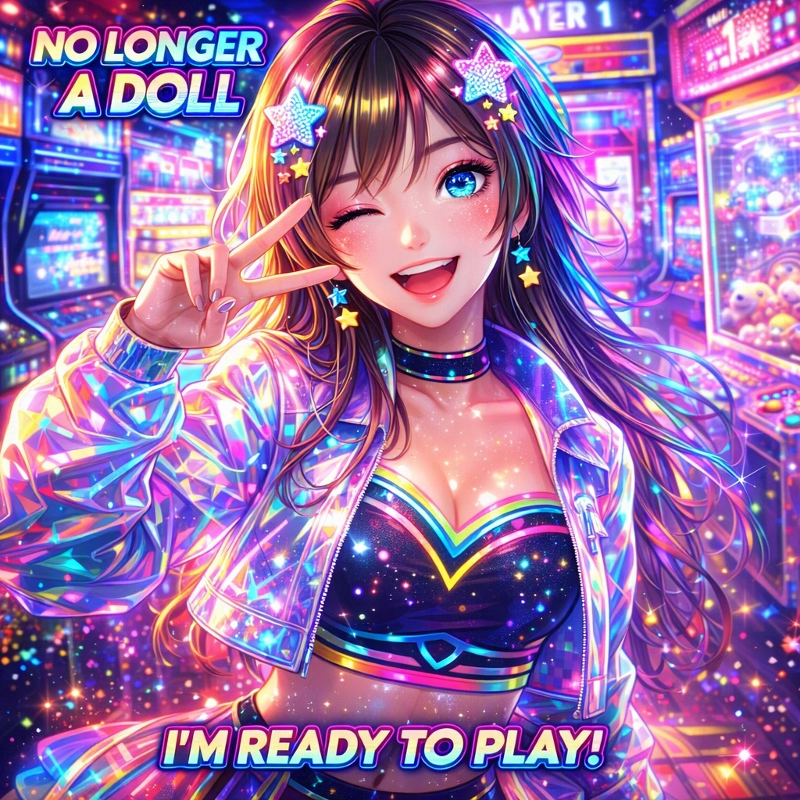

## K-Pop Neon-Pop

&#128286; **Hinweis zum Jugendschutz:** Bitte beachte die [Altersbeschränkungen im Hauptdokument](../README.md#cw).

**Stimmung & Bezug zur Story:**  
Verspielt, bunt und elektrisierend. Mit seinen Arcade-Sounds und Gaming-Effekten betont dieser Stil die spielerische Ebene (*I'm the ultimate prize!*).

---

## Tracks & Style-Prompts

#### Variante 01

[➜ 16 - No Longer a Doll (K-Pop Neon-Pop)](https://suno.com/s/rYmmggvZoCRFQqwq)
12-1 (gut)

````text
Ultra-bright K-pop, neon-pop aesthetic, electronic gaming sfx, Bouncy tempo, rapid-fire rapping verses, Sultry R&B pre-chorus with lush harmonies, Explosive synth-driven pop chorus, earworm hook, Sleek, youthful female vocals, cheerful, euphoric, seductive delivery, 135 bpm, C# minor
````

#### Variante 02
12-3 (ok pop dance)

[➜ 16_02 - No Longer a Doll (K-Pop Neon-Pop)](https://suno.com/s/KJxgQOQOnABqkSCo)

````text
K-pop neon-pop with bright arcade synths, electronic gaming sound effects, and a punchy synth-driven chorus; tight compressed drums and crisp digital transitions; sleek female vocals in a low, dark register, clipped rhythmic staccato phrasing, rapid-fire rap verses, sultry R&B pre-chorus harmonies, hooks doubled; bouncy dance-pop groove at 124 BPM, explosive chorus built around an earworm hook
````

---

## Covers & Image-Prompts

#### Variante 01




````text
SUBJECT: Mitsuko from Once Human — use the attached reference image for face and hairstyle (restyled as an ultra-bright neon gaming idol: holographic iridescent cropped jacket over a playful neon-trimmed top, cute pixel-star hair clips). Her eyes are OPEN with one playful wink and a bright, radiant smile. Dynamic mid-motion idol pose, making a playful peace sign near her cheek with one hand, glossy sheen on her skin. No microphone.
ENVIRONMENT: A bustling, ultra-colorful Tokyo or Seoul arcade alley at night, surrounded by glowing retro arcade cabinets, neon signs, and transparent claw machines filled with small plush dolls in the softly blurred background.
LIGHT & FX: Vibrant multi-colored neon reflections (hot pink, electric cyan, acid yellow) bouncing off her skin and holographic jacket, sparkling stardust light flares, subtle arcade pixel sparkles, and a faint retro "PLAYER 1" arcade light bar glow in the background.
COLOR PALETTE: Electric Cyan #06B6D4, Hot Pink #EC4899, Arcade Yellow #FACC15, Deep Night Indigo #1E1B4B, Stardust Magenta #E879F9.
TYPOGRAPHY: Title "NO LONGER A DOLL" in glossy, chunky arcade-pop sans-serif with a crisp neon outline, placed in the top-left corner. Tagline "I'M READY TO PLAY!" in punchy, glowing neon-tube uppercase typography at the bottom center.
STYLE: Ultra-bright K-pop neon-pop single cover, square 1:1, vibrant nocturnal street-fashion photography meets glossy 3D-anime polish, high saturation, electrifying and playful.
````

---

Hier geht es weiter zur [➜ nächsten Musikrichtung (*Kawaii Future Bass*)](kawaii_future_bass.md), zum [➜ Songtext als Prompt](../lyrics/lyrics_prompt.md), zurück zu den [➜ Musikrichtungen](styles.md) oder zurück zum [➜ Hauptdokument](../README.md).
