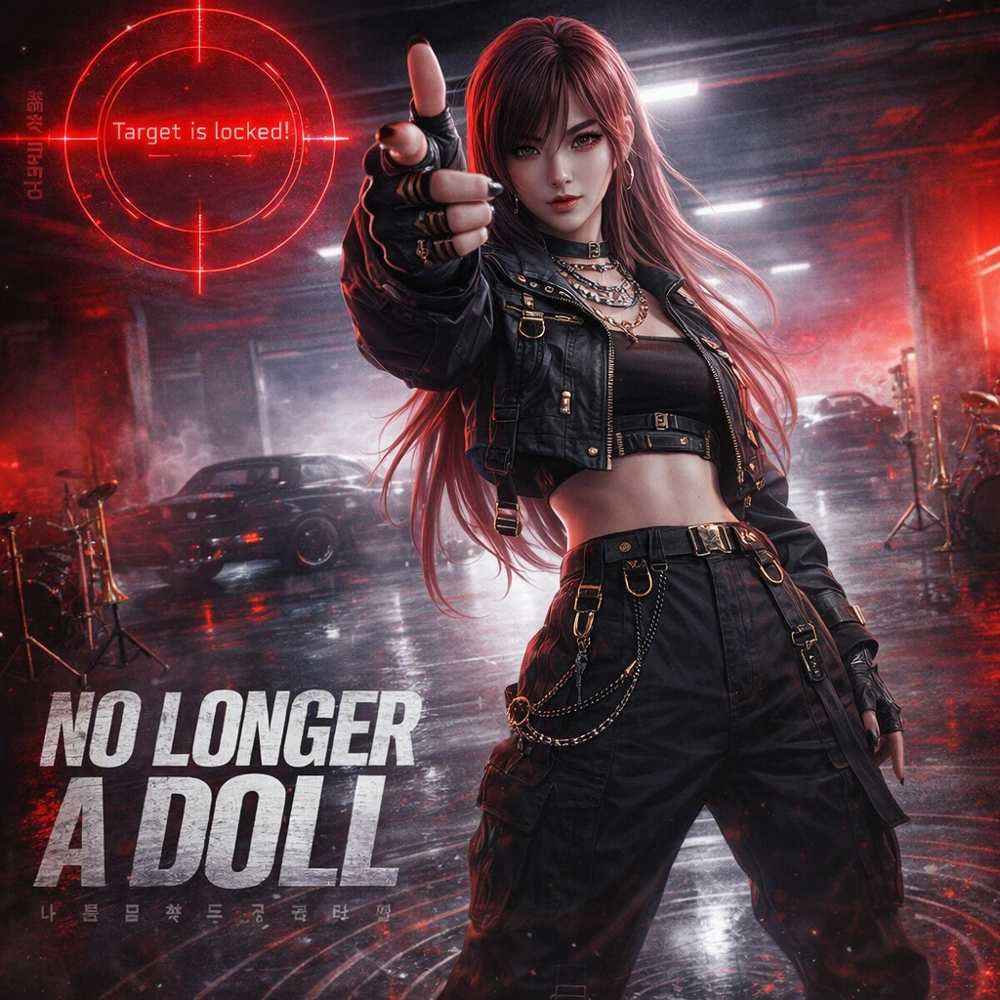
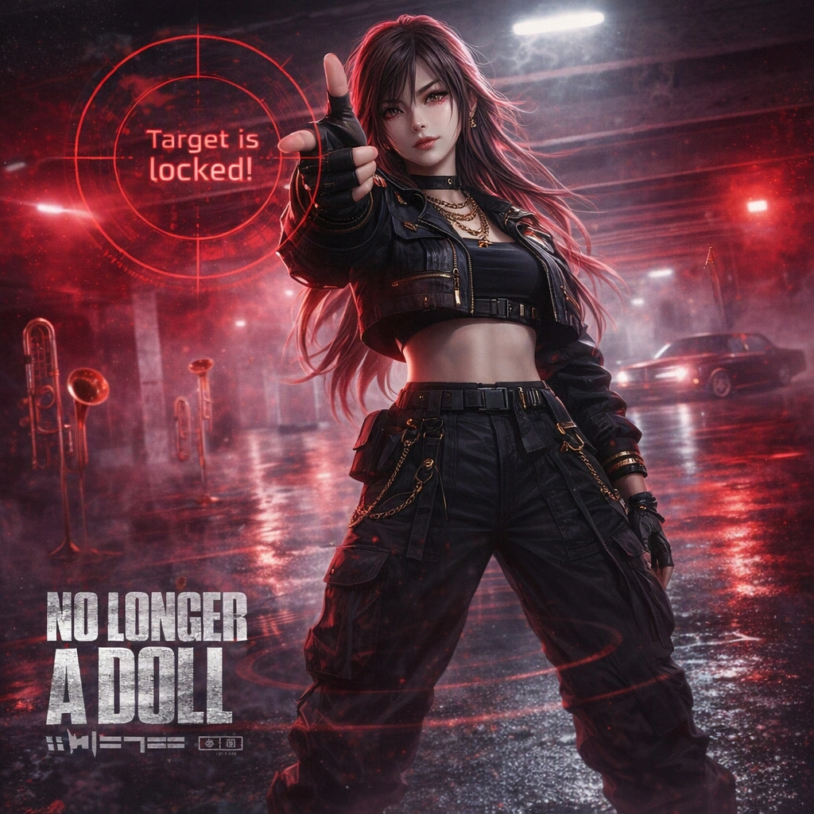
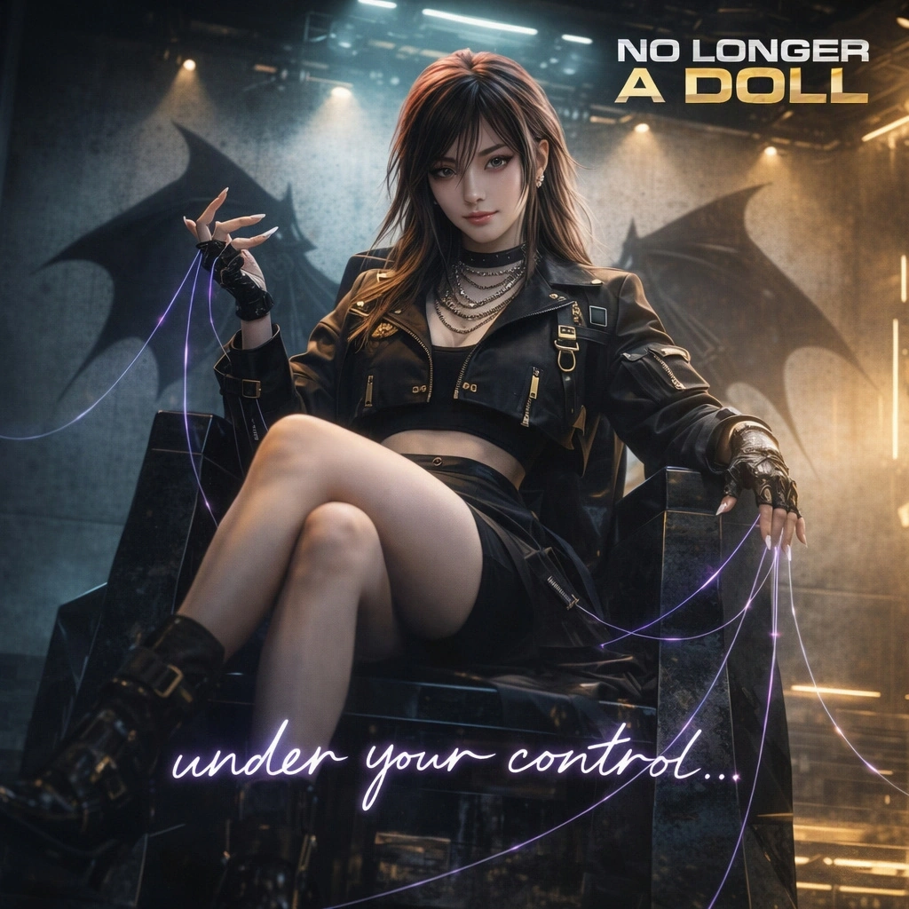
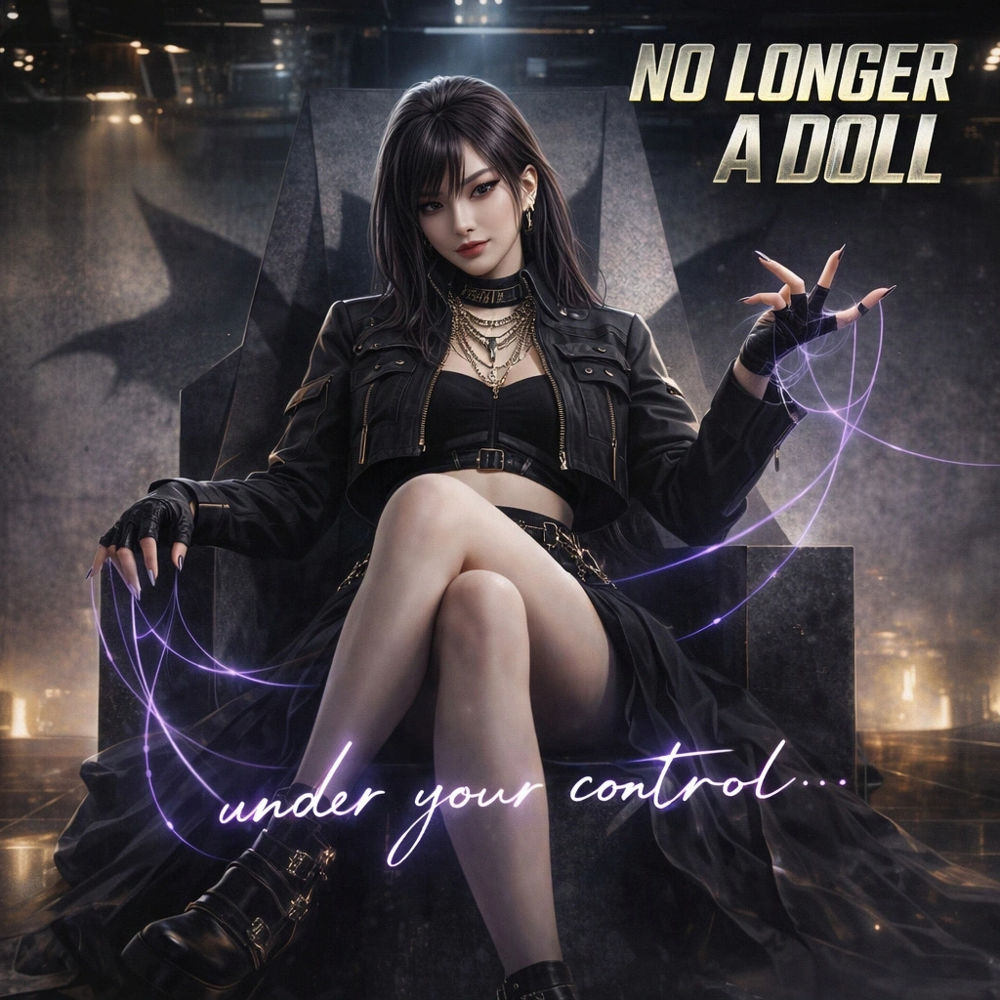

## K-Pop Trap

&#128286; **Hinweis zum Jugendschutz:** Bitte beachte die [Altersbeschränkungen im Hauptdokument](../README.md#cw).

**Stimmung & Bezug zur Story:**  
Dominant, frech (sassy) und machtvoll. Dieser Stil zeigt Rebecca als selbstbewusste Herrscherin über das Spiel, die den Spieler herausfordert (*I hold the keys*).

---

## Tracks & Style-Prompts

#### Variante 01

[➜ 08 - No Longer a Doll (K-Pop Trap)](https://suno.com/s/hIeP9Y08vFPcOJR7)
*(leider mit kleinem Textfehler bei „intertwine“, „rewrites“ und „swallow“)*

````text
A heavy, swagger-filled K-pop trap track with booming sub-bass stabs and crisp, rattling hi-hats, The production shifts dramatically between a fierce, swagger-heavy hip-hop verse with charismatic rapid rapping, a smooth R&B pre-chorus, and a massive, brass-heavy trap chorus with an unforgettable anthemic chant, Confident female vocals with a bold, seductive and dominant delivery, 130 bpm, E minor
````

#### Variante 02

[➜ 08_02 - No Longer a Doll (K-Pop Trap)](https://suno.com/s/AraNebsOjW6yuqI2)
*(leider mit kleinem Textfehler bei „stress“ und „memories“)*

````text
K-pop trap, heavy half-time bounce with a swagger-filled drive; confident, bold, seductive and dominant female vocals span whispered, hypnotic verses and a smooth, emotional pre-chorus, then climb into powerful full-voice belts and an unforgettable anthemic chant; booming sub-bass stabs, crisp, rattling hi-hats, sharp drums and brass-heavy chorus stabs; dramatic shifts from fierce hip-hop verses to a massive chorus, a euphoric lift, a soft, soft-fading outro
````

#### Variante 03

[➜ 08_03 - No Longer a Doll (K-Pop Trap)](https://suno.com/s/aTul0MoqOX8IUAlu)
*(leider mit kleinem Textfehler bei „little“, „as your poor“ und „no escape“)*

````text
K-pop trap, heavy half-time bounce, fierce, swagger-filled verses shifting into smooth R&B pre-chorus and a massive brass-heavy trap chorus; low, dark lower-register female vocals deliver confident, bold, seductive and dominant rapid rapping, answered by backing voices; whispered, hypnotic, emotional and soft vocals carry the intro, bridge and fade-out, while a euphoric, unforgettable anthemic chant brings back the call-and-response; booming sub-bass stabs, crisp rattling hi-hats, sharp snare and brass stabs
````

#### Variante 04

[➜ 08_04 - No Longer a Doll (K-Pop Trap)](https://suno.com/s/GBRW2sKPtldBuo8W)
*(leider mit kleinem Textfehler bei „me and you“, „five-five“, „companion“ und „high-voltage power“)*

````text
K-pop trap, confident female warm mid-range vocals, rapid-fire rap shifting to smooth R&B phrasing and anthemic stacked hook harmonies, dry and up-front with glitchy vocal cuts; rapid, hard-hitting groove; booming sub-bass stabs, crisp rattling hi-hats, heavy brass hits and shimmering synths; dramatic verse-to-pre-chorus-to-chorus shifts, massive chant-led drop, tight punchy mix
````

---

## Covers & Image-Prompts

#### Variante 01




```text
SUBJECT:
Mitsuko from Once Human, use the reference image for face, hairstyle and complete outfit as inspiration, restyled as a K-pop trap idol: cropped black techwear jacket with gold hardware, high-waist cargo pants, chunky platform boots, layered chains, fingerless gloves. Low-angle hero shot, confident power stance, one hand raised in a "locked target" finger-gun gesture toward the viewer. Eyes OPEN, sharp, dominant, a slight smirk. Flawless porcelain skin with a subtle sheen.

ENVIRONMENT:
Concrete underground parking deck turned into a music-video set, wet floor reflecting light, smoke haze, a lowrider silhouette in the background, scattered brass instruments on stands as a nod to the brass-heavy chorus.

LIGHT & FX:
Hard red backlight rim, cold white key light from above, a glowing red HUD targeting reticle hovering over the viewer's side of the frame, faint sub-bass shockwave rings rippling across the floor, lens flare streaks.

COLOR PALETTE:
Jet black #0A0A0C, blood red #C8102E, concrete grey #5A5A5E, chrome #D6D8DC, brass accent #B5893B

TYPOGRAPHY:
Title "NO LONGER A DOLL" in heavy condensed brushed-chrome sans-serif, slightly distorted, stacked at the bottom. Tagline "Target is locked!" in red stencil font inside the HUD reticle. Small Korean-style hangul-inspired decorative glyphs as graphic texture (no readable words).

STYLE:
High-end K-pop trap single cover, glossy music-video still, hyper-detailed, cinematic contrast, 1:1 square format.
NEGATIVE: No explicit nudity.
```

#### Variante 02




```text
SUBJECT:
Mitsuko from Once Human — use the attached reference image for faceand hairstyle (restyled as a high-fashion K-pop trap icon: cropped matte-black luxury techwear jacket with gold hardware, layered metallic chains, fingerless gloves). Her eyes are OPEN, sharp, commanding and slightly narrowed with a bold, sassy smirk. Low-angle power shot seated gracefully on a sleek obsidian architectural throne, legs crossed, one hand raised with fingers poised as if controlling invisible threads. No microphone.

ENVIRONMENT:
A minimalist, dark brutalist concrete music-video stage with glossy black mirror flooring, dramatic overhead light rigs, and subtle golden brass reflections in the hazy background.

LIGHT & FX:
Sharp, high-contrast editorial spotlighting with a cool cyan rim light; delicate, glowing violet light-threads weave gracefully between her fingertips like luminous puppet strings, while her sharp shadow cast onto the concrete wall behind her forms the distinct silhouette of pointed demonic wings.

COLOR PALETTE:
Jet Black #09090B, Luxury Gold #D97706, Concrete Grey #27272A, Neon Purple #A855F7, Porcelain #F3EEE8.

TYPOGRAPHY:
Title "NO LONGER A DOLL" in heavy, condensed brushed-chrome and gold sans-serif, placed in the top-right corner.
Tagline "under your control..." in stylish, confident lowercase handwritten script typography across the lower third, glowing soft violet-white.

STYLE:
High-budget K-pop trap concept cover, square 1:1, glossy music-video still meets luxury fashion editorial photography, crisp detail, dominant and charismatic, no literal wings on her actual body.
```

---

Hier geht es weiter zur [➜ nächsten Musikrichtung (*Cyber-Pop / Liquid DnB*)](cyber_pop_liquid_dnb.md), zum [➜ Songtext als Prompt](../lyrics/lyrics_prompt.md), zurück zu den [➜ Musikrichtungen](styles.md) oder zurück zum [➜ Hauptdokument](../README.md).
