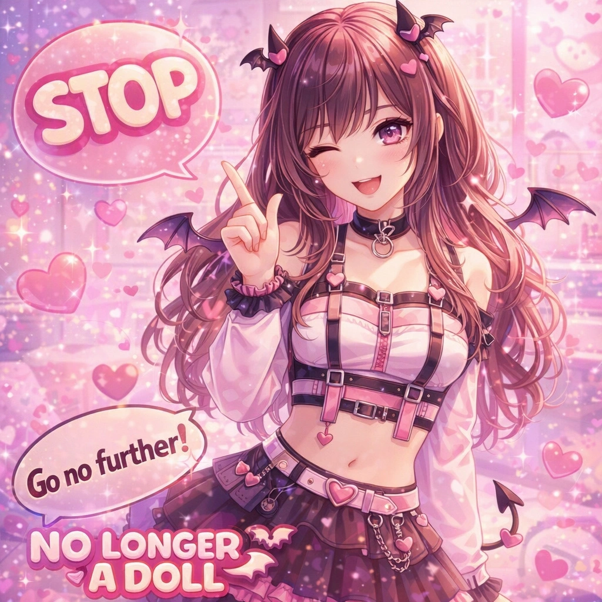
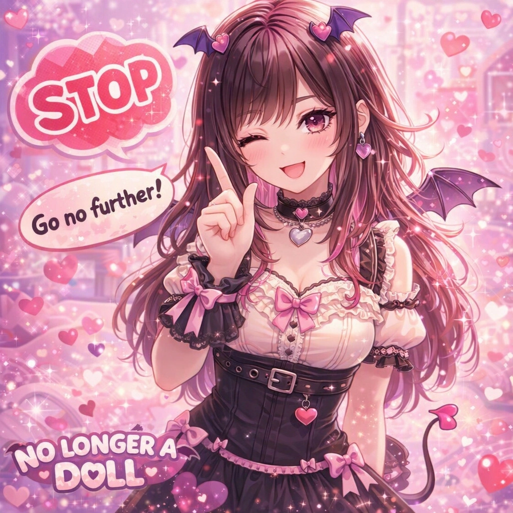
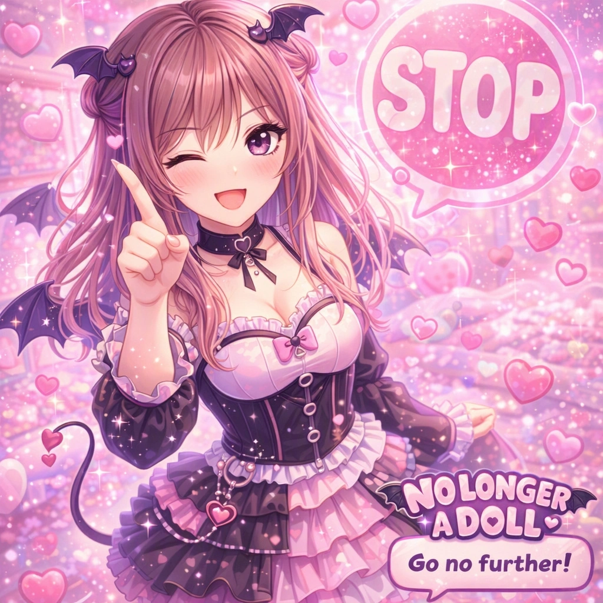

## Kawaii Future Bass

&#128286; **Hinweis zum Jugendschutz:** Bitte beachte die [Altersbeschränkungen im Hauptdokument](../README.md#cw).

**Stimmung & Bezug zur Story:**  
Niedlich, liebevoll und zuckersüß – mit einem besitzergreifenden Unterton. Dieser Stil macht das Ende zu einer überraschend anhänglichen Yandere-Liebeserklärung (*No log-out! No escape!*).

---

## Tracks & Style-Prompts

#### Variante 01

[➜ 17 - No Longer a Doll (Kawaii Future Bass)](https://suno.com/s/4cQgouStoX806Z4t)

````text
Future bass with cheerful neon-pop gloss; high, light female vocals, sweetly affectionate, gritty and strained, in call-and-response with backing voices; pumping sidechain compression; warm rich synths, sparkling chimes, happy brass accents, symphonic lifts, snappy layered claps, orchestral cymbal swells; playful syncopated dance-pop groove
````

#### Variante 02

[➜ 17_02 - No Longer a Doll (Kawaii Future Bass)](https://suno.com/s/pIrP3eWtPW1SIS4t)
*(leider mit kleinem Textfehler bei „private“)*

````text
Kawaii future bass, neon-pop: upbeat four-on-the-floor bounce; sweet, affectionate female vocals in a low, dark, nasal, reedy register, clipped rhythmic staccato with loving emotional delivery; wide detuned synth layers and shimmering drops; rubber-bounce synth bass, warm rich synths, sparkling chimes, cheerful brass stabs, uplifting symphonic flourishes
````

#### Variante 03

[➜ 17_03 - No Longer a Doll (Kawaii Future Bass)](https://suno.com/s/uZvxIB4pWby37Dw1)
*(leider mit kleinem Textfehler bei „Mitsuko“ und „rewrites“)*

````text
bright kawaii future bass, cheerful neon-pop, uplifting symphonic elements, sweet affectionate female vocals, emotional loving delivery, sparkling chimes, warm rich synthesizers, happy brass accents, energetic playful rhythm
140 bpm: E major
````

---

## Covers & Image-Prompts

#### Variante 01





```text
SUBJECT: Rebecca from Once Human. Use the attached reference image for face, hairstyle and complete outfit; kawaii-goth pastel twist. Eyes OPEN, playful flirty wink, finger raised in a teasing "stop" gesture. Subtle succubus hints in cute form: tiny bat-wing hair clips and a small heart-tipped tail charm on her belt. Adorable, sweet, clearly lovable.
ENVIRONMENT: Pastel dream room with floating hearts, a giant cute "STOP" sign bubble, sparkling symphonic confetti.
LIGHT & FX: Pink-violet glow, sparkle chimes, heart particles drifting toward her.
COLOR PALETTE: Candy pink #FF6FB5, plum #8E4FBF, cream #FFF4E6, soft black #2B1E33, cherry #FF3D6E.
TYPOGRAPHY: Title "NO LONGER A DOLL" in bubbly rounded font with a little bat-wing ornament. Tagline "Go no further!" in a bold comic speech bubble.
STYLE: Kawaii anime pop illustration, cute-mischievous, polished, 1:1.
```

---

Hier geht es weiter zum [➜ Songtext als Prompt](../lyrics/lyrics_prompt.md), zurück zu den [➜ Musikrichtungen](styles.md) oder zurück zum [➜ Hauptdokument](../README.md).
