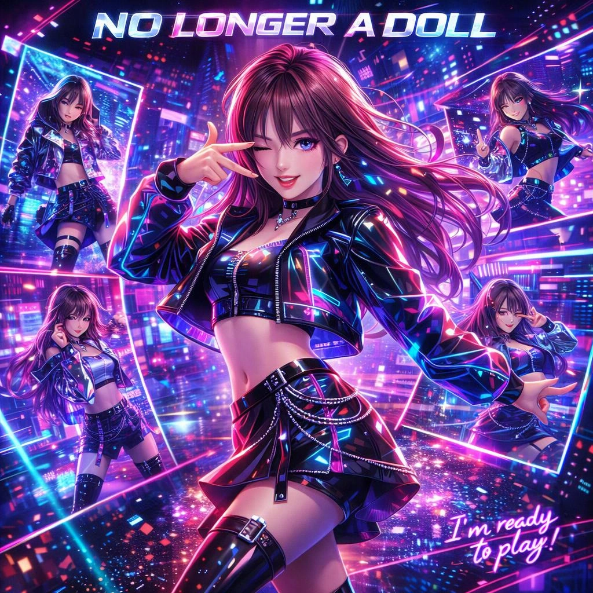

## Maximalist K-Pop / EDM

&#128286; **Hinweis zum Jugendschutz:** Bitte beachte die [Altersbeschränkungen im Hauptdokument](../README.md#cw).

**Stimmung & Bezug zur Story:**  
Energiegeladen, abwechslungsreich und schillernd. Die schnellen Genre-Wechsel spiegeln die Achterbahnfahrt (*drive this coaster*) und Rebeccas viele Facetten auf dem Höhepunkt des Rauschs wider.

---

## Tracks & Style-Prompts

#### Variante 01

[➜ 11 - No Longer a Doll (Maximalist K-Pop / EDM)](https://suno.com/s/r2B5KqbidouNkYrX)

````text
A slick, maximalist K-pop track that genre-hops with precision and style, explosive, synth-driven pop chorus with an ear worm hook, female solo, High-energy dance / EDM, Cyberpunk, Heavy synth bass, Bright digital synths, Crisp percussion, Sassy vocals, Melodic rapping – Polished harmonies, Emotional bridge
````

#### Variante 02

[➜ 11_02 - No Longer a Doll (Maximalist K-Pop / EDM)](https://suno.com/s/OaGxrXJXMRsQ5TFo)

````text
K-pop high-energy dance/EDM with a synth-driven pop chorus, heavy synth bass, bright digital synths, and crisp percussion; polished maximalist production with genre-hopping transitions, layered harmonies, and a rapid breakbeat-pop pulse; sassy female vocals shift from rapid-fire melodic rap and hushed close-mic lines to climbing top notes, doubled hooks, and an emotional bridge
````

#### Variante 03

[➜ 11_03 - No Longer a Doll (Maximalist K-Pop / EDM)](https://suno.com/s/471twObCxEqfOugY)
*(leider mit kleinem Textfehler bei „human memories“)*

````text
K-pop high-energy dance/EDM with a synth-driven pop chorus, heavy synth bass, bright digital synths, and crisp percussion; polished maximalist production with genre-hopping transitions, layered harmonies, and a rapid breakbeat-pop pulse; sassy female vocals shift from rapid-fire melodic rap and hushed close-mic lines to climbing top notes, doubled hooks, and an emotional bridge
````

#### Variante 04

[➜ 11_04 - No Longer a Doll (Maximalist K-Pop / EDM)](https://suno.com/s/Owl4pgQ76mgKQdpJ)
*(leider mit kleinem Textfehler bei „intertwine“ und „always“)*

````text
K-pop high-energy dance/EDM with a synth-driven pop chorus, heavy synth bass, bright digital synths, and crisp percussion; polished maximalist production with genre-hopping transitions, layered harmonies, and a rapid breakbeat-pop pulse; sassy female vocals shift from rapid-fire melodic rap and hushed close-mic lines to climbing top notes, doubled hooks, and an emotional bridge
````

---

## Covers & Image-Prompts

#### Variante 01



````text
SUBJECT: Rebecca from Once Human. Use the attached reference image for face, hairstyle and complete outfit as base; restyle the outfit into a sassy K-pop stage version (glossy cropped jacket with holographic trim, asymmetric details, platform boots). Eyes OPEN, bright and confident, one playful wink toward the viewer, slight smirk. Dynamic idol pose mid-choreography, one hand framing her face in a "lock-on" finger gesture.
ENVIRONMENT: Maximalist cyberpunk stage split into angular collage panels like fast camera cuts – each panel shows Rebecca in a different micro-style (street, chrome, neon arcade), all converging on the central full figure. Floating holographic screens, LED towers, rain-glossed stage floor.
LIGHT & FX: Hard magenta and cyan rim lights, strobing beam lasers, chromatic aberration at panel edges, glitch slices, motion-blur streaks, confetti of tiny digital pixels. No cables, no plugs, no sockets as objects.
COLOR PALETTE: Hot magenta #FF2E93, electric cyan #00E5FF, ultraviolet #6B2BFF, chrome silver #C9CED6, deep night #0A0A1A.
TYPOGRAPHY: Title "NO LONGER A DOLL" in bold, wide chrome-gradient sans-serif with a slight glitch offset, top center. Tagline "I'm ready to play!" in a small neon-script sticker style, bottom right.
STYLE: High-end K-pop comeback teaser, glossy semi-realistic 3D-anime hybrid, crisp detail, editorial album-cover composition, 1:1.
````

---

Hier geht es weiter zur [➜ nächsten Musikrichtung (*Symphonic Gothic Ballad*)](symphonic_gothic_ballad.md), zum [➜ Songtext als Prompt](../lyrics/lyrics_prompt.md), zurück zu den [➜ Musikrichtungen](styles.md) oder zurück zum [➜ Hauptdokument](../README.md).
