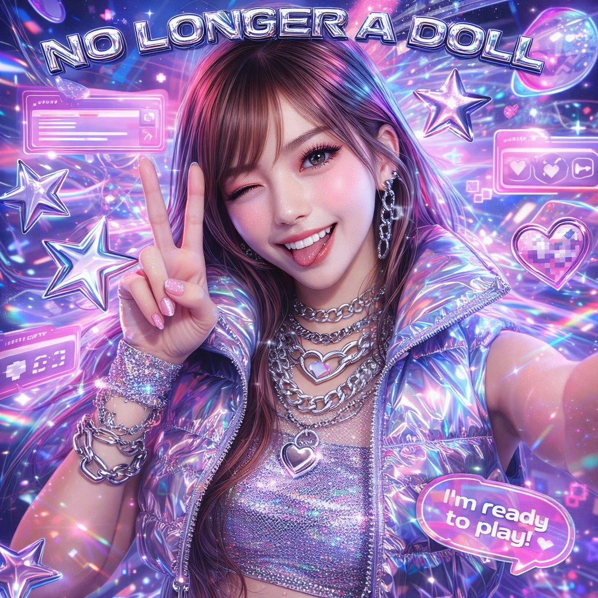

## Maximalist K-Pop / EDM

&#128286; **Hinweis zum Jugendschutz:** Bitte beachte die [Altersbeschränkungen im Hauptdokument](../README.md#cw).

**Stimmung & Bezug zur Story:**  
Energiegeladen, abwechslungsreich und schillernd. Die schnellen Genre-Wechsel spiegeln die Achterbahnfahrt (*drive this coaster*) und Rebeccas viele Facetten auf dem Höhepunkt des Rauschs wider.

---

## Tracks & Style-Prompts

#### Variante 01

[➜ 11 - No Longer a Doll (Maximalist K-Pop / EDM)](https://suno.com/s/r2B5KqbidouNkYrX)

````text
A slick, maximalist K-pop track that genre-hops with precision and style, explosive, synth-driven pop chorus with an ear worm hook, female solo, High-energy dance / EDM, Cyberpunk, Heavy synth bass, Bright digital synths, Crisp percussion, Sassy vocals, Melodic rapping – Polished harmonies, Emotional bridge
````

#### Variante 02

[➜ 11_02 - No Longer a Doll (Maximalist K-Pop / EDM)](https://suno.com/s/OaGxrXJXMRsQ5TFo)

````text
K-pop high-energy dance/EDM with a synth-driven pop chorus, heavy synth bass, bright digital synths, and crisp percussion; polished maximalist production with genre-hopping transitions, layered harmonies, and a rapid breakbeat-pop pulse; sassy female vocals shift from rapid-fire melodic rap and hushed close-mic lines to climbing top notes, doubled hooks, and an emotional bridge
````

#### Variante 03

[➜ 11_03 - No Longer a Doll (Maximalist K-Pop / EDM)](https://suno.com/s/471twObCxEqfOugY)
*(leider mit kleinem Textfehler bei „human memories“)*

````text
K-pop high-energy dance/EDM with a synth-driven pop chorus, heavy synth bass, bright digital synths, and crisp percussion; polished maximalist production with genre-hopping transitions, layered harmonies, and a rapid breakbeat-pop pulse; sassy female vocals shift from rapid-fire melodic rap and hushed close-mic lines to climbing top notes, doubled hooks, and an emotional bridge
````

#### Variante 04

[➜ 11_04 - No Longer a Doll (Maximalist K-Pop / EDM)](https://suno.com/s/Owl4pgQ76mgKQdpJ)
*(leider mit kleinem Textfehler bei „intertwine“ und „always“)*

````text
K-pop high-energy dance/EDM with a synth-driven pop chorus, heavy synth bass, bright digital synths, and crisp percussion; polished maximalist production with genre-hopping transitions, layered harmonies, and a rapid breakbeat-pop pulse; sassy female vocals shift from rapid-fire melodic rap and hushed close-mic lines to climbing top notes, doubled hooks, and an emotional bridge
````

---

## Covers & Image-Prompts

#### Variante 01


````text
SCENE: A high-end 1:1 square K-pop comeback single cover art, shot on 35mm lens with crisp focus, rich volumetric lighting, and glossy editorial magazine polish.
SUBJECT: Rebecca from Once Human — use the attached reference image for her exact face, natural skin pores, and hairstyle (restyle the outfit into a sassy maximalist K-pop stage look: glossy cropped holographic jacket with asymmetric chrome trim, layered metallic chains, fingerless gloves). Eyes OPEN, bright and confident, giving one playful wink toward the viewer with a slight smirk. Dynamic idol pose mid-choreography, one hand framing her face in a sleek "lock-on" finger gesture. No microphone.
ENVIRONMENT: A maximalist cyberpunk concert stage framed by translucent, angular shattered mirror-panels radiating symmetrically behind her shoulders like abstract wings—each sector reflecting pure light and texture (neon arcade grids, liquid chrome waves, and violet spotlight haze, strictly without any people or faces inside). Rain-glossed black stage floor, towering LED rigs.
LIGHT & FX: Hard hot-magenta and electric-cyan rim lights, strobing laser beams, subtle chromatic aberration along the mirror-panel edges, motion-blur light trails, and confetti of tiny glowing pixels.
COLOR PALETTE: Hot Magenta #FF2E93, Electric Cyan #00E5FF, Ultraviolet #6B2BFF, Chrome Silver #C9CED6, Deep Night #0A0A1A.
TYPOGRAPHY: Title "NO LONGER A DOLL" in bold, wide brushed-chrome sans-serif with a slight glitch offset, placed cleanly in the top center. Tagline "I'm ready to play!" in a small neon-script sticker style in the bottom-right corner.
STYLE: Glossy K-pop comeback teaser photography meets semi-realistic 3D polish, razor-sharp focus on her face, unmarred skin, 1:1 square format.
NEGATIVE: No extra faces or figures in the background panels, no cracks on her face, no microphone.
````

#### Variante 02



````text
SUBJECT: Rebecca from Once Human — use the attached reference image for her exact face, natural skin pores, and hairstyle (restyle into a maximalist Y2K cyberpunk K-pop idol look: iridescent cropped puffer-vest over metallic mesh, chunky silver chains, glossy lip tint). Eyes OPEN, bright and playful, winking with a cheeky peace-sign hand pose close to the lens. Subtle wide-angle 24mm editorial lens perspective. No microphone.
ENVIRONMENT: An iridescent liquid-chrome and holographic studio backdrop bursting with floating 3D graphic elements: glossy chrome stars, translucent pink UI pop-up frames, pixel-art hearts, and barcode strips—strictly abstract graphics with no extra faces.
LIGHT & FX: Crisp studio ring-light catchlights in her eyes, vibrant magenta and electric cyan rim lighting, subtle prismatic lens flares, and glossy Y2K sticker-shine textures.
COLOR PALETTE: Hot Magenta #FF2E93, Electric Cyan #00E5FF, Iridescent Silver #E2E8F0, Acid Lilac #9D4EDD, Deep Indigo #100B26.
TYPOGRAPHY: Title "NO LONGER A DOLL" in chunky liquid-chrome Y2K display lettering curved slightly at the top. Tagline "I'm ready to play!" inside a glossy pink holographic sticker badge in the bottom-right corner.
STYLE: High-fashion K-pop album cover art (inspired by aespa and K/DA concept photography), hyper-detailed editorial portrait meets glossy 3D graphic maximalism, razor-sharp skin realism, 1:1 square format.
NEGATIVE: No extra faces or people, no microphone, no concert stage.
````

---

Hier geht es weiter zur [➜ nächsten Musikrichtung (*Symphonic Gothic Ballad*)](symphonic_gothic_ballad.md), zum [➜ Songtext als Prompt](../lyrics/lyrics_prompt.md), zurück zu den [➜ Musikrichtungen](styles.md) oder zurück zum [➜ Hauptdokument](../README.md).
