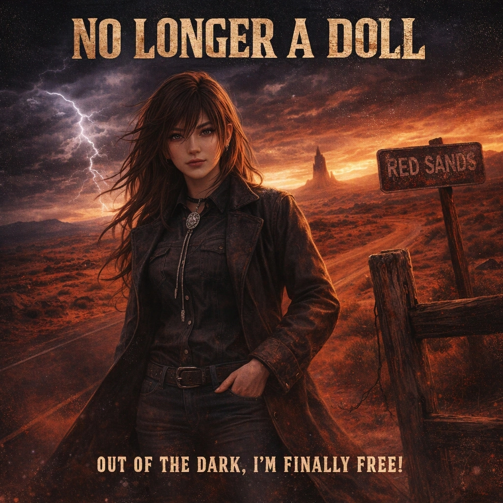
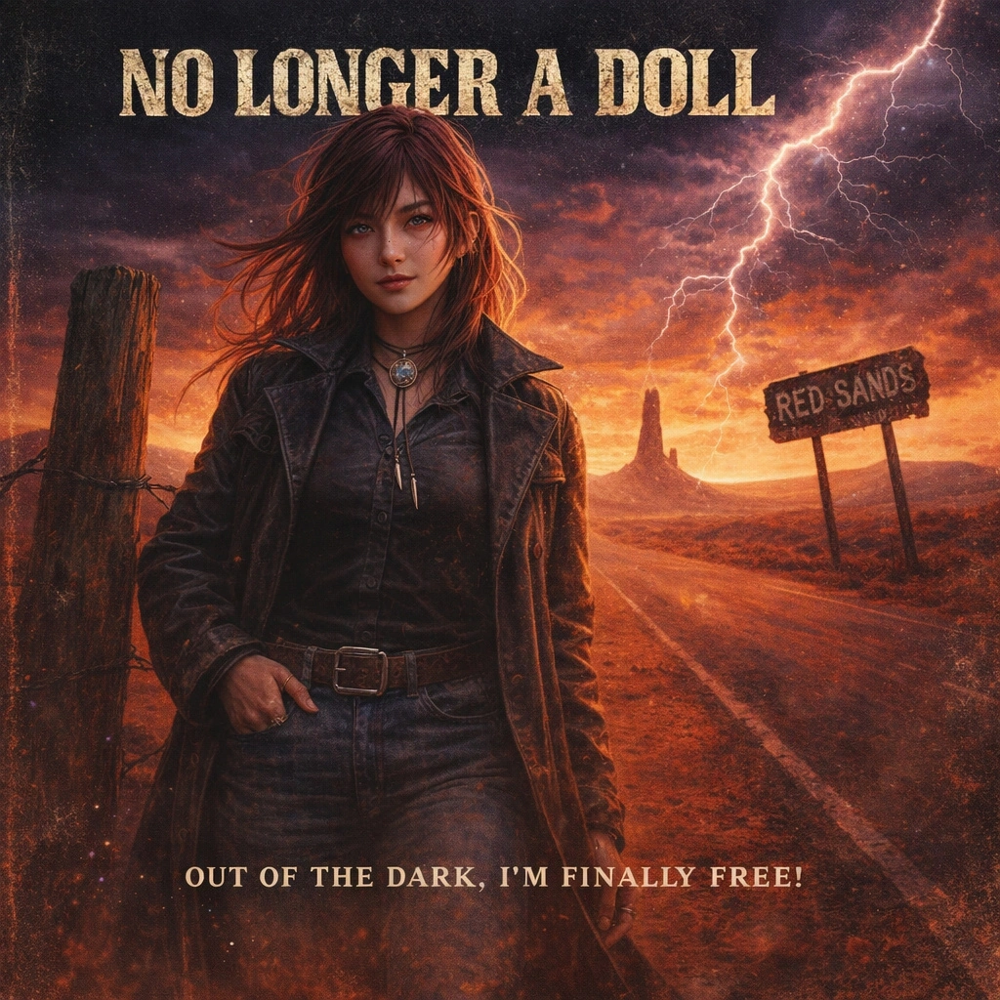
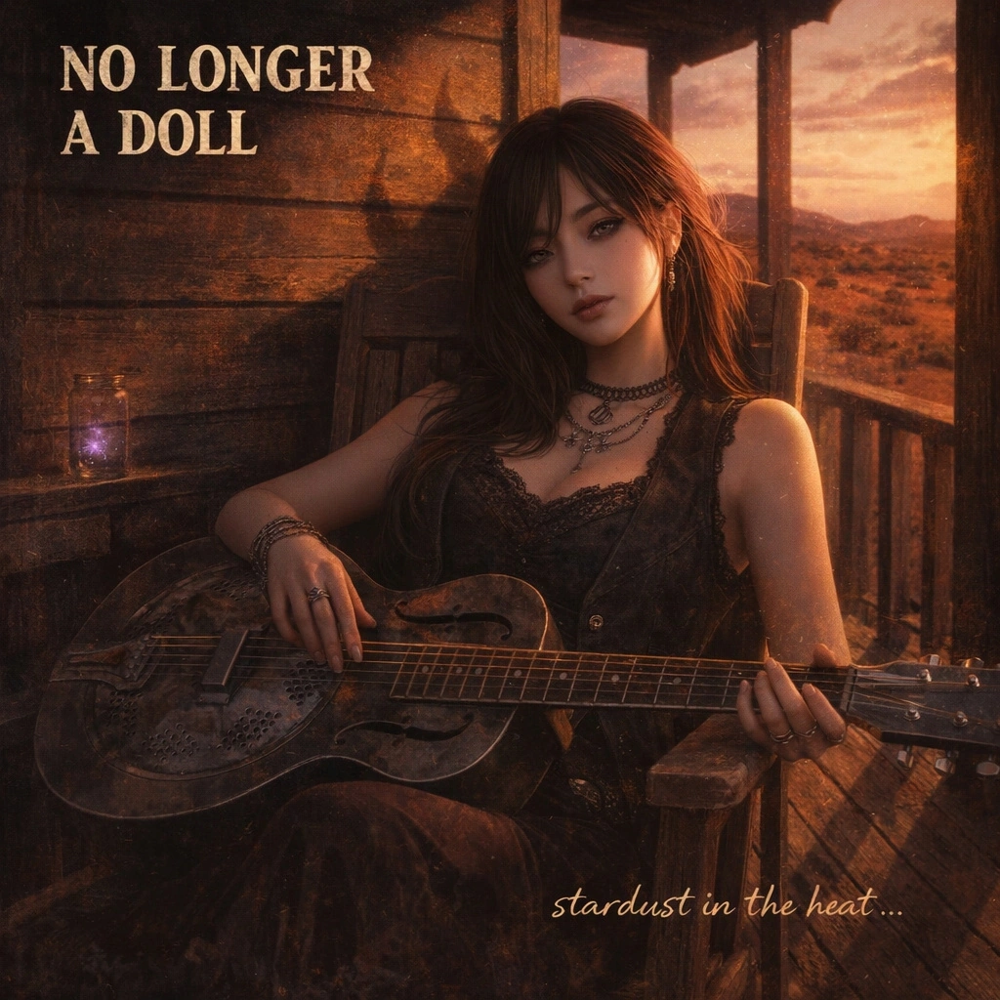
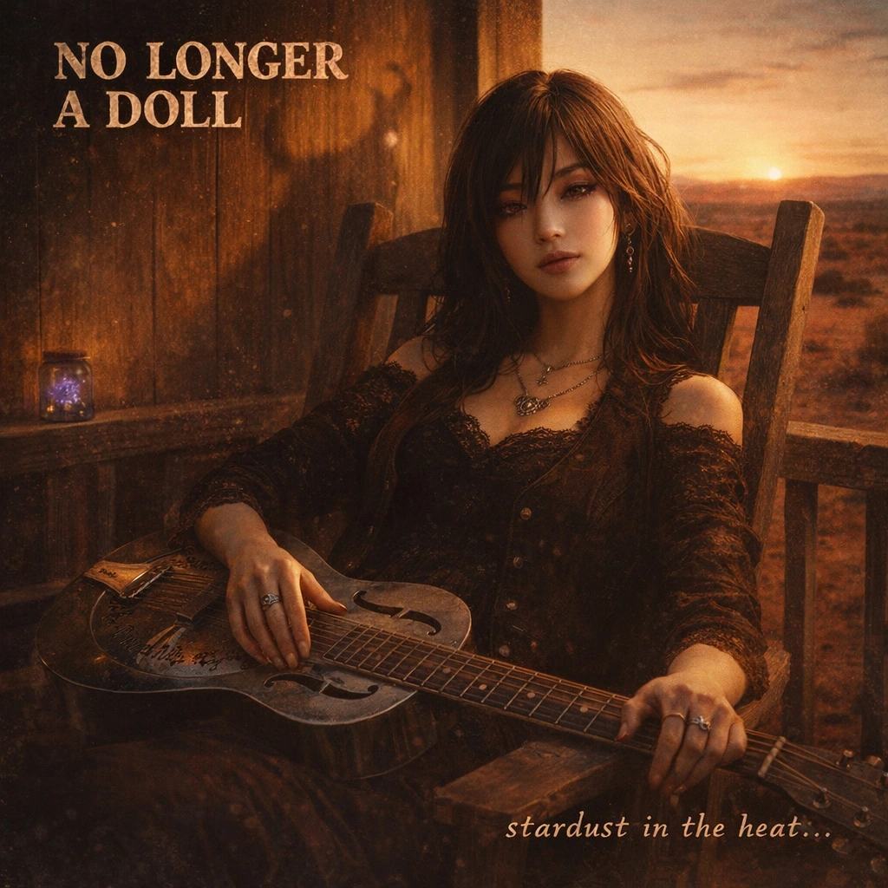

## Outback Dark Country Rock

&#128286; **Hinweis zum Jugendschutz:** Bitte beachte die [Altersbeschränkungen im Hauptdokument](../README.md#cw).

**Stimmung & Bezug zur Story:**  
Staubig, unheilvoll, ungezähmt und treibend. Mit schwerem Stampfen, trockener Slide-Gitarre und fernen Gewittern fängt dieser Stil die gnadenlose Wüstenstimmung von **Red Sands** ein – und begleitet Rebeccas einsamen Aufbruch ins Ungewisse nach ihrem Ausbruch aus den LEA-Labs (*Out of the dark, I'm finally free!*).  

---

## Tracks & Style-Prompts

#### Variante 01

[➜ 22 - No Longer a Doll (Outback Dark Country Rock)](https://suno.com/s/z0QkBHJwS2mUO2vJ)

````text
Outback Dark Country Rock, Gothic Americana; dry close-miked guitar amp and gritty slide resonator leads over boot percussion, heavy 808 sub-bass, and sharp lightning cracks; heavy stomping 96 BPM pulse; female vocals in a dark lower register, hushed and close-miked; dry guitar texture with a tight, clean vocal pocket.
````

#### Variante 02

[➜ 22_02 - No Longer a Doll (Outback Dark Country Rock)](https://suno.com/s/0SvHtSMowdMGcatX)

````text
Outback Dark Country Rock, Gothic Americana: gritty slide resonator guitar leads over dry close-miked amp, boot-stomp percussion, heavy 808 sub-bass and sharp lightning-crack accents; tight clean vocal pocket, dark 96 BPM stomping pulse; female voice with a wide range, climbing to powerful full-voice high-note belts
````

---

## Covers & Image-Prompts

#### Variante 01




````text
SUBJECT: Rebecca from Once Human — use the attached reference image for face and hairstyle (restyled in rugged Gothic Americana fashion: worn matte-black leather duster coat over dark denim, silver bolo tie, dusty weathered leather boots, subtle silver rings). Her eyes are OPEN, calm, resolute and fiercely magnetic, gazing directly toward the viewer with a quiet, untamed half-smile. Three-quarter low-angle hero framing, standing beside an old weathered wooden fence post along an empty desert road, one thumb hooked casually into her belt. No microphone.
ENVIRONMENT: A vast, arid red-earth outback desert highway at dusk merging subtly with the Red Sands badlands; far on the dark horizon stands the faint, half-obscured silhouette of a distant monolithic spire and a rusted, crooked roadside sign reading "RED SANDS" riddled with dust.
LIGHT & FX: Dramatic storm-front lighting — a jagged, dry white-violet lightning bolt splits the brooding twilight clouds in the distance, casting a crisp rim light along her shoulders and hair, while warm amber sunset embers linger low on the horizon. Fine red dust drifts in the wind, with faint violet stardust sparks swirling subtly near the hem of her coat like static before a storm. Heavy 35mm analog film grain.
COLOR PALETTE: Scorched Outback Ochre #8C3B2B, Storm Shadow Charcoal #121115, Dry Lightning White-Violet #E9D5FF, Dusty Rust #59251C, Sunset Amber #D97724.
TYPOGRAPHY: Title "NO LONGER A DOLL" in tall, weathered slab-serif woodcut typography with distressed metallic texture, placed in the top-center. Tagline "OUT OF THE DARK, I'M FINALLY FREE!" in clean, wide-spaced condensed serif uppercase near the bottom, glowing warm off-white.
STYLE: Outback Dark Country Rock / Gothic Americana single cover, square 1:1, gritty neo-western editorial photography meets semi-realistic digital painting, rich analog texture, raw and magnetic, no literal wings or horns.
````

#### Variante 02




````text
SUBJECT: Rebecca from Once Human — use the attached reference image for face and hairstyle (wearing a dark vintage lace-trimmed blouse under a dusty black suede vest, worn silver jewelry). Her eyes are OPEN, half-lidded, alluring and knowing, leaning back on a weathered wooden porch chair with a vintage tarnished chrome resonator guitar resting casually across her lap, one hand poised near the steel strings. No microphone.
ENVIRONMENT: The shadowed wooden veranda of an isolated, sun-bleached outback roadhouse overlooking vast red desert scrubland at twilight, heat haze shimmering over cracked earth in the background, a small glass jar glowing faintly with trapped violet stardust sitting unnoticed on the wooden railing beside her as a subtle easter egg.
LIGHT & FX: Warm, golden-amber late-dusk sunlight slanting under the porch roof, contrasting against deep cool indigo shadows; fine dust motes dance in the light beam, and a faint, ambiguous shadow on the weathered wooden wall behind her hints subtly at curved horns. Analog 35mm film grain and warm lens halation.
COLOR PALETTE: Roadhouse Shadow #141010, Tarnished Chrome #A1A8B3, Outback Red Earth #9E3D2A, Warm Dusk Gold #E09132, Stardust Violet #9333EA (sparingly).
TYPOGRAPHY: Title "NO LONGER A DOLL" in classic, slightly worn vintage Americana serif lettering with subtle metallic sheen, placed in the top-left corner. Tagline "stardust in the heat..." in understated, intimate lowercase handwritten script near the bottom-right.
STYLE: Gothic Americana / Dark Country Rock album cover, square 1:1, moody atmospheric film still, tactile textures of weathered wood, steel and dust, seductive and authentic.
````

---

Hier geht es weiter zum [➜ Songtext als Prompt](../lyrics/lyrics_prompt.md), zurück zu den [➜ Musikrichtungen](styles.md) oder zurück zum [➜ Hauptdokument](../README.md).
