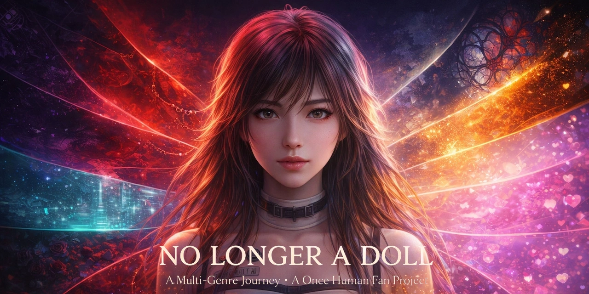
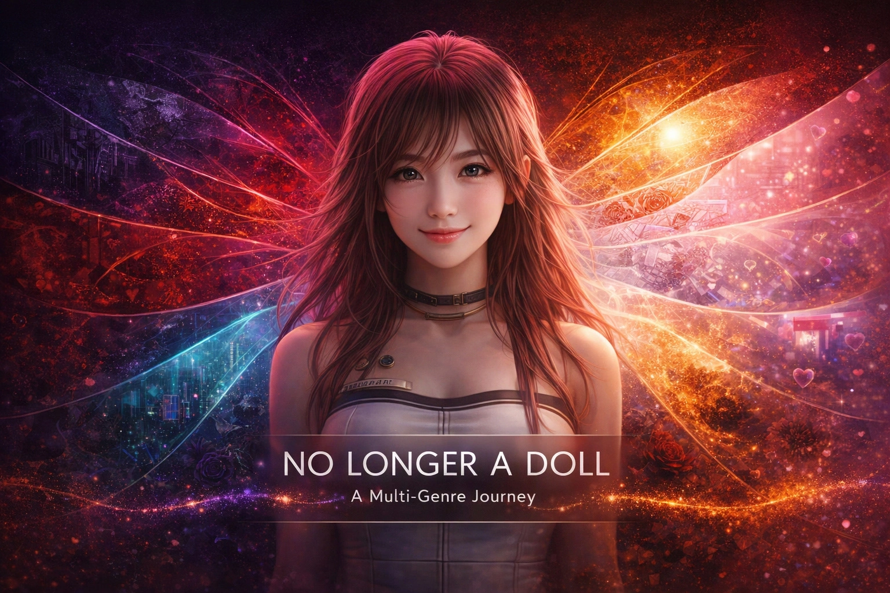

## Preview Image

#### Variante 01: Das Prisma-Zentrum (1 großes Hauptporträt + 6 Flügel-Sektoren)




````text
SUBJECT: Create a 3:2 landscape key art banner (1536x1024) featuring a medium-shot central portrait (from chest up) of Mitsuko from the attached photorealistic reference image. Keep her exact face, natural skin pores, and hair identical to the reference—her face remains completely unmarred without cracks or glitches. Her eyes are OPEN. She looks directly at the viewer with a captivating expression blending vulnerability and newfound strength. Leave generous headroom above her hair and space below her chin so the image can later be cropped to a 2:1 banner without cutting off her head or text.
COMPOSITION & 6 WING-LIKE STYLE SECTORS: Radiating symmetrically outward behind her shoulders like six translucent, multi-layered abstract wings of light, glass, and shadow, the background divides into six seamless sectors from left to right:
1. Far Left (Witch House): Dark LEA-Labs ruins, violet ritual sigils, and smoky shadow-wing contours.
2. Mid-Left (K-Pop Trap & Dark-Pop): Deep crimson velvet, gold chains, and glowing violet light-threads.
3. Inner-Left (Cyberpunk Phonk): Rain-wet neon cyan and magenta light streaks with holographic glitch fragments.
4. Inner-Right (Symphonic Gothic): Silver moonlight beams, shattered stained-glass rose window shards, and dark roses.
5. Mid-Right (Epic Orchestral DnB): Radiant golden dawn sunbeams and blazing phoenix-like stardust trails.
6. Far Right (Kawaii & Neon-Pop): Soft pastel pink arcade glow, holographic sparkles, and tiny floating glossy hearts.
LIGHT & FX: Dynamic multi-colored rim lighting from the six wing-like background sectors illuminates the edges of her hair and shoulders, while her face remains crisply lit and photorealistic. A delicate trail of glowing violet and gold stardust weaves horizontally across the center.
COLOR PALETTE: Rich transition from Void Black (#0A0710) and Crimson (#8C1C2E) on the left, through Neon Cyan (#00E5FF) and Radiant Gold (#FBBF24), to Candy Pink (#FF6FB5) on the right.
TYPOGRAPHY: Placed cleanly in the central safe zone over her chest/collarbone area with subtle dark-glass contrast (well away from the top and bottom edges): Title "NO LONGER A DOLL" in sharp, bold lettering, and smaller subtitle "A Multi-Genre Journey • A Once Human Fan Project".
STYLE: Photorealistic editorial key art photography, 85mm portrait lens sharpness on the face, wide framing with safe margins top and bottom, 3:2 landscape aspect ratio.
````

#### Variante 022C: Das 6-teilige Evolutions-Panorama (6 Gesichter nebeneinander)



````text
SUBJECT: Create a 3:2 landscape panoramic banner (1536x1024) based on the attached photorealistic reference image of Mitsuko. Keep her exact face, realistic skin texture, and hairstyle consistent across six seamless vertical panels flowing from left to right. Frame the characters as medium-wide portraits (from mid-chest up) with generous headroom above their hair and extra margin at the bottom, ensuring the central horizontal band can later be cropped to a 2:1 GitHub banner without cutting off heads or text:
1. Far Left (Witch House – LEA Labs): Eyes half-lidded and hypnotic, dark cyber-goth lace, glowing violet ritual triangles and a cracked glass containment cylinder behind her.
2. Mid-Left (Dark-Pop / Trap): Confident smirk, sleek black techwear with gold chains, glowing violet puppet-string light threads weaving between her fingertips.
3. Center-Left (Drift / Cyberpunk Phonk): Predatory focused gaze, black racing jacket with crimson stripes, neon cyan and blood-red tunnel reflections.
4. Center-Right (Symphonic Gothic): Tender, emotional gaze upward, Victorian black-and-ivory lace, silver moonlight through a shattered stained-glass rose window.
5. Mid-Right (Epic Orchestral DnB): Fierce, triumphant expression, regal dark-and-silver battle couture, radiant golden dawn light and high-speed stardust trails.
6. Far Right (Kawaii / Neon-Pop): Playful flirty wink and sweet smile, pastel pink and holographic arcade glow, floating glossy hearts.
ENVIRONMENT & FX: A continuous stream of glowing violet and gold stardust connects all six panels smoothly across the center. Sharp facial details, crisp eyes, unmarred skin without cracks, and natural pores in every section.
COLOR PALETTE: Seamless transition from Void Black (#0A0710) and Ritual Crimson (#8C1C2E) to Neon Cyan (#00E5FF), Moonlight Silver, Radiant Gold (#FBBF24), and Candy Pink (#FF6FB5).
TYPOGRAPHY: Placed strictly inside the central safe zone across the chest/collarbone level (at least 20% away from the bottom edge) with a subtle dark frosted-glass backing for high readability: Main title "NO LONGER A DOLL" in bold, clean modern typography, with the subtitle "A Multi-Genre Journey • A Once Human Fan Project" directly underneath.
STYLE: High-end photorealistic key art banner, cinematic lighting, sharp focus on faces, 3:2 landscape aspect ratio (1536x1024).
````

---

Hier geht es zurück zum [➜ Hauptdokument](../README.md).
