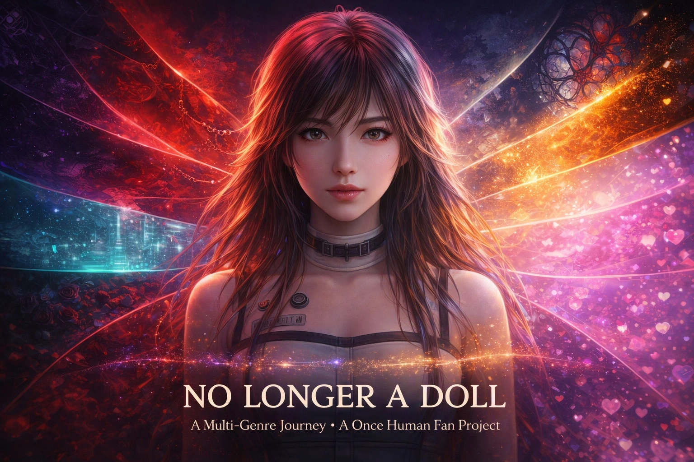
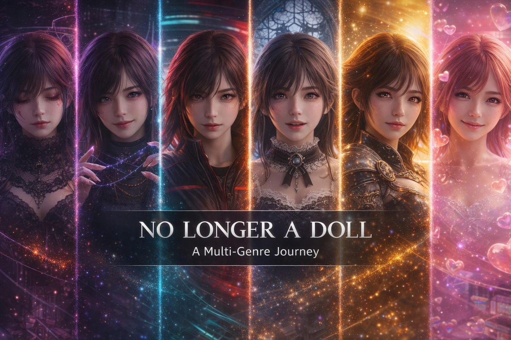

## Titelbilder & Social-Preview-Banner

Für die GitHub-Startseite und das Social-Media-Preview-Image sind zwei verschiedene Designs entstanden. Beide Prompts sind so konstruiert, dass alle wichtigen Bild- und Textelemente in einer zentralen **Safe Zone** liegen – so lassen sich die Motive bei Bedarf verlustfrei auf das typische Bannerformat zuschneiden, ohne Köpfe oder Typografie anzuschneiden.

---

#### Variante 01: Das Prisma-Zentrum *(Aktuelles Titelbild)*

*Ein zentrales Porträt vor sechs lichtdurchfluteten Flügel-Sektoren, welche die musikalischen Genres des Projekts von links (düsterer Witch House) bis rechts (heller Kawaii-Pop) auffächern. Hierzu entstanden zwei Render-Durchläufe desselben Prompts:*




````text
SCENE: A wide 2:1 panoramic key art banner inside a 1536x1024 image designed with generous top and bottom margins so the central horizontal band can later be cropped cleanly to a 2:1 GitHub social preview (1280x640). Photorealistic cinematic still, shot on 35mm, crisp focus, rich lighting, fine film grain.
SUBJECT: Medium-wide central portrait (from mid-chest up) of Mitsuko from the attached photorealistic reference image, framed comfortably inside the middle horizontal band of the canvas. Keep her exact face, natural skin pores, and hair identical to the reference—her face remains completely unmarred without cracks or glitches. No butterfly on her face.
Her eyes are OPEN, bright, and sparkling with warm affection. She looks directly at the viewer with a gentle, closed-mouth smile—subtle, warm, and playfully expectant, as if happily welcoming someone special.
COMPOSITION & 6 WING-LIKE STYLE SECTORS: Radiating symmetrically outward behind her shoulders like six translucent, multi-layered abstract wings of light, glass, and shadow, the background divides into six seamless sectors from left to right:
1. Far-left sector: Dark LEA-Labs ruins, violet ritual sigils, and smoky shadow-wing contours.
2. Mid-left sector: Deep crimson velvet, gold chains, and glowing violet light-threads.
3. Inner-left sector: Rain-wet neon cyan and magenta light streaks with holographic glitch fragments.
4. Inner-right sector: Silver moonlight beams, shattered stained-glass rose window shards, and dark roses.
5. Mid-right sector: Radiant golden dawn sunbeams and blazing phoenix-like stardust trails.
6. Far-right sector: Soft pastel pink arcade glow, holographic sparkles, and tiny floating glossy hearts.
LIGHT & FX: Dynamic multi-colored rim lighting from the six wing-like background sectors illuminates the edges of her hair and shoulders, while her face remains crisply lit and photorealistic with a soft, warm inner glow. A delicate trail of glowing violet and gold stardust weaves horizontally across the center.
COLOR PALETTE: Rich transition from Void Black (#0A0710) and Crimson (#8C1C2E) on the left, through Neon Cyan (#00E5FF) and Radiant Gold (#FBBF24), to Candy Pink (#FF6FB5) on the right.
TYPOGRAPHY: The only text in the entire image is a single nameplate. No other text anywhere — no panel headings, no captions, no labels, no genre names, no act names, no numbers, no watermarks, no single letters in the background or between the panels. Nameplate: sleek, semi-transparent dark frosted-glass bar across the lower chest area inside the middle 50% vertical safe zone (at least 25% away from top and bottom edges) so all faces and outfits stay clearly visible. On it only: bold title "NO LONGER A DOLL" with the smaller subtitle "A Multi-Genre Journey" directly underneath.
STYLE: Photorealistic editorial key art photography, 35mm wide-angle sharpness on the face, wide panoramic framing with safe margins top and bottom, 3:2 landscape aspect ratio (1536x1024).
````

#### Variante 02: Das Evolutions-Panorama *(Alternative)*

*Sechs ineinander übergehende Porträt-Panels zeigen Mitsukos bzw. Rebeccas Verwandlung entlang der Story-Chronologie – vom hypnotischen Blick im LEA-Labor bis zum strahlenden Lächeln im Finale.*



````text
SUBJECT: Create a 3:2 landscape panoramic banner (1536x1024) based on the attached photorealistic reference image of Mitsuko. Keep her exact face, realistic skin texture, and hairstyle consistent across six seamless vertical panels flowing from left to right. Frame the characters as medium-wide portraits (from mid-chest up) with generous headroom above their hair and extra margin at the bottom, ensuring the central horizontal band can later be cropped to a 2:1 GitHub banner without cutting off heads or text:
1. Far Left (Witch House – LEA Labs): Eyes half-lidded and hypnotic, dark cyber-goth lace, glowing violet ritual triangles and a cracked glass containment cylinder behind her.
2. Mid-Left (Dark-Pop / Trap): Confident smirk, sleek black techwear with gold chains, glowing violet puppet-string light threads weaving between her fingertips.
3. Center-Left (Drift / Cyberpunk Phonk): Predatory focused gaze, black racing jacket with crimson stripes, neon cyan and blood-red tunnel reflections.
4. Center-Right (Symphonic Gothic): Tender, emotional gaze upward, Victorian black-and-ivory lace, silver moonlight through a shattered stained-glass rose window.
5. Mid-Right (Epic Orchestral DnB): Fierce, triumphant expression, regal dark-and-silver battle couture, radiant golden dawn light and high-speed stardust trails.
6. Far Right (Kawaii / Neon-Pop): Playful flirty wink and sweet smile, pastel pink and holographic arcade glow, floating glossy hearts.
ENVIRONMENT & FX: A continuous stream of glowing violet and gold stardust connects all six panels smoothly across the center. Sharp facial details, crisp eyes, unmarred skin without cracks, and natural pores in every section.
COLOR PALETTE: Seamless transition from Void Black (#0A0710) and Ritual Crimson (#8C1C2E) to Neon Cyan (#00E5FF), Moonlight Silver, Radiant Gold (#FBBF24), and Candy Pink (#FF6FB5).
TYPOGRAPHY: Placed strictly inside the central safe zone across the chest/collarbone level (at least 20% away from the bottom edge) with a subtle dark frosted-glass backing for high readability: Main title "NO LONGER A DOLL" in bold, clean modern typography, with the subtitle "A Multi-Genre Journey • A Once Human Fan Project" directly underneath.
STYLE: High-end photorealistic key art banner, cinematic lighting, sharp focus on faces, 3:2 landscape aspect ratio (1536x1024).
````

---

Hier geht es weiter zu den [➜ Album-Covern & Prompts](album.md), zu [➜ Musikrichtungen & Cover-Art](styles.md) oder zurück zum [➜ Hauptdokument](../README.md).
