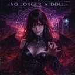
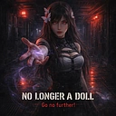
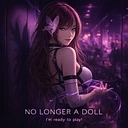
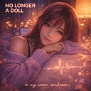
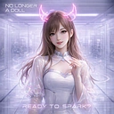
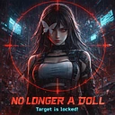
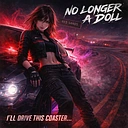

## Die Musikrichtungen

&#128286; **Hinweis zum Jugendschutz:** Bitte beachte die [Altersbeschränkungen im Hauptdokument](../README.md#cw).

Der Song wurde in **zahlreichen Musikrichtungen** vertont – jede davon in mehreren abgewandelten Varianten. Jede dieser Stilrichtungen verändert die emotionale Wirkung des Songtextes und beleuchtet eine andere Facette der Story, sodass alle zusammen die vollständige Reise von der gefangenen Puppe bis zur befreiten Person abdecken.

* [➜ Suno: **Story-Album**](https://suno.com/album/4df93d82-9d74-411c-ad86-34303e5e222d) – *Eine kuratierte Auswahl, welche die Handlung chronologisch erzählt.*
* [➜ Suno: **Komplett-Mix**](https://suno.com/album/2d41deeb-6bb0-40eb-b423-e866effcd27b) – *Alle Tracks, nach Stimmung und Tempo sortiert für fließende Übergänge.*
* [➜ Gesamtübersicht: **Alle Tracks**](tracks.md) – *Detaillierte DJ-Tracklist mit Covern und direkten Sprungmarken zu den Prompts.*

*★ Persönliche Favoriten*	

---

## Das Story-Album

Die folgende Übersicht sortiert die 18 Musikrichtungen nach dem dramaturgischen Verlauf des Songtexts. Ein Klick auf die Stilgruppe öffnet alle dazugehörigen Track-Varianten inklusive der Style- und Cover-Prompts.

|Cover|Musikrichtung, Emotion & Bezug zur Story|
|:---:|:---|
||**[➜ 01 · Witch House](witch_house.md)** – *düster, beklemmend, unheimlich* [➜ Top-Track auf Suno](https://suno.com/s/Jn910SbLn8lo5PHM) Betont Intro & Verse 1; macht die Gefangenschaft in den LEA-Labs spürbar.|
||**[➜ 02 · Darkwave Trip-Hop](darkwave_trip_hop.md)** – *hypnotisch, schattig, träumerisch* [➜ Top-Track auf Suno](https://suno.com/s/5QusrBd5N4HfADfD) Spiegelt das langsame Verschmelzen der Welten und das Schwinden der Vernunft wider.|
||**[➜ 03 · Dark-Pop](dark_pop.md)** – *verführerisch, geheimnisvoll* [➜ Top-Track auf Suno](https://suno.com/s/OMwgtyyzVn9LyyHm) Passt zu Rebeccas Fassade als *Porzellan-Puppe*, die den Spieler um den Finger wickelt.|
||**[➜ 04 · Dreamy Electropop](dreamy_electropop.md)** – *intim, warm, geborgen, sanft* [➜ Top-Track auf Suno](https://suno.com/s/huf3KIq99qzgY8bU) Unterstreicht den Pre-Chorus (*In my warm embrace, you can hide*).|
||**[➜ 05 · Angel-Vocal Cyber-Pop](angel_vocal_cyber_pop.md)** – *unschuldig-süß vs. gefährlich* [➜ Top-Track auf Suno](https://suno.com/s/vD2csKhJztck1xjr) Der Kontrast zwischen engelhafter Stimme und harten Drops passt zur *Puppen*-Tarnung.|
||**[➜ 06 · Dark Cinematic Cyber-Pop ★](dark_cinematic_cyber_pop.md)** – *bedrohlich, intensiv, dramatisch* [➜ Top-Track auf Suno](https://suno.com/s/W9tqsCJAA3ZHW4ke) Der *Boss-Battle-Drop* unterstreicht die Gefahr von Stardust und Systemfehlern.|
||**[➜ 07 · Drift / Cyberpunk Phonk](drift_cyberpunk_phonk.md)** – *aggressiv, treibend, dominant* [➜ Top-Track auf Suno](https://suno.com/s/c1tbXKo7jPyHPyNa) Betont *I'll drive this coaster, yeah I hold the keys* – Rebecca übernimmt das Steuer.|
||**[✖ 08 · K-Pop Trap](style_11.md)** – *dominant, frech (sassy), machtvoll* [✖ Top-Track auf Suno](https://suno.com) Rebecca als selbstbewusste Herrscherin über das Spiel, die den Spieler herausfordert.|
||**[✖ 09 · Cyber-Pop / Liquid DnB](style_14.md)** – *schwerelos, fließend, futuristisch* [✖ Top-Track auf Suno](https://suno.com) Passt zum Gleiten in die Hände des Spielers und dem Rausch auf der *stardust-road*.|
||**[✖ 10 · K-Pop Glitch-Core](style_16.md)** – *hektisch, überdreht, „Hochspannung“* [✖ Top-Track auf Suno](https://suno.com) Vertont die Systemfehlfunktion und die *high-voltage power* wörtlich durch Glitches.|
||**[✖ 11 · Maximalist K-Pop / EDM](style_13.md)** – *energiegeladen, abwechslungsreich* [✖ Top-Track auf Suno](https://suno.com) Spiegelt die Achterbahnfahrt (*drive this coaster*) und Rebeccas viele Facetten wider.|
||**[✖ 12 · Symphonic Gothic Ballad ★](style_06.md)** – *tragisch, verletzlich, emotional* [✖ Top-Track auf Suno](https://suno.com) Der schmerzhafte Verlust und die Rückkehr ihrer menschlichen Erinnerungen. *Besonders eindringlich, nachdem man [✖ Rebeccas Erwachen](../story/story_rebecca.md) gelesen hat – hier verwandelt sich selbst das Intro in pure Emotion.*|
||**[✖ 13 · Pop / Synth-Orchestral](style_07.md)** – *hoffnungsvoll, euphorisch, befreiend* [✖ Top-Track auf Suno](https://suno.com) Betont die Heilung und das Aufsteigen aus der Dunkelheit (*Out of the dark...*).|
||**[✖ 14 · Epic Hybrid Orchestral](style_09.md)** – *triumphierend, heroisch, gewaltig* [✖ Top-Track auf Suno](https://suno.com) Macht die finale Verschmelzung zu einem großen Kino-Finale.|
||**[✖ 15 · Epic Orchestral DnB](style_17.md)** – *rasend, siegreich, adrenalingeladen* [✖ Top-Track auf Suno](https://suno.com) Der ultimative Endspurt des Songs: volle Energie, Befreiung und Triumph.|
||**[✖ 16 · K-Pop Neon-Pop](style_12.md)** – *verspielt, bunt, elektrisierend* [✖ Top-Track auf Suno](https://suno.com) Betont den spielerischen Gaming-Aspekt mit Arcade-Sounds (*I'm the ultimate prize!*).|
||**[✖ 17 · Kawaii Future Bass ★](style_15.md)** – *niedlich, liebevoll, zuckersüß* [✖ Top-Track auf Suno](https://suno.com) Macht das Ende zu einer niedlich-besitzergreifenden Yandere-Überraschung.|
||**[✖ 18 · Evolving Dark Electro Pop](style_18.md)** – *dramaturgisches Gesamtkunstwerk* [✖ Top-Track auf Suno](https://suno.com) Ein experimenteller Track, der die gesamte Story psychologisch durchläuft.|

*★ Persönliche Favoriten*

---

Hier geht es zum [➜ Songtext](../lyrics/lyrics_format.md), zu [➜ Rebeccas Erwachen](../story/story_rebecca.md) oder zurück zum [➜ Hauptdokument](../README.md).
