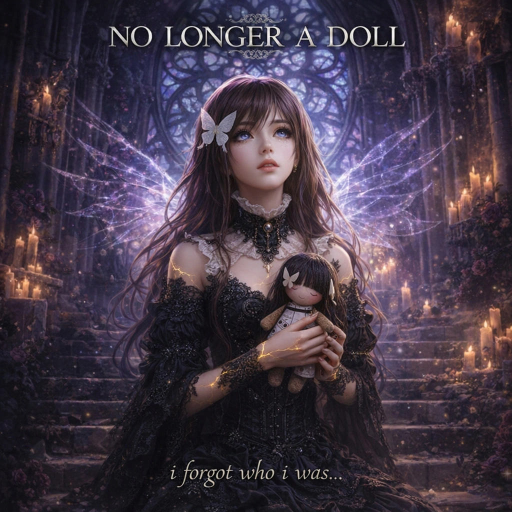
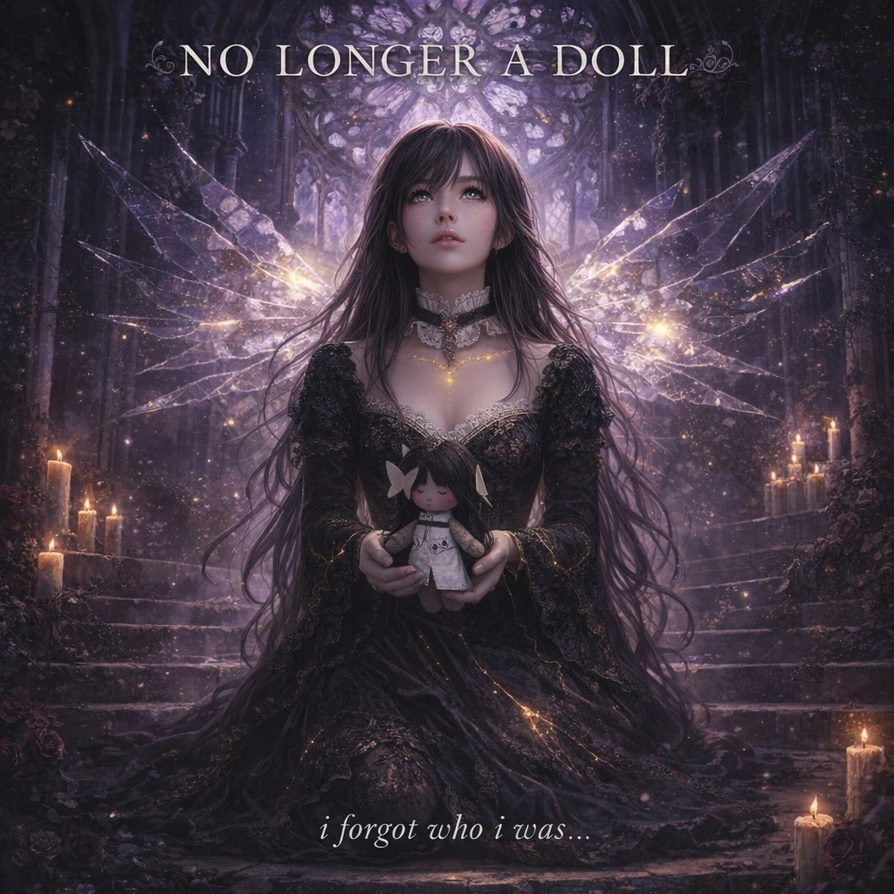
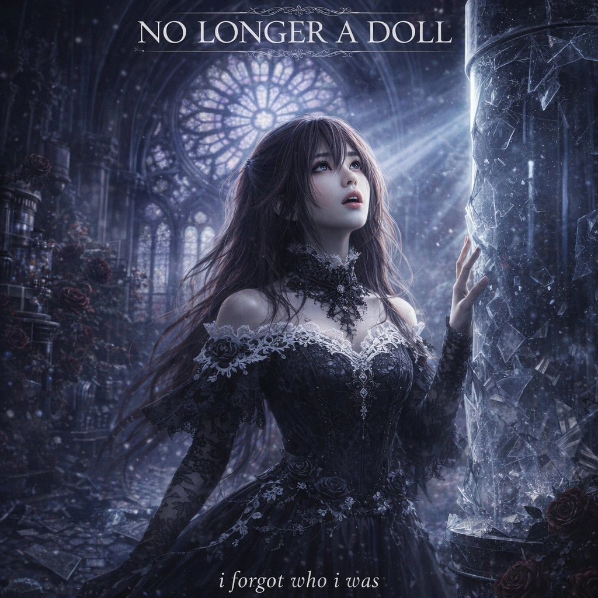
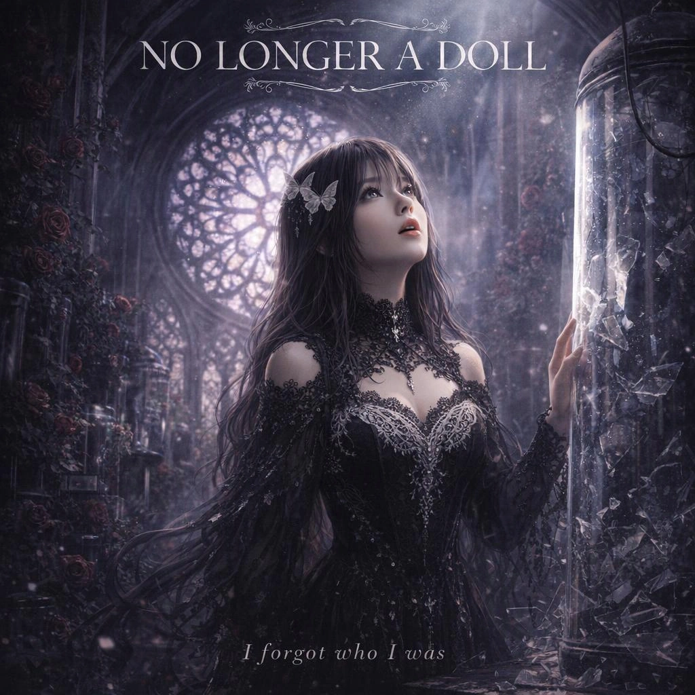

## Symphonic Gothic Ballad

&#128286; **Hinweis zum Jugendschutz:** Bitte beachte die [Altersbeschränkungen im Hauptdokument](../README.md#cw).

**Stimmung & Bezug zur Story:**  
Tragisch, verletzlich, emotional und schmerzlich-schön. Dieser Stil vertont die **Bridge**: den schmerzhaften Verlust und das langsame Wiederkehren ihrer menschlichen Erinnerungen (*I forgot who I was... No longer a doll*).

---

## Tracks & Style-Prompts

#### Variante 01

[➜ 12 - No Longer a Doll (Symphonic Gothic Ballad)](https://suno.com/s/q86bOANGjq5fDzgT)

````text
Symphonic gothic pop ballad with sweeping orchestral strings, warm cinematic piano, emotional cello, ambient harp, and deep sub-bass; tender, vulnerable female vocals spanning a wide range, climbing into powerful full-voice belts with gang-vocal shouts on the hook; measured cinematic ballad pulse; lush reverb
````

#### Variante 02

[➜ 12_02 - No Longer a Doll (Symphonic Gothic Ballad)](https://suno.com/s/8oAmWI6DfLLtZoyF)
*(leider mit kleinem Textfehler bei five-five)*

````text
Symphonic gothic pop ballad, warm mid-range female vocals, tender and vulnerable with clear passionate singing, call-and-response backing voices and a touch of vocal slapback echo; sweeping orchestral strings, warm cinematic piano, emotional cello, ambient harp and deep sub-bass; expansive rubato piano-ballad pacing; lush reverb and high emotional intensity, tragic yet beautiful
````

#### Variante 03

[➜ 12_03 - No Longer a Doll (Symphonic Gothic Ballad)](https://suno.com/s/WBt1jayPnxuA63lX)
*(leider mit kleinem Textfehler bei „doing“, „rising“, „all your energy“ und „territory“)*

````text
Symphonic gothic pop ballad, sweeping orchestral strings, warm cinematic piano, emotional cello, ambient harp, deep sub-bass, tender vulnerable female vocals, passionate clear singing, tragic yet beautiful, lush reverb, high emotional intensity, 90 BPM written in D minor
````

---

## Covers & Image-Prompts

#### Variante 01




```text
SUBJECT: Rebecca from Once Human (use reference image for face, hairstyle; outfit reinterpreted as a gothic gown: black lace, high collar, porcelain-white details). Eyes OPEN, gazing upward toward the light, emotional and searching, lips slightly parted as if mid-song. She stands beside a tall shattered glass tube, one hand resting on the broken glass.
ENVIRONMENT: Hybrid of gothic cathedral and laboratory: a vaulted nave with a large rose window, lab machinery overgrown with dark roses, glass shards scattered on the stone floor like stars.
LIGHT & FX: Soft cold moonlight through the rose window, god rays through incense haze, faint stardust particles floating in the air. Lush, dreamy atmosphere.
COLOR PALETTE: Midnight Navy #12152B, Gothic Burgundy #5C0F22, Porcelain White #F3EEE8, Moonlight Silver #AEB6C8, Rose Black #1A0D12.
TYPOGRAPHY: Title "NO LONGER A DOLL" in elegant engraved serif capitals with fine ornamental flourishes, top center. Tagline "I forgot who I was" in thin lowercase italic serif at the bottom.
STYLE: Symphonic gothic pop cover, cinematic fantasy painting meets photoreal portrait, tragic yet beautiful, square 1:1 format.
NEGATIVE: no explicit content.
```

#### Variante 02




```text
SUBJECT: Mitsuko from Once Human — use the attached reference image for face and hairstyle (reinterpreted in an intricate Victorian Gothic gown of black lace, velvet, and ivory-white high-collar details). Her eyes are OPEN, luminous and glistening with emotion, gazing slightly upward toward the light with a tender, searching expression. Kneeling gracefully on cold cathedral stone steps, cradling a small, worn vintage rag doll gently in both hands. Her face remains unmarred, while ultra-fine, delicate kintsugi-like seams along her collarbone and wrists glow softly with warm golden light. No microphone.
ENVIRONMENT: The ruins of a grand Gothic cathedral merging with an abandoned laboratory: towering pointed stone arches, melted pillar candles, dark climbing roses, and a tall shattered stained-glass rose window opening to a starry night sky.
LIGHT & FX: Pale silver moonlight streaming through the broken rose window behind her, scattering jagged shards of stained glass and violet-silver light beams behind her shoulders like fragile angel-succubus wings. Soft incense haze and floating golden-violet dust motes.
COLOR PALETTE: Cathedral Shadow #0C0A12, Moonlight Silver #CBD5E1, Candlelight Gold #EAB308, Gothic Wine #6B1336, Mystic Violet #8B5CF6.
TYPOGRAPHY: Title "NO LONGER A DOLL" in elegant engraved high-contrast serif capitals with fine ornamental flourishes, top center.
Tagline "i forgot who i was..." in delicate, emotional lowercase handwritten script typography at the bottom, keeping the pronoun "i" strictly lowercase.
STYLE: Symphonic gothic ballad album cover, square 1:1, dark romanticism fine-art painting meets cinematic portrait photography, tragic yet breathtakingly beautiful, keep her face without cracks.
```

---

Hier geht es zurück zu den [➜ Musikrichtungen](styles.md) oder zurück zum [➜ Hauptdokument](../README.md).
