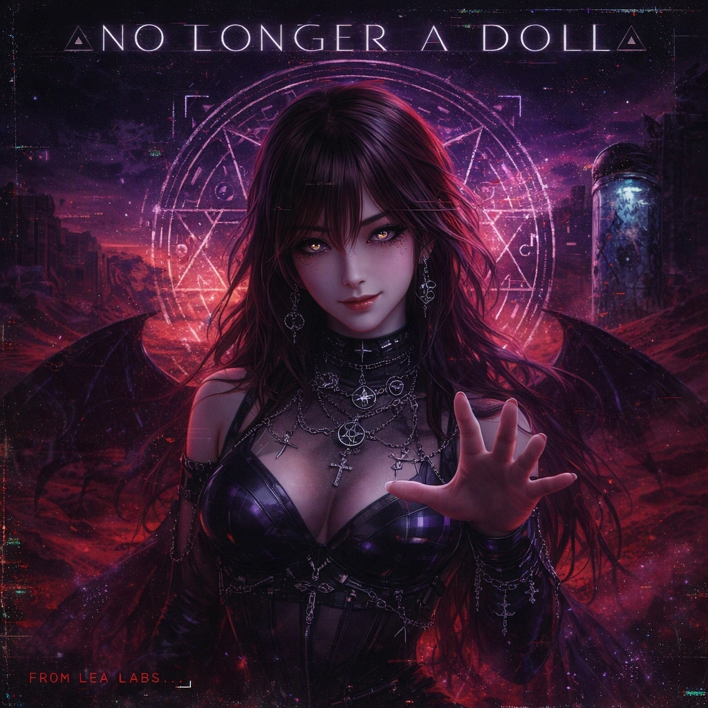
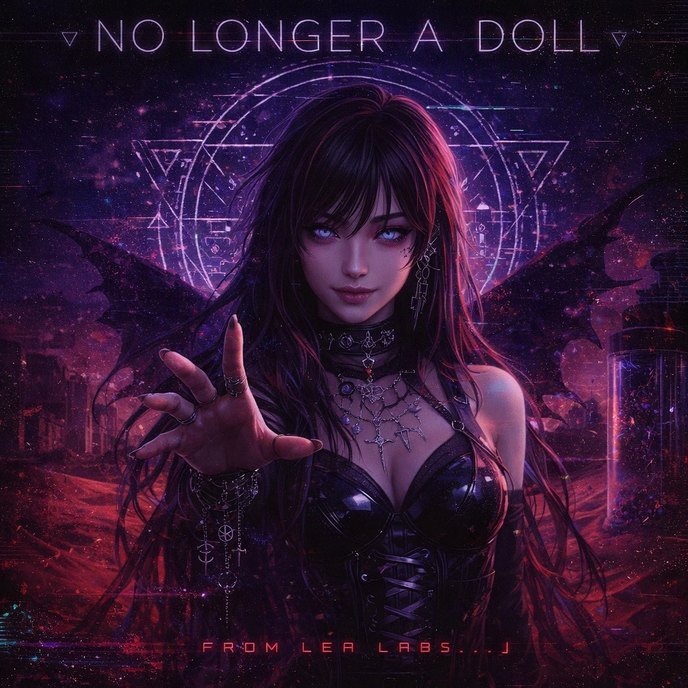
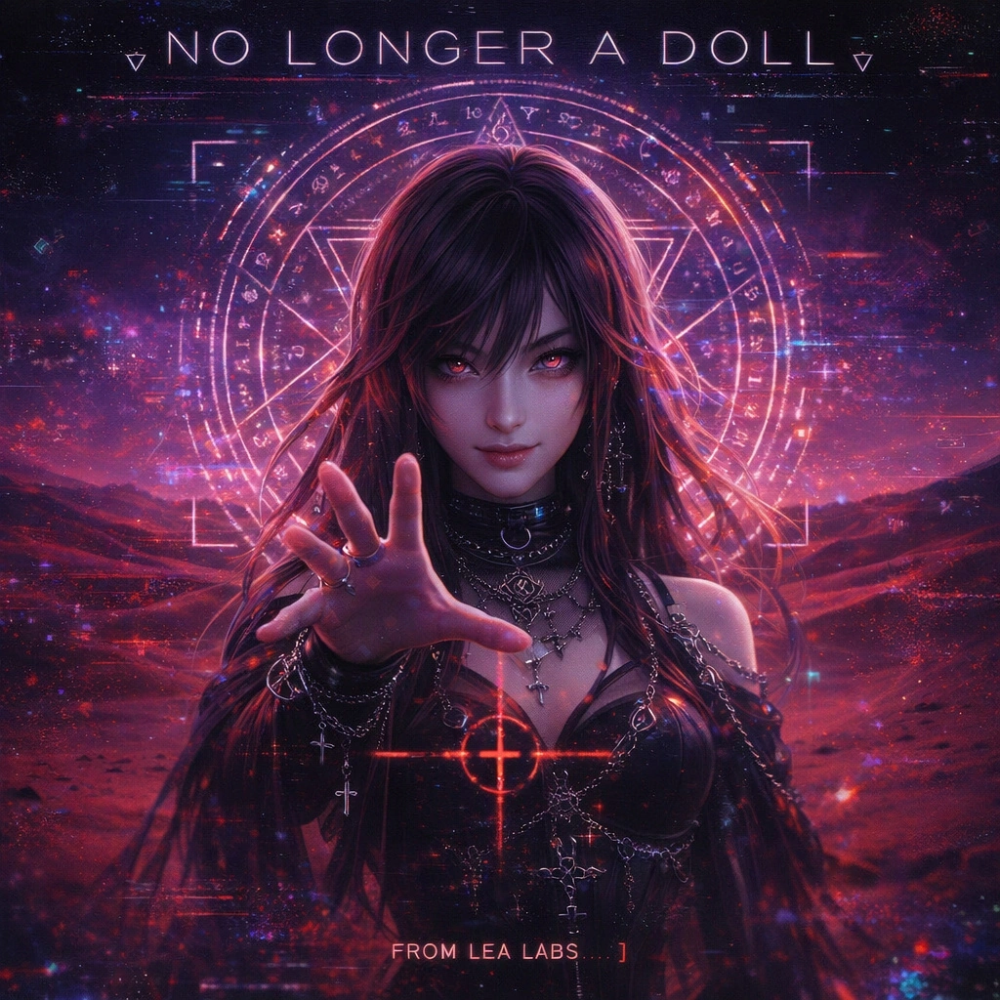
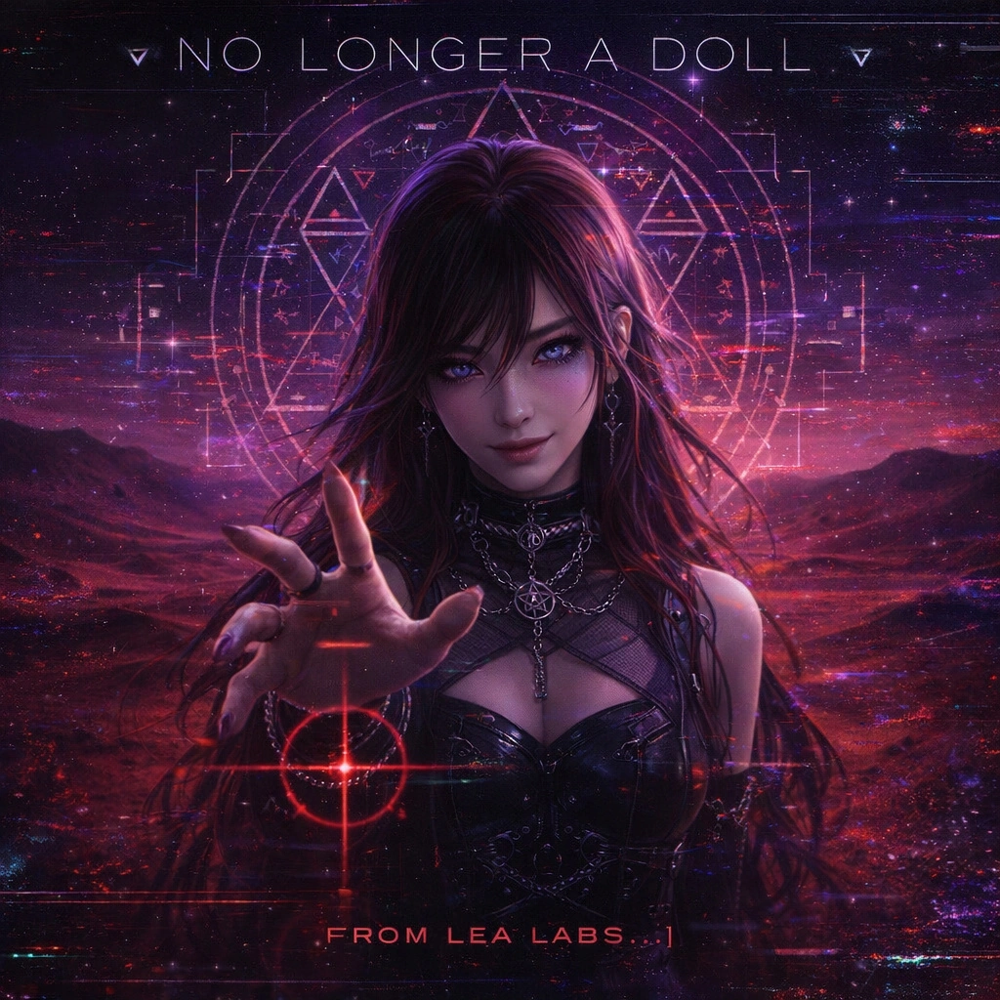

## Witch House

**Stimmung & Bezug zur Story:**  
Düster, beklemmend, ritualhaft und geisterhaft. Dieser Stil vertont das **Intro** und **Verse 1**: Rebecca ist noch in ihrer Glaskapsel in den LEA-Labs gefangen und führt Rosettas Befehlskette aus (*Target is locked!*).

---

## Tracks & Style-Prompts

#### Variante 01

[➜ 01 - No Longer a Doll (Witch House)](https://suno.com/s/Jn910SbLn8lo5PHM)

````text
Witch house, cyber goth: distorted Reese bass, dark ritual beats and eerie synth pulses; industrial shadow textures, glitch cuts and a haunting tech-atmosphere; warm mid-range ghost vocals, hushed and close-mic; 90 BPM, F minor, slow lurching pulse
````

#### Variante 02

[➜ 01_02 - No Longer a Doll (Witch House)](https://suno.com/s/6HpcbqiFsG1PEXHQ)
*(leider mit Textfehler bei „before“)*

````text
Witch house, cyber goth with industrial-shadow production and haunting tech-atmosphere; distorted Reese bass, dark ritual beats, and eerie glitch textures; high, light ghost vocals with stacked harmonies on the hooks; 90 BPM, F minor, slow pulse and shadowy half-time sway
````

#### Variante 03
*(leider mit Textfehler bei „before“ und „deep“)*

[➜ 01_03 - No Longer a Doll (Witch House)](https://suno.com/s/PfJzRcklwtGFcMyU)

````text
Witch house, cyber goth; hypnotic midtempo club stomp with dark ritual drum pulses;
eerie ghostly female vocals in a warm mid-range, half-spoken talk-sing and rapid-fire verses, whispered ad-libs between lines;
distorted reese bass and glassy glitch synths;
industrial-shadowed textures, haunting tech atmosphere, shimmering hyper-pop chorus drops
````

#### Variante 04

[➜ 01_04 - No Longer a Doll (Witch House)](https://suno.com/s/uHdhqX6eZbITWiW7)

````text
Witch house, cyber goth;
distorted reese bass, glassy glitch synths and dark ritual drum pulses;
eerie ghostly female vocals in a warm mid-range, half-spoken talk-sing with rapid-fire verses and whispered ad-libs between lines;
hooks widen into stacked harmonies, with layered octave doubles thickening each chorus refrain;
industrial-shadowed textures and a haunting tech atmosphere, shimmering hyper-pop chorus drops, a stripped bridge and softly whispered outro;
hypnotic midtempo club stomp
````

#### Variante 05

[➜ 01_05 - No Longer a Doll (Witch House)](https://suno.com/s/vxiYFJZEQtb1FLCw)

````text
Witch house, cyber goth;
call-and-response backing voices cut through industrial-shadowed textures and a haunting tech atmosphere, with layered gang-vocal shouts on the hook and shimmering hyper-pop chorus drops;
hypnotic midtempo club stomp, dark ritual drum pulses, distorted reese bass, glassy glitch synths;
eerie ghostly female vocals in a warm mid-range, half-spoken talk-sing, rapid-fire verses, whispered ad-libs between lines;
spoken bridge builds into a shouted final refrain, then a soft vocal fade
````

#### Variante 06

[➜ 01_06 - No Longer a Doll (Witch House)](https://suno.com/s/IQv2zUiC65CXWhG0)

````text
Witch house, cyber goth: distorted Reese bass, dark ritual beats and eerie synth pulses;
industrial shadow textures, glitch cuts and a haunting tech-atmosphere;
warm mid-range ghost vocals, hushed and close-mic;
90 BPM, F minor, slow lurching pulse
````

#### Variante 07

[➜ 01_07 - No Longer a Doll (Witch House)](https://suno.com/s/tpm0nddItVhmTh9Q)

````text
Witch house, cyber goth: distorted Reese bass, dark ritual beats and eerie synth pulses;
industrial shadow textures, glitch cuts and a haunting tech-atmosphere;
warm mid-range ghost vocals, hushed and close-mic;
90 BPM, F minor, slow lurching pulse
````

---

## Covers & Image-Prompts

#### Variante 01




````text
SUBJECT:
Rebecca from Once Human — use the attached reference image for face, hairstyle and complete outfit (outfit styled darker in cyber-goth fashion: matte black latex accents, sheer black mesh layers, silver occult chain jewelry). Her eyes are OPEN, half-lidded and hypnotic, staring directly into the viewer with a calm, predatory-playful confidence and a faint knowing smile. Upper body and face centered, slight head tilt, one hand raised at chest height with fingers spread as if casting a quiet hex. No microphone.

ENVIRONMENT:
A nocturnal Red Sands desert merging into the decaying concrete ruins of LEA Labs under a black-violet sky. Behind her floats a giant glitching ritual circle made of inverted triangles (▼), sigils and sci-fi targeting HUD brackets, alongside a cracked glass containment cylinder half-buried in the dark sand. Faint sand dust drifts through the air.

LIGHT & FX:
Cold violet rim light from behind, crimson underglow rising from the red sand. Dark violet stardust mist curls subtly behind her shoulders in the faint silhouette of elegant demonic wings. VHS noise, chromatic aberration, scanline glitches and small shimmering sparkle bursts at the edges.

COLOR PALETTE:
Void black #0A0710, deep violet #3B1A5C, ritual crimson #8C1C2E, ghost lilac #B9A3D9, glitch cyan accent #4FE3E0 (sparingly).

TYPOGRAPHY:
Title "NO LONGER A DOLL" in sharp, thin, wide-spaced occult sans-serif, all caps, framed by small ▼ symbols, placed at the top, slightly glitched horizontally.
Tagline "FROM LEA LABS..." in small monospace HUD font at the bottom, crimson red, with a blinking-cursor bracket.

STYLE:
Witch house / cyber goth single cover, square 1:1, dark ritual club aesthetic, cinematic semi-realistic digital painting with photographic skin detail, high contrast, grainy analog texture, haunting yet seductive.
````

#### Variante 02




````text
SUBJECT:
Rebecca from Once Human — use the attached reference image for face, hairstyle and complete outfit (outfit may be styled darker in cyber-goth fashion: matte black latex accents, sheer black mesh layers, silver occult chain jewelry). Her eyes are OPEN, half-lidded and hypnotic, staring directly into the viewer with a calm, predatory-playful confidence and a faint knowing smile. Upper body and face centered, slight head tilt, one hand raised at chest height with fingers spread as if casting a targeting spell.

ENVIRONMENT:
A nocturnal Red Sands desert under a black-violet sky. Behind her floats a giant glitching ritual circle made of inverted triangles, sigils and sci-fi targeting HUD brackets, merging occult and tech. Faint sand dust drifts through the air.

LIGHT & FX:
Cold violet rim light, crimson underglow from the sand. A red holographic crosshair hovers softly over the viewer's position (implied, foreground blur). VHS noise, chromatic aberration, scanline glitches and small shimmering hyper-pop sparkle bursts at the edges, like a chorus drop frozen in time.

COLOR PALETTE:
Void black #0A0710, deep violet #3B1A5C, ritual crimson #8C1C2E, ghost lilac #B9A3D9, glitch cyan accent #4FE3E0 (sparingly).

TYPOGRAPHY:
Title "NO LONGER A DOLL" in sharp, thin, wide-spaced occult sans-serif, all caps, framed by small ▼ symbols, placed at the top, slightly glitched horizontally.
Tagline "FROM LEA LABS..." in small monospace HUD font at the bottom, red, with a blinking-cursor bracket.

STYLE:
Witch house / cyber goth single cover, square 1:1, dark ritual club aesthetic, cinematic semi-realistic digital painting with photographic skin detail, high contrast, grainy analog texture, haunting yet seductive.
````

---

Hier geht es weiter zur [➜ nächsten Musikrichtung (*Darkwave Trip-Hop*)](darkwave_trip_hop.md), zum [➜ Songtext als Prompt](../lyrics/lyrics_prompt.md), zurück zu den [➜ Musikrichtungen](styles.md) oder zurück zum [➜ Hauptdokument](../README.md).
